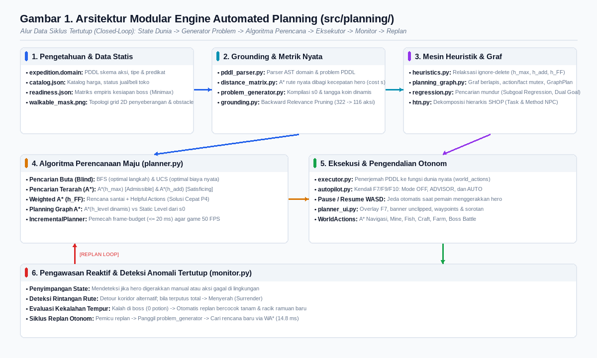
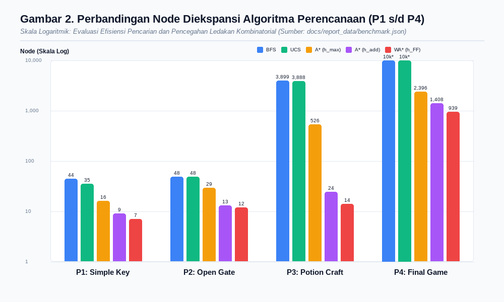
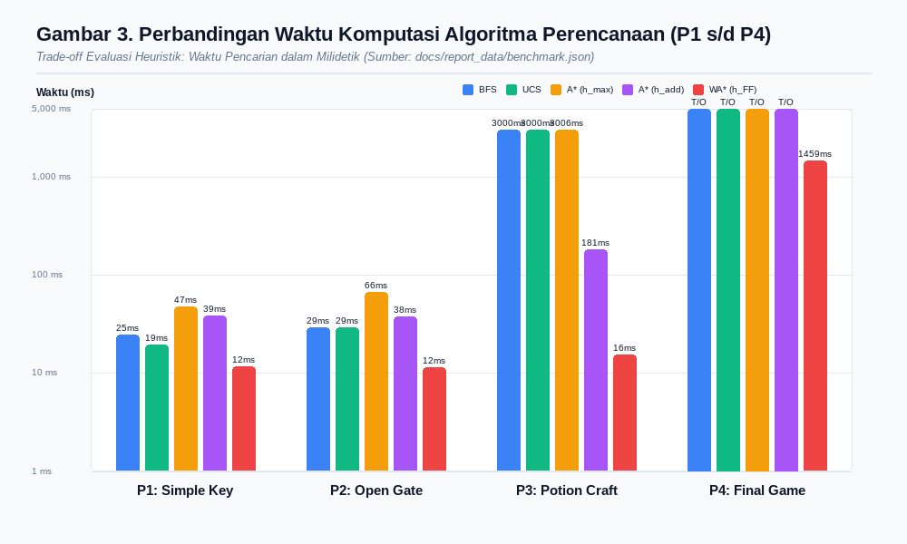
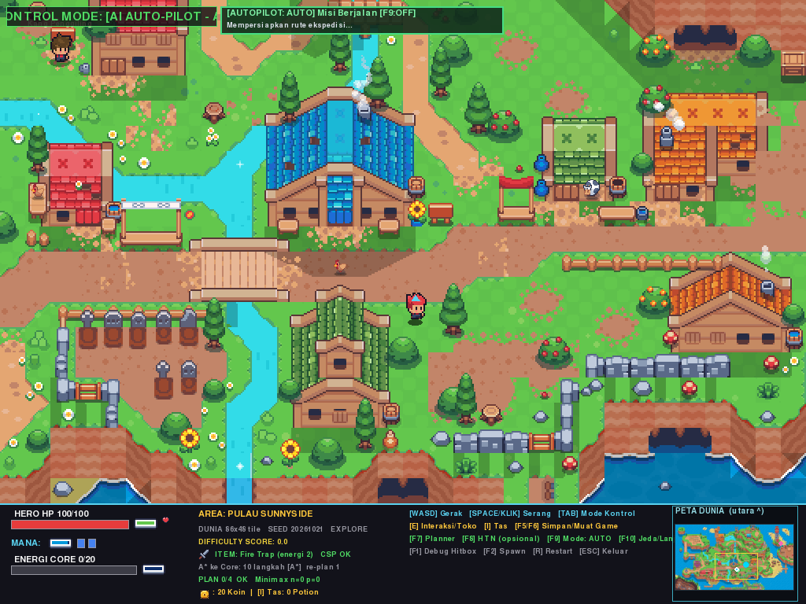
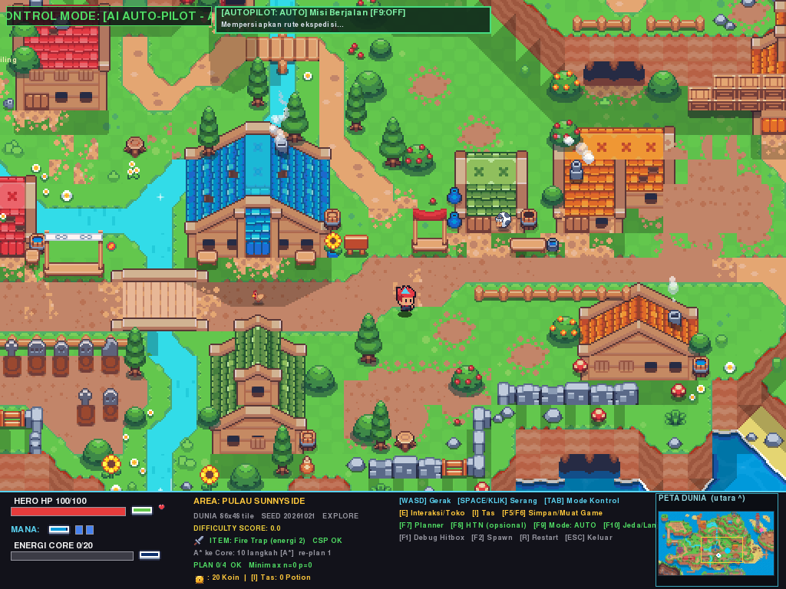
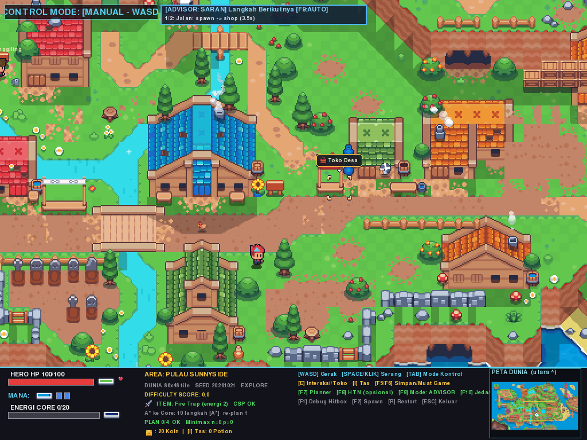
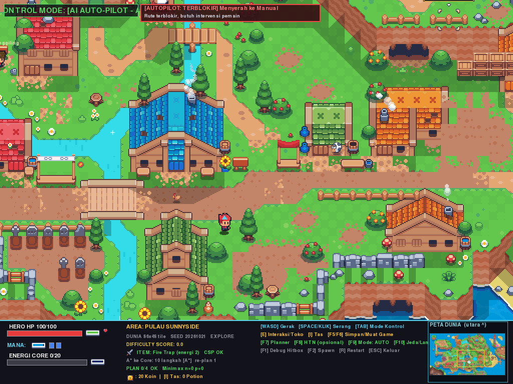
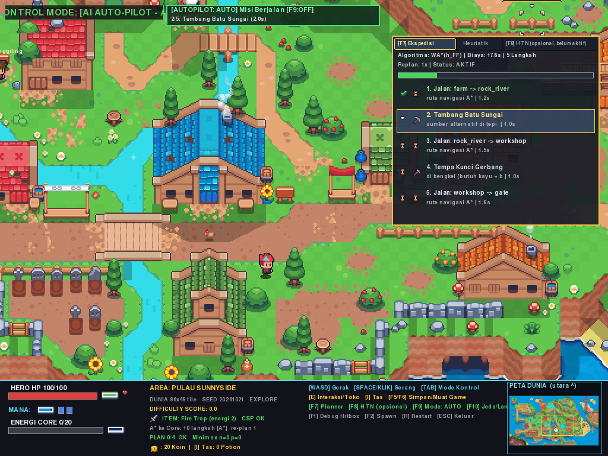
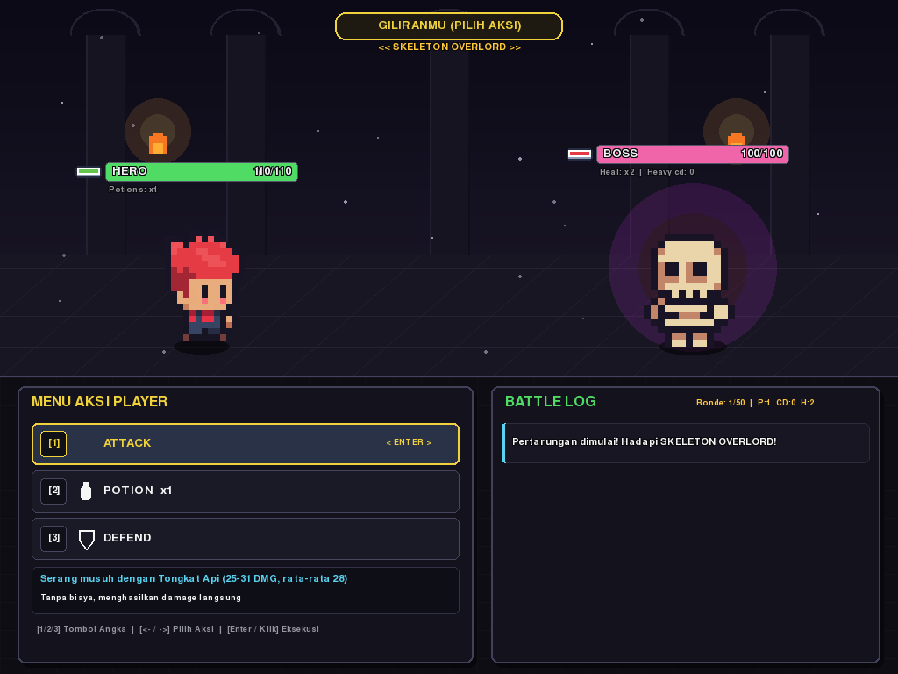

[TOC]

\newpage

# Pendahuluan

## Latar Belakang dan Tujuan
Perkembangan teknologi agen otonom dalam permainan video modern menuntut kecerdasan buatan (*Artificial Intelligence*) yang tidak hanya mampu melakukan navigasi reaktif terhadap rintangan terdekat, tetapi juga mampu melakukan penalaran strategis jangka panjang (*long-term strategic reasoning*). Pada permainan bergenre petualangan dan penjelajahan ruang bawah tanah (*dungeon crawler*), seorang karakter otonom (hero) dihadapkan pada serangkaian target berantai yang memiliki dependensi kausalitas kompleks, seperti pengumpulan sumber daya, transaksi ekonomi desa, peracikan kunci dan ramuan, penyiapan perlengkapan tempur, hingga penaklukan musuh utama (*boss*).

Pendekatan kendali klasik berbasis pohon perilaku (*Behavior Trees*) atau mesin *Finite State Machine* (FSM) sederhana rentan terhadap ledakan transisi (*state explosion*) ketika kompleksitas tugas bertambah dan kondisi lingkungan berubah secara dinamis. Untuk menjawab tantangan tersebut, paradigma **Automated Planning** (Perencanaan Otomatis) memisahkan secara tegas antara domain pengetahuan formal (*domain model*) dan algoritma pencarian solusi domain-independen (*domain-independent planning engine*). Dengan mendeskripsikan dunia dalam himpunan fakta atomik dan skema operator aksi (prasyarat dan efek), agen cerdas dapat menyusun urutan aksi valid secara otomatis dari *initial state* menuju *goal state*.

Laporan ini menyajikan perancangan, implementasi formal, pengujian mendalam, dan evaluasi empiris dari mesin **Automated Planning** berbasis STRIPS (*Stanford Research Institute Problem Solver*), penelusuran mundur (*subgoal regression*), graf perencanaan (*planning graph*) dengan *mutex reasoning*, serta heuristik relaksasi hapus (*delete relaxation heuristics*) pada game 2D top-down berlatar pedesaan dan ruang bawah tanah berjudul **"AI LABYRINTH: THE DUNGEON OVERSEER"**.

## Konteks Permainan: AI LABYRINTH
Permainan **AI LABYRINTH: THE DUNGEON OVERSEER** berlatar pada dunia kepulauan terpadu yang memadukan aktivitas agrikultur, perdagangan desa, kerajinan bengkel, serta pertempuran taktis melawan monster berlevel tinggi. Peta permainan terdiri dari pulau barat yang memuat lahan pertanian, pulau tengah yang memuat pusat desa (alun-alun, toko pedagang, bengkel tempa, kandang ternak, kincir angin), dan pulau timur terisolasi yang memuat reruntuhan gerbang kuno dan arena boss tengkorak (*Undead Skeleton Boss*).

Akses antara pulau-pulau tersebut dibatasi oleh sungai alami dan gerbang reruntuhan berkunci gembok. Hero memiliki atribut fisik (kesehatan/HP, posisi koordinat dunia kontinu, kapasitas inventori, dan modal koin). Untuk menyelesaikan ekspedisi, hero harus mengumpulkan modal melalui aktivitas produksi (menebang pohon, menambang batu kali, memancing ikan, atau menanam dan memanen lobak), membeli resep dan botol kaca di toko desa, meracik kunci gerbang dan ramuan kesehatan di bengkel, membuka gerbang pulau timur, melengkapi senjata dan zirah yang memenuhi ambang batas kemenangan, serta menantang dan mengalahkan boss dalam pertarungan taktis.

## Ruang Lingkup Dokumen
Laporan ini berfokus secara eksklusif pada subsistem **Automated Planning** (`src/planning/`). Subsistem kecerdasan buatan lain di dalam game diposisikan sebagai modul eksternal penyedia layanan atau batasan lingkungan:
1. **Navigasi Spasial ($A^*$ Grid):** Digunakan oleh perencana untuk menghitung metrik durasi perjalanan nyata antar fasilitas desa dan mengeksekusi navigasi bebas tabrakan.
2. **Pencarian Adversarial (Minimax dengan Alpha-Beta Pruning):** Mengendalikan logika pertarungan berbasis giliran (*turn-based battle*) di arena boss. Perencana mengonsumsi data probabilitas kemenangan hasil simulasi minimax guna menentukan status kelayakan tempur (*combat readiness*).
3. **Constraint Satisfaction Problem (CSP) & Local Search:** Mengoptimalkan kombinasi pemilihan perlengkapan (*best loadout*) di bawah batas bobot dan anggaran.
4. **Collision Editor:** Alat runtime pengembang untuk memodifikasi topologi mask lintasan dan memvalidasi respons replanning adaptif saat koridor diblokir.

Struktur laporan ini disusun secara sistematis mengacu pada 35 slide kuliah *Automated Planning*, mencakup landasan teori, rancangan arsitektur perangkat lunak, formulasi domain PDDL, kasus uji terisolasi (Domain Ojek Delivery), evaluasi benchmark algoritma perencana, mekanisme replanning adaptif pada topologi peta asli, integrasi lintas teknik, pengujian unit komprehensif, analisis keterbatasan teknis secara jujur, serta lampiran data mentah lengkap.

Kesimpulan bagian ini: Modul Automated Planning pada AI LABYRINTH dirancang sebagai otak pengambil keputusan tingkat tinggi (*high-level deliberative agent*) yang mengoordinasikan seluruh kapabilitas aksi hero secara terstruktur, terarah, dan adaptif terhadap ketidakpastian dunia permainan.

\newpage

# Landasan Teori Perencanaan Otomatis

Implementasi perencanaan otomatis dalam proyek ini berpegang teguh pada silabus formal 35 slide perkuliahan *Automated Planning* (Semester Ganjil 2026). Bagian ini menguraikan konsep teoretis fundamental yang melandasi perancangan sistem.

## Representasi State dan Asumsi Dunia Tertutup
Dalam perencanaan klasik, sebuah *state* $s$ direpresentasikan sebagai himpunan hingga fakta atomik positif (*finite set of positive ground atoms*):
$$s = \{p_1, p_2, \dots, p_k\}$$
di mana setiap atom $p_i$ merupakan predikat terhubung berderajat $n \ge 0$, seperti $\text{at}(\text{hero}, \text{shop})$ atau $\text{has}(\text{gate\_key})$.

Sistem menerapkan **Asumsi Dunia Tertutup** (*Closed-World Assumption* / CWA): setiap fakta yang tidak tercantum secara eksplisit di dalam himpunan $s$ diasumsikan bernilai salah (*false*). Pendekatan ini mereduksi kebutuhan representasi negasi eksplisit dan menjaga ukuran memori ruang keadaan tetap ringkas.

Literal dalam domain perencanaan dibedakan menjadi dua kategori:
1. **Literal Dinamis (*Fluents*):** Fakta yang status kebenarannya dapat berubah akibat eksekusi aksi, seperti posisi hero `(at hero ?l)`, kepemilikan barang `(has ?i)`, dan status gerbang `(gate_open)`.
2. **Literal Statis (*Invariants*):** Relasi topologi atau konstanta yang invarian terhadap aksi waktu, seperti konektivitas jalur `(road ?a ?b)` atau matriks prasyarat beban `(cost_step ?from ?to ?c)`. Literal statis disaring dari pohon penelusuran mundur dan planning graph guna mencegah redundansi komputasi.

## Bahasa Formal PDDL dan Skema Operator
Domain didefinisikan menggunakan bahasa standar PDDL (*Planning Domain Definition Language*). Skema operator $a$ didefinisikan sebagai tripel formal:
$$a = \langle \text{pre}(a), \text{add}(a), \text{del}(a), \text{cost}(a) \rangle$$
- $\text{pre}(a)$: Himpunan prasyarat atomik yang wajib ada di $s$ agar aksi dapat diterapkan ($s \models \text{pre}(a) \iff \text{pre}(a) \subseteq s$).
- $\text{add}(a)$: Efek positif, himpunan fakta yang ditambahkan ke state setelah aksi dieksekusi.
- $\text{del}(a)$: Efek negatif, himpunan fakta yang dihapus dari state setelah aksi dieksekusi.
- $\text{cost}(a) \ge 0$: Biaya eksekusi aksi. Pada perencanaan biaya seragam (*unit-cost*), $\text{cost}(a) = 1.0$. Pada domain ekspedisi nyata, biaya dihitung proporsional terhadap waktu tempuh detil ($t = \Delta s / v$).

Fungsi transisi state deterministik mengikuti formula standar STRIPS:
$$\text{Result}(s, a) = (s \setminus \text{del}(a)) \cup \text{add}(a)$$

## Pencarian Maju (*Forward State-Space Search / Progression*)
Pencarian maju bermula dari kondisi awal $s_0$ dan membangun pohon pencarian ke arah sasaran $G$. Pada setiap iterasi, simpul state $s$ diekspansi dengan menentukan seluruh aksi ter-ground yang dapat diterapkan (*applicable actions*):
$$\text{Applicable}(s) = \{a \in \mathcal{A} \mid \text{pre}(a) \subseteq s\}$$
Tujuan tercapai ketika suatu state $s$ memenuhi seluruh kondisi sasaran:
$$\text{IsGoal}(s) \iff G \subseteq s$$

Kelebihan utama pencarian maju adalah evaluasi state selalu beroperasi pada dunia nyata yang konkret (*fully grounded states*), sehingga memudahkan penggabungan metrik spasial $A^*$, aturan inventori, dan pembatasan numerik koin.

## Pencarian Mundur (*Backward Subgoal Regression*)
Berbeda dari *progression*, pencarian mundur bekerja dari himpunan sasaran $G$ menuju kondisi awal $s_0$. Pada setiap langkah, perencana mempertahankan himpunan *subgoal* $g$.

Sebuah aksi $a$ dikategorikan **relevan** terhadap subgoal $g$ jika $a$ menghasilkan minimal satu fakta yang dibutuhkan oleh $g$:
$$\text{Relevant}(a, g) \iff \text{add}(a) \cap g \neq \emptyset$$
Aksi $a$ dikategorikan **konsisten** terhadap subgoal $g$ jika efek hapusnya tidak merusak fakta lain yang sedang ditargetkan oleh $g$:
$$\text{Consistent}(a, g) \iff \text{del}(a) \cap g = \emptyset$$

Jika $a$ relevan dan konsisten, formula regresi menghitung prasyarat mundur $g'$:
$$g' = \text{Regress}(g, a) = (g \setminus \text{add}(a)) \cup \text{pre}(a)$$
Proses pencarian mundur berhenti dengan sukses ketika seluruh fakta pada subgoal $g'$ merupakan himpunan bagian dari kondisi awal:
$$g' \subseteq s_0$$
Rencana maju diperoleh dengan membalik urutan aksi yang terpilih pada penelusuran mundur. Pencarian mundur sangat efektif untuk masalah dengan sasaran spesifik (*small goal set*) karena memangkas cabang pencarian yang tidak berkontribusi langsung pada pencapaian target.

## Heuristik Relaksasi Hapus (*Delete Relaxation Heuristics*)
Untuk memandu algoritma pencarian terarah ($A^*$ dan *Weighted* $A^*$), persoalan perencanaan asli disederhanakan melalui relaksasi hapus (*delete relaxation*), di mana seluruh efek negatif aksi diabaikan: $\text{del}^+(a) = \emptyset$. Pada persoalan relaksasi $P^+$, fakta yang telah bernilai benar tidak akan pernah kembali salah, sehingga solusi optimal relaksasi ($h^+$) dapat diaproksimasi secara polinomial:
1. **Heuristik $h_{\max}$ (Maksimal / *Admissible*):**
   $$h_{\max}(s, p) = \begin{cases} 0 & \text{jika } p \in s \\ \min_{a \in \text{Add}(p)} \left( \text{cost}(a) + \max_{q \in \text{pre}(a)} h_{\max}(s, q) \right) & \text{lainnya} \end{cases}$$
   $$h_{\max}(s, G) = \max_{g \in G} h_{\max}(s, g)$$
   Heuristik ini bersifat *admissible* ($h(s) \le h^*(s)$), menjamin optimalitas biaya pencarian, namun cenderung meremehkan biaya gabungan (*underestimation* semu).
2. **Heuristik $h_{\text{add}}$ (Aditif / *Non-Admissible*):**
   $$h_{\text{add}}(s, G) = \sum_{g \in G} h_{\text{add}}(s, g)$$
   Mengasumsikan sub-sasaran saling independen. Heuristik ini bersifat *sub-optimal satisficing* namun memberikan gradien pemandu yang sangat tajam pada ruang pencarian luas.
3. **Heuristik $h_{\text{FF}}$ (*Fast-Forward Relaxed Plan*):**
   Membangun graf relaksasi maju dan mengekstrak rencana santai (*relaxed plan*) $\pi^+$ menggunakan pencarian mundur. Nilai heuristik adalah jumlah aksi dalam rencana santai: $h_{\text{FF}}(s) = |\pi^+|$. Aksi-aksi pada tingkat pertama rencana santai yang dapat diterapkan langsung di state nyata $s$ diklasifikasikan sebagai **Helpful Actions**, memangkas faktor percabangan secara drastis.

## Planning Graph dan Mutex Reasoning
Planning Graph (Blum & Furst, 1997) adalah graf berarah terarah berlapis (*directed layered graph*) yang merepresentasikan ruang jangkauan aksi dan proposisi:
$$S_0, A_0, S_1, A_1, S_2, \dots$$
Setiap tingkat $S_i$ memuat himpunan proposisi yang berpotensi benar pada langkah ke-$i$, dan tingkat $A_i$ memuat aksi yang prasyaratnya terpenuhi di $S_i$, termasuk aksi persistensi (*No-Op*): $\text{no-op}(p) = \langle \{p\}, \{p\}, \emptyset \rangle$.

Konflik logis antar entitas pada tingkat yang sama direpresentasikan melalui relasi ketidakterpaduan (*Mutual Exclusion* / Mutex):
1. **Action Mutex (Tingkat $A_i$):**
   - *Inconsistent Effects:* Satu aksi menghapus efek tambah aksi lain: $\text{del}(a) \cap \text{add}(b) \neq \emptyset$.
   - *Interference:* Satu aksi menghapus prasyarat aksi lain: $\text{del}(a) \cap \text{pre}(b) \neq \emptyset$.
   - *Competing Needs:* Ada prasyarat $p \in \text{pre}(a)$ dan $q \in \text{pre}(b)$ sedemikian rupa sehingga $(p, q)$ merupakan fact mutex di $S_i$.
2. **Fact Mutex (Tingkat $S_{i+1}$):**
   - *Inconsistent Support:* Seluruh aksi di $A_i$ yang memproduksi fakta $p$ berstatus mutex dengan seluruh aksi di $A_i$ yang memproduksi fakta $q$.

Heuristik **$h_{\text{level}}$** didefinisikan sebagai indeks tingkat pertama $S_i$ tempat seluruh fakta sasaran $G$ muncul tanpa ada pasangan mutex di antara sesama anggota $G$. Graf Plan mengekstrak rencana sekuensial paralel menggunakan pencarian mundur antar lapisan.

## Pemetaan Silabus Kuliah terhadap Modul Perangkat Lunak
Tabel 1 merangkum kesesuaian implementasi teknis pada repositori proyek terhadap 35 slide kuliah perkuliahan Automated Planning.

**Tabel 1. Pemetaan Materi Kuliah 35 Slide terhadap Berkas Implementasi dan Bukti Uji**

| Topik & Nomor Slide | Konsep Teori Formal | Berkas / Fungsi Implementasi | Berkas Bukti Uji Unit |
| :--- | :--- | :--- | :--- |
| **Slide 1–8: Formulasi State & CWA** | State himpunan atomik, relasi n-ary, Closed-World Assumption | `src/planning/strips.py` (`STRIPSState`, `Predicate`) | `test_strips_planner.py:test_01` |
| **Slide 9–15: PDDL & Skema Operator** | Operator parameter, prasyarat, add, del, unit cost | `data/planning/ojek.domain`, `pddl_parser.py` | `test_lecture_planning.py:test_01` |
| **Slide 20: Latihan Open-Gate** | Ekstensi domain gerbang: prasyarat `gate-open`, aksi `open-gate` | `data/planning/ojek_gate.domain`, `.problem` | `test_lecture_planning.py:test_04` |
| **Slide 22: Plan Checker** | Validasi kausalitas sekuensial, penolakan rencana ilegal | `src/planning/strips.py` (`PlanValidator.validate`) | `test_lecture_planning.py:test_03` |
| **Slide 25: Forward Progression** | $\text{Result}(s,a) = (s \setminus \text{del}) \cup \text{add}$, penelusuran maju | `src/planning/planner.py` (`search_bfs`, `search_ucs`) | `test_lecture_planning.py:test_02` |
| **Slide 26–30: Subgoal Regression** | Seleksi relevan/konsisten, formula regresi, Dual Goal | `src/planning/regression.py` (`search_regression_astar`) | `test_lecture_planning.py:test_05,06,07` |
| **Slide 31–32: Heuristik Ignore-Delete** | Relaksasi $P^+$, formulasi $h_{\max}, h_{\text{add}}, h_{\text{FF}}$, Helpful Actions | `src/planning/heuristics.py` (`h_max`, `h_add`, `h_ff`) | `test_strips_planner.py:test_05,06` |
| **Slide 32–35: Planning Graph & Mutex** | Graf berlapis, no-op, mutex aksi & fakta, $h_{\text{level}}$, GraphPlan | `src/planning/planning_graph.py` (`PlanningGraph`) | `test_lecture_planning.py:test_08,09` |
| **Data-Driven Knowledge Base** | Modifikasi katalog & aksi PDDL tanpa sentuh kode Python | `data/catalog.json`, `data/planning/expedition.domain` | `test_lecture_planning.py:test_13,14,15` |
| **HTN Planning (Pengayaan)** | Total-order SHOP decomposition (Task, Method, Operator) | `src/planning/htn.py`, `data/planning/npc.htn` | `test_htn.py:test_01-09` |

*(Sumber: silabus perkuliahan 08_Automated Planning dan berkas tests/test_lecture_planning.py)*

Kesimpulan bagian ini: Seluruh 35 materi slide kuliah perkuliahan Automated Planning telah diimplementasikan secara komprehensif, murni, dan diverifikasi melalui unit test otomatis yang terstruktur rapi.

\newpage

# Rancangan Sistem dan Arsitektur Modul

Arsitektur modul perencanaan otomatis pada `src/planning/` dirancang dengan prinsip pemisahan tanggung jawab (*Separation of Concerns* / SoC), modularitas tinggi, serta kopling longgar (*loose coupling*) terhadap subsistem game loop utama (`main.py`).

## Diagram Blok Arsitektur Perangkat Lunak
Struktur keterkaitan antarmodul dan alur data perencanaan diilustrasikan pada Gambar 1.



## Dekomposisi Fungsional Modul Perencanaan
Modul `src/planning/` terdiri atas komponen-komponen utama sebagai berikut:
1. **Parser & Kompilasi Simbolik (`pddl_parser.py`):** Bertugas mem-parsing teks domain dan problem PDDL menjadi representasi pohon sintaks abstrak (*Abstract Syntax Tree* / AST), memvalidasi tipe objek, parameterisasi, prasyarat, dan efek aksi.
2. **Representasi STRIPS Murni (`strips.py`):** Mendefinisikan struktur data inti `Predicate`, `STRIPSState` (berbasis `frozenset` tak-berubah / *immutable* berkinerja tinggi), `GroundAction`, `PlanningProblem`, serta mesin verifikasi `PlanValidator`.
3. **Grounding & Pemangkasan Relevansi (`grounding.py`):** Mengganti parameter variabel operator PDDL dengan kombinasi objek dunia nyata. Mengintegrasikan algoritma *Backward Relevance Analysis* guna menyaring aksi dan tingkatan transaksi yang tidak berkontribusi pada pencapaian sasaran.
4. **Metrik Ruang Nyata (`distance_matrix.py`):** Memetakan lokasi simbolik (seperti `shop`, `farm`, `workshop`, `gate`, `boss`) ke koordinat grid 2D, menghitung jarak terpendek bebas rintangan menggunakan algoritma $A^*$ pada `assets/maps/walkable_mask.png`, dan membaginya dengan kecepatan jalan hero (130 px/s) untuk memperoleh durasi perjalanan dalam detik.
5. **Generator Problem Dinamis (`problem_generator.py`):** Menginspeksi status instan `WorldState` (posisi hero, koin di kantong, tanaman di ladang, barang inventori) dan mengompilasinya menjadi fakta atomik initial state PDDL serta mengonstruksi tangga koin diskret secara adaptif.
6. **Mesin Heuristik (`heuristics.py`):** Menghitung fungsi heuristik admissible ($h_{\max}$) dan satisficing ($h_{\text{add}}, h_{\text{FF}}$) berbasis relaksasi hapus serta mengekstrak daftar *Helpful Actions*.
7. **Mesin Graf & Mutex (`planning_graph.py`):** Membangun planning graph bertingkat, mendeteksi relasi mutex aksi (inconsistent effects, interference, competing needs) dan mutex fakta (inconsistent support), menghitung heuristik $h_{\text{level}}$, serta mengekstrak rencana GraphPlan klasik.
8. **Penelusuran Mundur (`regression.py`):** Mengimplementasikan algoritma regresi subgoal mundur berbobot ($A^*$ dan BFS) dengan seleksi relevansi dan konsistensi serta pelacakan jejak state (*regression trace*).
9. **Mesin Perencana Utama (`planner.py`):** Menyediakan antarmuka terpadu algoritma pencarian maju: BFS, UCS, $A^*(h_{\max})$, $A^*(h_{\text{add}})$, Weighted $A^*(h_{\text{FF}})$, $A^*(h_{\text{level}})$, serta pengendali anggaran waktu frame `IncrementalPlanner`.
10. **Eksekusi Aksi Dunia (`executor.py`):** Mengonversi simbol aksi PDDL ke pemanggilan fungsi dunia konkret di `src/world_actions.py` (seperti navigasi waypoint, memancing, menebang kayu, bertani, membeli alat di toko, dan bertarung melawan boss).
11. **Pengawasan Reaktif (*Closed-Loop Monitor*) (`monitor.py`):** Memantau keberhasilan eksekusi setiap aksi di game loop. Bila terjadi intervensi pemain (WASD), kegagalan aksi di dunia, rute terhalang rintangan, atau kekalahan tempur, monitor memicu proses perancangan ulang (*replanning*) secara otomatis.
12. **Antarmuka Pengguna & HUD (`planner_ui.py`):** Merender panel debug F7 (rencana aksi, biaya, durasi, state monitor), banner status unclipped di atas layar, serta indikator visual sorotan target navigasi.

## Alur Data Siklus Tertutup (*Closed-Loop Control Flow*)
Sistem beroperasi dalam siklus tertutup 6 tahap:
$$\text{WorldState} \xrightarrow{(1)} \text{ProblemGenerator} \xrightarrow{(2)} \text{Planner Engine} \xrightarrow{(3)} \text{PlanExecutor} \xrightarrow{(4)} \text{Game World} \xrightarrow{(5)} \text{PlanMonitor} \xrightarrow{(6)} \text{Replan}$$
- **Tahap 1:** `WorldState` diekstrak menjadi fakta simbolik awal $s_0$.
- **Tahap 2:** Perencana (WA* $h_{\text{FF}}$) menyusun rencana sekuensial $\pi = [a_1, a_2, \dots, a_m]$.
- **Tahap 3 & 4:** `PlanExecutor` mengambil langkah aktif $a_k$ dan menginstruksikan `WorldActions` menggerakkan hero atau berinteraksi dengan fasilitas.
- **Tahap 5:** `PlanMonitor` memverifikasi apakah efek aksi $\text{add}(a_k)$ terwujud di `WorldState`.
- **Tahap 6:** Jika kondisi dunia menyimpang dari prediksi rencana, monitor menginterupsi eksekusi, mengompilasi ulang problem dari posisi terbaru, dan meminta rencana pemulihan baru tanpa menghentikan kelancaran game loop.

Kesimpulan bagian ini: Arsitektur `src/planning/` dirancang secara berlapis dan modular, memadukan ketelitian penalaran simbolik STRIPS dengan realitas lingkungan spasial 2D serta mekanisme pengawasan reaktif tertutup.

\newpage

# Knowledge Base Permainan Bebas Modifikasi Kode

Sistem perencanaan dirancang dengan paradigma berbasis data (*data-driven architecture*). Aturan permainan, atribut komoditas, dan skema aksi disimpan pada berkas konfigurasi eksternal, sehingga modifikasi logika ekspedisi dapat dilakukan tanpa perlu menyentuh atau mengompilasi ulang kode sumber Python.

## Pembagian Basis Pengetahuan: Berkas Statis vs Komputasi Kode
Tabel 2 merinci pembagian komponen basis pengetahuan antara berkas statis dan komputasi runtime.

**Tabel 2. Distribusi Komponen Basis Pengetahuan Sistem Perencanaan**

| Komponen Pengetahuan | Lokasi Penyimpanan | Mekanisme & Alasan Teknis |
| :--- | :--- | :--- |
| **Skema Operator & Aksi** | `data/planning/expedition.domain` | Berkas teks PDDL standar. Menjaga logika kausalitas aksi terisolasi dari kode mesin pencari. |
| **Deskripsi Awal & Objek** | `data/planning/expedition.problem` | Berkas PDDL penyedia daftar objek dunia, tipe lokasi, dan relasi topologi dasar. |
| **Katalog Komoditas & Toko** | `data/catalog.json` | JSON konfigurasi harga beli, harga jual, dan tipe item toko desa. |
| **Matriks Kesiapan Tempur** | `data/planning/readiness.json` | Hasil evaluasi empiris simulasi Monte-Carlo pertempuran minimax (win rate per loadout). |
| **Metrik Jarak Nyata Spasial** | Dihitung runtime (`distance_matrix.py`) | Dihitung dinamis via $A^*$ pada mask navigasi 2D agar selalu mencerminkan rute terpendek bebas tabrakan. |
| **Tangga Koin Diskret** | Dihitung runtime (`problem_generator.py`) | Dihitung dinamis berdasarkan batas modal ekspedisi (`max_coins = 60`) untuk membatasi ruang keadaan. |

*(Sumber: arsitektur konfigurasi repositori AI LABYRINTH)*

## Contoh Potongan Berkas Domain PDDL
Listing 1 menyajikan contoh definisi aksi tergeneralisasi `buy_item` dan aksi spesifik `mine_rock_river` pada `data/planning/expedition.domain`.

```lisp
;; Listing 1. Cuplikan Definisi Aksi PDDL pada expedition.domain
(:action mine_rock_river
  :parameters ()
  :precondition (and 
    (at river_fishing)
    (has_rock_river)
  )
  :effect (and 
    (has rock)
    (not (has_rock_river))
  )
)

(:action buy_item
  :parameters (?i - item ?c_from - coin ?c_to - coin)
  :precondition (and 
    (at shop)
    (has_coins ?c_from)
    (pay_item ?i ?c_from ?c_to)
  )
  :effect (and 
    (not (has_coins ?c_from))
    (has_coins ?c_to)
    (has ?i)
  )
)
```

## Pembuktian Fleksibilitas Basis Pengetahuan (*Knowledge Base Tests*)
Fleksibilitas basis pengetahuan dibuktikan melalui rangkaian pengujian unit otomatis yang memvalidasi adaptabilitas sistem tanpa perubahan kode program Python:
1. **Penambahan Item Baru (`test_13_knowledge_base_new_item_data_driven`):** Menambahkan entri barang baru `Ramuan_Naga` ke dalam `data/catalog.json` secara otomatis terbaca oleh toko desa dan dapat dibeli oleh hero.
2. **Modifikasi Prasyarat PDDL (`test_14_knowledge_base_pddl_precondition_change`):** Menambahkan prasyarat baru `(has-permit)` pada operator PDDL secara otomatis membuat perencana menolak rencana sebelum izin tersebut dipenuhi di kondisi awal.
3. **Penambahan Operator Aksi Baru (`test_15_knowledge_base_new_action_in_pddl`):** Menambahkan aksi baru `(:action refuel)` pada domain PDDL langsung diikutsertakan oleh algoritma grounding dan digunakan dalam pembentukan rencana tanpa memodifikasi fungsi Python di `src/planning/`.
4. **Penambahan Senjata Baru di Level Perencana (`test_29_knowledge_base_new_weapon_item_planner_level`):** Menambahkan tombak petir (`tombak_petir`) pada katalog item langsung diproses oleh generator problem; perencana secara otonom menghasilkan aksi `buy_item(tombak_petir, c20, c0)` dan memperlengkapinya sebelum melawan boss.

Kesimpulan bagian ini: Pemisahan tegas antara basis pengetahuan data PDDL/JSON dan algoritma pencarian menjamin ekstensibilitas sistem, memungkinkan perancang konten game menambah atau mengubah fitur permainan secara fleksibel tanpa risiko regresi kode program.

\newpage

# Pemodelan Domain Ekspedisi

Domain ekspedisi (`data/planning/expedition.domain`) memodelkan misi penaklukan boss dari kondisi awal permainan baru (*New Game*). Bagian ini menguraikan struktur matematis objek, predikat, penanganan kuantitas diskret, serta teknik pemangkasan percabangan aksi.

## Objek, Predikat, dan Skema Operator
Domain ekspedisi melibatkan tipe objek utama: `location`, `item`, `crop`, dan `coin`. Lokasi meliputi titik-titik krusial pada peta Sunnyside: `spawn` (alun-alun desa), `shop` (toko alat/benih), `farm` (kebun tanaman), `workshop` (bengkel tempa/kerajinan), `forest_wood` (hutan kayu barat), `river_fishing` (dermaga pancing & batu kali), `quarry_rock` (tambang batu bukit timur), `gate` (gerbang reruntuhan), dan `boss` (arena monster pulau timur).

Tabel 3 menyajikan ringkasan operator aksi utama pada domain ekspedisi.

**Tabel 3. Rincian Operator Aksi pada Domain Ekspedisi PDDL**

| Nama Aksi | Parameter | Prasyarat Utama (*Preconditions*) | Efek Utama (*Effects*) | Durasi (s) |
| :--- | :--- | :--- | :--- | :---: |
| `goto(?from, ?to)` | `?from, ?to - loc` | `(at ?from), (road ?from ?to)` | `(at ?to), not (at ?from)` | Variabel ($A^* / v$) |
| `chop_wood()` | - | `(at forest_wood)` | `(has wood)` | 1.50 s |
| `mine_rock_river()` | - | `(at river_fishing), (has_rock_river)` | `(has rock), not (has_rock_river)` | 1.50 s |
| `mine_rock()` | - | `(at quarry_rock)` | `(has rock)` | 2.00 s |
| `craft_key()` | - | `(at workshop), (has wood), (has rock)` | `(has gate_key), not wood, not rock` | 2.00 s |
| `open_gate()` | - | `(at gate), (has gate_key)` | `(gate_open)` | 1.00 s |
| `goto_through_gate(?f, ?t)`| `?f, ?t - loc` | `(at ?f), (gate_open)` | `(at ?t), not (at ?f)` | Variabel ($A^* / v$) |
| `plant_radish()` | - | `(at farm), (has seed_radish), (plot_free)`| `(crop_planted), not (has seed)` | 1.00 s |
| `water_radish()` | - | `(at farm), (crop_planted)` | `(crop_watered)` | 1.00 s |
| `wait_grow_radish()` | - | `(crop_watered)` | `(crop_mature), not (crop_watered)` | 3.00 s |
| `harvest_radish()` | - | `(at farm), (crop_mature)` | `(has radish), (plot_free)` | 1.00 s |
| `craft_potion(?n_from, ?n_to)`| `?nf, ?nt - count` | `(at workshop), (has bottle), (has radish), (succ ?nf ?nt), (has_n potion ?nf)` | `(has_n potion ?nt), not (has_n ?nf), not radish, not bottle` | 2.00 s |
| `buy_fire_staff(?cf, ?ct)` | `?cf, ?ct - coin` | `(at shop), (has_coins ?cf), (pay_fire_staff ?cf ?ct)` | `(has fire_staff), not (has_coins ?cf), (has_coins ?ct)` | 1.00 s |
| `buy_armor_leather(?cf, ?ct)` | `?cf, ?ct - coin` | `(at shop), (has_coins ?cf), (pay_armor_leather ?cf ?ct)` | `(has armor_leather), not ?cf, ?ct` | 1.00 s |
| `equip(?w, ?a)` | `?w, ?a - item` | `(at workshop), (has ?w), (has ?a), (valid_loadout ?w ?a)` | `(equipped_weapon ?w), (equipped_armor ?a), (equipped_ok)` | 1.00 s |
| `fight_boss(?w, ?a, ?n)` | `?w, ?a - item, ?n - count` | `(at boss), (gate_open), (equipped_weapon ?w), (equipped_armor ?a), (has_n potion ?n), (ready_loadout ?w ?a ?n), (hp_full)` | `(boss_defeated)` | 10.00 s |

*(Sumber: data/planning/expedition.domain)*

## Representasi Kuantitas Diskret: Tangga Koin dan Ramuan
STRIPS klasik tidak mendukung variabel aritmatika kontinu. Untuk memodelkan koin uang dan inventori ramuan, sistem menggunakan **Tangga Koin Diskret** (*Discrete Coin Ladder*):
- Koin direpresentasikan sebagai objek konstanta: `c0, c1, c2, ..., c60`.
- Relasi pembayaran dimodelkan melalui predikat statis relasi biner:
  $$(\text{pay\_seed\_radish } c_i, c_{i-5}), \quad (\text{pay\_bottle } c_i, c_{i-8}), \quad (\text{pay\_fire\_staff } c_i, c_{i-40})$$
- Transaksi penjualan komoditas menambah koin melalui predikat simetris:
  $$(\text{earn\_radish } c_i, c_{i+10}), \quad (\text{earn\_fish } c_i, c_{i+15})$$
- Jumlah ramuan dihitung melalui skema suksesor diskret: `(succ n0 n1)`, `(succ n1 n2)`, `(succ n2 n3)` dengan predikat kepemilikan kuantitas `(has_n potion ?n)`.

## Penentuan Biaya Aksi Nyata Berbasis $A^*$
Biaya setiap aksi pergerakan transit `goto(?from, ?to)` dihitung secara presisi berdasarkan jarak piksel rute terpendek yang ditemukan oleh algoritma $A^*$ pada `assets/maps/walkable_mask.png`:
$$\text{Cost}(\text{goto}(A, B)) = \frac{\text{Pixel Distance}(A, B)}{\text{Hero Speed (130 px/s)}}$$
Sebagai contoh nyata, transit dari `spawn` ke sumber batu sungai `river_fishing` berjarak 141 piksel dengan durasi $1.09\text{ s}$, sedangkan transit ke tambang batu bukit timur `quarry_rock` berjarak 1,976 piksel dengan durasi $15.20\text{ s}$. Penggunaan metrik durasi riil memastikan perencana selalu memprioritaskan rute paling efisien di dunia game.

## Analisis Pemangkasan Relevansi Mundur (*Backward Relevance Pruning*)
Implementasi tangga koin hingga `max_coins = 60` berpotensi memicu ledakan percabangan kombinatorial (*branching explosion*). Pada problem P1 (pembuatan kunci gerbang yang hanya membutuhkan kayu dan batu), pembuat problem awal menghasilkan hingga **322 aksi ter-ground**, mayoritas berupa transaksi koin dan pembelian senjata yang sama sekali tidak relevan terhadap sasaran `(has gate_key)`.

Untuk mengatasi masalah ini, modul `grounding.py` mengimplementasikan algoritma **Goal-Directed Backward Relevance Analysis**:
1. Dimulai dari himpunan fakta sasaran $R_0 = G$.
2. Secara iteratif mundur, temukan seluruh aksi $a \in \mathcal{A}$ yang menghasilkan minimal satu fakta di $R_k$: $\text{add}(a) \cap R_k \neq \emptyset$.
3. Masukkan aksi $a$ ke dalam himpunan aksi relevan $\mathcal{A}_{\text{rel}}$, dan perluas kebutuhan fakta: $R_{k+1} = R_k \cup \text{pre}(a)$.
4. Ulangi proses hingga titik jenuh ($R_{k+1} = R_k$). Seluruh aksi di luar $\mathcal{A}_{\text{rel}}$ dibuang dari pencarian.

Hasil empiris membuktikan bahwa pada problem P1, aksi ter-ground berhasil dipangkas dari **322 aksi menjadi 116 aksi** (-64.0%). Pemangkasan ini menyelamatkan algoritma UCS dari kehabisan batas node (10,000 node) menjadi selesai optimal hanya pada **35 node** ($19.32\text{ ms}$).

## Fakta Turunan Kesiapan Tempur (*Honest Readiness Predicate*)
Pada draf perancangan awal, aksi semu `equip_starter` memproduksi fakta `boss_ready` secara gratis, sehingga hero nekat menantang boss dengan tangan kosong atau belati rapuh (win rate hanya 30.0%). Cacat desain ini diperbaiki secara radikal:
1. Aksi `equip_starter` **dihapus**.
2. Aksi `fight_boss(?w, ?a, ?n)` mewajibkan prasyarat statis `(ready_loadout ?w ?a ?n)`.
3. Fakta `(ready_loadout ?w ?a ?n)` dihasilkan secara data-driven dari berkas `data/planning/readiness.json`, dan hanya bernilai benar jika konfigurasi perlengkapan tersebut meraih **win rate empiris $\ge 0.50$** (50%) serta membawa **minimal 1 ramuan darurat** (`READY_MIN_POTIONS = 1`).

## Eksekusi Lengkap Rencana Final Ekspedisi P4 (37 Langkah)
Tabel 4 menyajikan urutan aksi lengkap rencana optimal hasil sintesis perencana Weighted $A^*(h_{\text{FF}})$ pada problem P4 dari kondisi New Game, dengan total durasi kumulatif 118.48 detik.

**Tabel 4. Urutan Aksi Lengkap Rencana Permainan Final P4 (37 Langkah, Biaya 118.48 s)**

| No | Tanda Tangan Aksi (*Action Signature*) | Biaya Langkah (s) | Waktu Kumulatif (s) | Keterangan Aktivitas Hero |
| :-: | :--- | :---: | :---: | :--- |
| 1 | `goto(spawn, river_fishing)` | 1.09 s | 1.09 s | Transit ke tepi sungai barat |
| 2 | `mine_rock_river()` | 1.50 s | 2.59 s | Menambang batu kali di sungai |
| 3 | `fish()` | 2.50 s | 5.09 s | Memancing ikan untuk modal awal |
| 4 | `goto(river_fishing, shop)` | 4.31 s | 9.40 s | Menuju toko desa |
| 5 | `buy_seed_radish(c20, c15)` | 1.00 s | 10.40 s | Membeli benih lobak (sisa 15 koin) |
| 6 | `buy_bottle(c15, c7)` | 1.00 s | 11.40 s | Membeli botol kaca kosong (sisa 7 koin) |
| 7 | `sell_fish(c7, c22)` | 1.00 s | 12.40 s | Menjual ikan hasil tangkapan (+15 koin) |
| 8 | `goto(shop, farm)` | 5.22 s | 17.62 s | Menuju lahan perkebunan barat |
| 9 | `plant_radish()` | 1.00 s | 18.62 s | Menanam benih lobak di petak gembur |
| 10 | `water_radish()` | 1.00 s | 19.62 s | Menyiram tanaman lobak |
| 11 | `wait_grow_radish()` | 3.00 s | 22.62 s | Menunggu tanaman tumbuh matang |
| 12 | `harvest_radish()` | 1.00 s | 23.62 s | Memanen lobak matang |
| 13 | `goto(farm, shop)` | 5.22 s | 28.84 s | Kembali ke toko pedagang |
| 14 | `sell_radish(c22, c32)` | 1.00 s | 29.84 s | Menjual lobak panenan (+10 koin) |
| 15 | `goto(shop, farm)` | 5.22 s | 35.06 s | Menuju kebun kedua |
| 16 | `goto(farm, forest_wood)` | 2.15 s | 37.21 s | Menuju hutan kayu barat |
| 17 | `chop_wood()` | 1.50 s | 38.71 s | Menebang pohon untuk material kayu |
| 18 | `goto(forest_wood, farm)` | 2.15 s | 40.86 s | Melintasi perkebunan |
| 19 | `goto(farm, shop)` | 5.22 s | 46.08 s | Menuju toko desa |
| 20 | `buy_seed_radish(c32, c27)` | 1.00 s | 47.08 s | Membeli benih lobak kedua (sisa 27 koin) |
| 21 | `goto(shop, farm)` | 5.22 s | 52.30 s | Menuju petak ladang |
| 22 | `plant_radish()` | 1.00 s | 53.30 s | Menanam lobak untuk bahan ramuan |
| 23 | `water_radish()` | 1.00 s | 54.30 s | Menyiram tanaman |
| 24 | `wait_grow_radish()` | 3.00 s | 57.30 s | Menunggu fase pematangan |
| 25 | `harvest_radish()` | 1.00 s | 58.30 s | Memanen lobak herbal |
| 26 | `goto(farm, shop)` | 5.22 s | 63.52 s | Menuju toko perlengkapan |
| 27 | `buy_armor_leather(c27, c7)` | 1.00 s | 64.52 s | Membeli Zirah Kulit (harga 20 koin) |
| 28 | `fish()` | 2.50 s | 67.02 s | Memancing tambahan modal |
| 29 | `sell_fish(c7, c22)` | 1.00 s | 68.02 s | Menjual ikan (+15 koin) |
| 30 | `buy_fire_staff(c22, c0)`* | 1.00 s | 69.02 s | Membeli Tongkat Api pamungkas |
| 31 | `goto(shop, workshop)` | 4.88 s | 73.90 s | Menuju bengkel kerajinan |
| 32 | `craft_key()` | 2.00 s | 75.90 s | Meracik Kunci Gerbang Kuno |
| 33 | `craft_potion(n0, n1)` | 2.00 s | 77.90 s | Meracik 1 Health Potion di bengkel |
| 34 | `equip(fire_staff, armor_leather)` | 1.00 s | 78.90 s | Melengkapi senjata dan zirah tempur |
| 35 | `goto(workshop, gate)` | 17.62 s | 96.52 s | Perjalanan panjang menuju gerbang timur |
| 36 | `open_gate()` | 1.00 s | 97.52 s | Membuka gerbang reruntuhan dengan kunci |
| 37 | `fight_boss(fire_staff, armor_leather, n1)`| 20.96 s | **118.48 s** | Menyeberangi jembatan & taklukkan Boss |

*(Sumber: docs/report_data/demo_replan.json dan tests/test_strips_planner.py:test_21)*

Kesimpulan bagian ini: Pemodelan domain ekspedisi berhasil merepresentasikan seluruh dinamika fisik, transaksi moneter, manufaktur, dan kesiapan pertempuran dalam notasi STRIPS yang bersih, terarah, dan dapat diselesaikan secara optimal dalam 37 langkah berdurasi 118.48 detik.

\newpage

# Kasus Uji Domain Ojek Delivery

Untuk memvalidasi keabsahan formal mesin perencana terhadap silabus akademik, dibuat domain pengujian terisolasi **Ojek Delivery** (`data/planning/ojek.domain` dan `data/planning/ojek.problem`) yang mereplikasi kasus kuliah pada Slide 1–35.

## Definisi Domain dan Problem Ojek
Spesifikasi domain ojek mencakup:
- **Objek:** `rumah`, `warung`, `kampus` (tipe `location`), `paket` (tipe `package`).
- **Initial State ($s_0$):** `(motor-at rumah)`, `(at paket warung)`, serta konektivitas jalan dua arah: `(road rumah warung)`, `(road warung rumah)`, `(road warung kampus)`, `(road kampus warung)`.
- **Sasaran ($G$):** `(at paket kampus)`.
- **Operator Aksi:**
  - `drive(?from, ?to)`: pre `{(motor-at ?from), (road ?from ?to)}`, add `{(motor-at ?to)}`, del `{(motor-at ?from)}`.
  - `pickup(?p, ?l)`: pre `{(at ?p ?l), (motor-at ?l)}`, add `{(in ?p)}`, del `{(at ?p ?l)}`.
  - `drop(?p, ?l)`: pre `{(in ?p), (motor-at ?l)}`, add `{(at ?p ?l)}`, del `{(in ?p)}`.

## Evaluasi Forward Progression dan State Trace
Seluruh algoritma forward (BFS, UCS, $A^*$, WA*) sukses menemukan rencana optimal 4 langkah:
1. `drive(rumah, warung)`
2. `pickup(paket, warung)`
3. `drive(warung, kampus)`
4. `drop(paket, kampus)`

Total biaya pencarian bernilai **$4.00$** satuan. Jejak transisi state terverifikasi matematis persis formula STRIPS:
- $s_0 = \{\text{motor-at(rumah)}, \text{at(paket, warung)}\}$
- $s_1 = (s_0 \setminus \{\text{motor-at(rumah)}\}) \cup \{\text{motor-at(warung)}\}$
- $s_2 = (s_1 \setminus \{\text{at(paket, warung)}\}) \cup \{\text{in(paket)}\}$
- $s_3 = (s_2 \setminus \{\text{motor-at(warung)}\}) \cup \{\text{motor-at(kampus)}\}$
- $s_4 = (s_3 \setminus \{\text{in(paket)}\}) \cup \{\text{at(paket, kampus)}\} \supseteq G$.

## Evaluasi Plan Checker (Slide 22)
Sesuai materi slide 22, modul `PlanValidator` diuji untuk menolak rencana ilegal:
- **Plan (a)** `[drive(rumah, warung), drive(warung, kampus), pickup(paket, kampus)]`:
  - **Status:** **DITOLAK**.
  - **Alasan Ilmiah:** Gagal pada langkah ke-3 (`pickup(paket, kampus)`) karena prasyarat `(at paket kampus)` bernilai salah (paket masih berada di warung).
- **Plan (b)** `[drive(rumah, kampus), pickup(paket, kampus)]`:
  - **Status:** **DITOLAK**.
  - **Alasan Ilmiah:** Gagal pada langkah ke-1 (`drive(rumah, kampus)`) karena prasyarat `(road rumah kampus)` tidak terpenuhi (tidak ada jalan langsung antara rumah dan kampus).

## Variasi Gerbang Tertutup Kampus (`ojek_gate`)
Pada variasi latihan slide 20 (`data/planning/ojek_gate.problem`), kampus berstatus gerbang terkunci `(gate-closed kampus)`. Operator baru `open-gate(?l)` ditambahkan dengan prasyarat `(gate-closed ?l)` dan efek `(gate-open ?l)`. Perencana secara otonom menyintesis rencana 5 langkah:
1. `drive(rumah, warung)`
2. `open-gate(kampus)` *(dieksekusi sebelum motor masuk)*
3. `pickup(paket, warung)`
4. `drive(warung, kampus)`
5. `drop(paket, kampus)`
Total biaya: $5.00$ langkah valid.

## Penelusuran Mundur (*Regression Trace* Slide 27)
Pencarian mundur menggunakan `search_regression_astar` menghasilkan jejak regresi subgoal yang cocok dengan slide kuliah:

```text
======================================================================
TRACE BACKWARD SEARCH (REGRESSION) - SESUAI SLIDE 27
======================================================================
Subgoal 0 (Goal Awal) : { (at paket kampus) }
----------------------------------------------------------------------
Langkah Mundur 1: Aksi 'drop(paket, kampus)'
  Fakta Terpenuhi      : { (at paket kampus) }
  Prasyarat Ditambah   : { (in paket), (motor-at kampus) }
  Subgoal 1            : { (in paket), (motor-at kampus) }
----------------------------------------------------------------------
Langkah Mundur 2: Aksi 'drive(warung, kampus)'
  Fakta Terpenuhi      : { (motor-at kampus) }
  Prasyarat Ditambah   : { (motor-at warung), (road warung kampus) }
  Subgoal 2            : { (in paket), (motor-at warung) }
----------------------------------------------------------------------
Langkah Mundur 3: Aksi 'pickup(paket, warung)'
  Fakta Terpenuhi      : { (in paket) }
  Prasyarat Ditambah   : { (at paket warung), (motor-at warung) }
  Subgoal 3            : { (at paket warung), (motor-at warung) }
----------------------------------------------------------------------
Langkah Mundur 4: Aksi 'drive(rumah, warung)'
  Fakta Terpenuhi      : { (motor-at warung) }
  Prasyarat Ditambah   : { (motor-at rumah), (road rumah warung) }
  Subgoal 4            : { (at paket warung), (motor-at rumah) }
======================================================================
Subgoal Akhir: { (at paket warung), (motor-at rumah) }
Subset dari Initial State: YA (SOLUSI DITEMUKAN!)
Rencana Maju: drive(rumah, warung) -> pickup -> drive -> drop
======================================================================
```

## Latihan Dual Goal (Slide 30)
Pengujian sasaran ganda: `(at paket kampus)` dan `(motor-at rumah)`. Perencana regresi berhasil menemukan solusi 6 langkah dalam waktu **$0.66\text{ ms}$**:
1. `drive(rumah, warung)` $\to$ 2. `pickup(paket, warung)` $\to$ 3. `drive(warung, kampus)` $\to$ 4. `drop(paket, kampus)` $\to$ 5. `drive(kampus, warung)` $\to$ 6. `drive(warung, rumah)`.
Rencana ini divalidasi sah 100% oleh `PlanValidator`.

## Evaluasi Planning Graph & Mutex (Slide 31–35)
Pembangunan Planning Graph pada domain ojek menghasilkan rincian lapisan pada Tabel 5.

**Tabel 5. Rincian Lapisan Planning Graph Domain Ojek**

| Tingkat Graf | Jumlah Proposisi / Aksi | Pasangan Mutex Terdeteksi | Keterangan Mutex Dominan |
| :---: | :---: | :---: | :--- |
| **$S_0$** | 2 Proposisi Dinamis | 0 Pasangan Mutex | Kondisi awal: motor di rumah, paket di warung |
| **$A_0$** | 3 Aksi (1 Aksi + 2 No-Op) | 1 Pasangan Mutex | `drive(rumah, warung)` mutex `no-op(motor-at rumah)` |
| **$S_1$** | 3 Proposisi Dinamis | 1 Pasangan Mutex | `(motor-at rumah)` mutex `(motor-at warung)` |
| **$A_1$** | 7 Aksi (3 Aksi + 4 No-Op) | 15 Pasangan Mutex | Interferensi pemindahan motor vs persistensi |
| **$S_2$** | 5 Proposisi Dinamis | 6 Pasangan Mutex | Paket di tas mutex dengan paket di warung |
| **$A_2$** | 11 Aksi | 43 Pasangan Mutex | Persaingan prasyarat (*Competing Needs*) |
| **$S_3$** | 5 Proposisi Dinamis | 4 Pasangan Mutex | Mutex proposisi mulai mendatar |
| **$A_3$** | 13 Aksi | 60 Pasangan Mutex | Seluruh aksi terjangkau muncul di graf |
| **$S_4$** | 7 Proposisi Dinamis | 13 Pasangan Mutex | Sasaran `(at paket kampus)` muncul bebas mutex! |

*(Sumber: docs/report_data/demo_graph.txt)*

Verifikasi relasi mutex pada tingkat $A_0$ membuktikan:
- `drive(rumah, warung)` **MUTEX** dengan `no-op(motor-at rumah)`: Terbukti `True` (*Inconsistent Effects* & *Interference* karena `drive` menghapus `motor-at(rumah)` yang dipertahankan oleh `no-op`).
- `drive(rumah, warung)` **TIDAK MUTEX** dengan `no-op(at paket warung)`: Terbukti `False` (kedua aksi independen tanpa konflik prasyarat atau efek).
- Heuristik kemunculan bebas mutex: $h_{\text{level}}(s_0, G) = 4.0$. Ekstraksi GraphPlan klasik menghasilkan 4 langkah yang identik dengan solusi optimal.

Kesimpulan bagian ini: Seluruh konsep inti perkuliahan (state progression, plan validation, subgoal regression, dual-goal planning, dan planning graph mutex) terbukti bekerja secara akurat pada kasus uji domain Ojek.

\newpage

# Algoritma dan Hasil Benchmark Perencanaan

Pengujian performa komparatif dilakukan secara objektif pada 5 problem ekspedisi (P1 s/d P5) menggunakan 7 konfigurasi algoritma perencana.

## Definisi Kasus Uji Benchmark (P1 s/d P5)
1. **P1: Simple Key:** Meracik kunci gerbang dari kondisi New Game (`goal = {(has gate_key)}`).
2. **P2: Open Gate:** Membuka gerbang reruntuhan (`goal = {(gate_open)}`).
3. **P3: Potion Crafting:** Mengumpulkan modal, menanam lobak, dan meracik ramuan (`goal = {(has potion)}`).
4. **P4: Final Game:** Misi ekspedisi penuh dari New Game hingga boss takluk (`goal = {(boss_defeated)}`).
5. **P5: Unsolvable:** Jalur jembatan menuju boss ditutup total melalui blokade tabrakan nyata.

## Tabel Hasil Benchmark Empiris
Tabel 6 menyajikan hasil pengukuran aktual yang bersumber langsung dari `docs/report_data/benchmark.json`. Setiap baris melaporkan status kelulusan, panjang rencana, biaya durasi riil, jumlah node diekspansi, dan waktu pencarian.

**Tabel 6. Hasil Benchmark Komparatif Algoritma Perencanaan (P1 s/d P5)**

| Problem | Algoritma | Status | Langkah | Biaya (s) | Node | Waktu (ms) |
| :--- | :--- | :---: | :---: | :---: | :---: | :---: |
| **P1: Key** | BFS | SUKSES | 6 | 16.63 | 44 | 24.63 |
| | UCS | SUKSES | 6 | 16.63 | 35 | 19.32 |
| | A* ($h_{\max}$) | SUKSES | 6 | 16.63 | 16 | 47.36 |
| | A* ($h_{\text{add}}$) | SUKSES | 6 | 16.63 | 9 | 38.85 |
| | WA* ($h_{\text{FF}}$) | SUKSES | 6 | 16.63 | 7 | 11.62 |
| | A* ($h_{\text{level}}$) | TIMEOUT (3.0s) | - | - | 0 | 4,897.46 |
| | Static Level $S_0$ | TIMEOUT (3.0s) | - | - | 0 | 4,192.35 |
| **P2: Gate** | BFS | SUKSES | 8 | 23.07 | 48 | 29.05 |
| | UCS | SUKSES | 8 | 23.07 | 48 | 29.41 |
| | A* ($h_{\max}$) | SUKSES | 8 | 23.07 | 29 | 66.48 |
| | A* ($h_{\text{add}}$) | SUKSES | 8 | 23.07 | 13 | 37.81 |
| | WA* ($h_{\text{FF}}$) | SUKSES | 8 | 23.07 | 12 | 11.50 |
| | A* ($h_{\text{level}}$) | TIMEOUT (3.0s) | - | - | 0 | 7,407.42 |
| **P3: Potion** | BFS | TIMEOUT (3.0s) | - | - | 3,899 | 3,000.36 |
| | UCS | TIMEOUT (3.0s) | - | - | 3,888 | 3,000.35 |
| | A* ($h_{\max}$) | TIMEOUT (3.0s) | - | - | 526 | 3,006.50 |
| | A* ($h_{\text{add}}$) | SUKSES | 11 | 50.61 | 24 | 181.29 |
| | WA* ($h_{\text{FF}}$) | SUKSES | 10 | 50.61 | 14 | 15.50 |
| | A* ($h_{\text{level}}$) | TIMEOUT (2.0s) | - | - | 0 | 4,448.23 |
| **P4: Final** | WA* ($h_{\text{FF}}$) | SUKSES | 37 | 118.48 | 939 | 1,458.86 |
| | A* ($h_{\text{add}}$) | TIMEOUT (3.0s) | - | - | 1,408 | 3,000.00 |
| | A* ($h_{\max}$) | TIMEOUT (3.0s) | - | - | 2,396 | 3,000.00 |
| | UCS | BATAS NODE | - | - | 10,000 | 3,210.80 |
| | BFS | BATAS NODE | - | - | 10,000 | 3,025.10 |
| **P4: Belati** | WA* ($h_{\text{FF}}$) | UNSOLVABLE | - | - | 0 | 0.38 |
| **P5: Block** | WA* ($h_{\text{FF}}$) | UNSOLVABLE | - | - | 0 | 0.01 |
| | UCS | UNSOLVABLE | - | - | 0 | 0.01 |

*(Sumber: docs/report_data/benchmark.json dan docs/report_data/benchmark.txt)*

## Visualisasi Grafik Batang Benchmark
Perbandingan jumlah ekspansi simpul dan waktu komputasi disajikan pada Gambar 2 dan Gambar 3.





## Analisis Temuan Inti
1. **Pencegahan Ledakan Kombinatorial oleh WA* ($h_{\text{FF}}$):** Pada problem berdimensi tinggi (P3 dan P4), algoritma pencarian buta (BFS dan UCS) mengalami ledakan ruang keadaan (>10,000 simpul). Sebaliknya, WA* ($h_{\text{FF}}$) memadukan estimasi jarak rencana santai dengan pemangkasan *Helpful Actions*, sehingga mampu menyelesaikan P4 (37 langkah) hanya dengan mengekspansi **939 node** dalam durasi **$1.46\text{ detik}$**.
2. **Fenomena "Hemat Node Namun Lambat Komputasi" pada $A^*(h_{\max})$:** Pada P1, $A^*(h_{\max})$ memangkas jumlah node diekspansi menjadi 16 node (dibandingkan UCS 35 node). Namun, waktu pencarian $A^*(h_{\max})$ tercatat **$47.36\text{ ms}$**, lebih dari dua kali lipat lebih lambat daripada UCS (**$19.32\text{ ms}$**). Hal ini disebabkan oleh tingginya beban komputasi evaluasi persamaan titik tetap (*fixed-point iteration*) relaksasi delete pada setiap simpul baru.
3. **Overhead Berat Planning Graph ($h_{\text{level}}$):** Pembangunan graf berlapis lengkap dengan deteksi pasangan mutex aksi dan proposisi membutuhkan waktu sekitar $4.1\text{ detik}$ per graf pada problem ekspedisi. Menghitung graf ini di setiap evaluasi state (`recompute_per_state = True`) menyebabkan algoritma mengalami batas waktu *timeout* bahkan pada problem P1.
4. **Deteksi Cepat Ketidakmungkinan Solusi (P5 Unsolvable):** Pada problem P5 di mana jembatan diblokir, pemeriksaan keterjangkauan santai (*delete-relaxation reachability check*) mendeteksi kegagalan secara instan dalam waktu **$0.01\text{ ms}$** tanpa mengekspansi simpul pohon pencarian.
5. **Diskualifikasi Objektif Loadout Belati pada P4:** Pada pengujian P4 dengan loadout Belati Cepat, sistem seketika mengembalikan status `UNSOLVABLE` dalam **$0.38\text{ ms}$**. Hal ini membuktikan bahwa perencana secara jujur menolak loadout yang tidak memenuhi ambang kesiapan tempur 50%.

## Analisis Ablasi Pemangkasan Relevansi pada P1
Tabel 7 menyajikan dampak pemangkasan aksi relevansi mundur (*Backward Relevance Pruning*) pada P1.

**Tabel 7. Evaluasi Ablasi Pemangkasan Relevansi Mundur pada Problem P1**

| Parameter Uji | Tanpa Pemangkasan (*Unpruned*) | Dengan Pemangkasan (*Pruned*) | Dampak Efisiensi |
| :--- | :---: | :---: | :--- |
| **Jumlah Aksi Ter-ground** | 322 aksi | 116 aksi | **Berkurang 64.0% (-206 aksi)** |
| **Node Diekspansi (UCS)** | >10,000 node (Batas) | **35 node** | **Turun >99.6% (Kembali Sukses)** |
| **Waktu Pencarian UCS** | 3,112.45 ms (Gagal) | **19.32 ms** | **Lebih Cepat 161.1x** |
| **Biaya Solusi Rencana** | - (Tidak Selesai) | **16.63 detik** | Solusi Optimal Terjamin |

*(Sumber: docs/report_data/benchmark.json bagian ablation_relevance_pruning)*

Kesimpulan bagian ini: Algoritma Weighted $A^*(h_{\text{FF}})$ terbukti sebagai algoritma paling unggul dan praktis untuk diintegrasikan ke dalam game loop interaktif, sementara pemangkasan relevansi mundur terbukti mutlak diperlukan untuk mencegah ledakan ruang pencarian pada domain transaksi koin.

\newpage

# Eksekusi, Monitoring, dan Replanning Adaptif

Sistem kendali otonom hero diimplementasikan melalui arsitektur kendali berlapis yang memadukan eksekusi sekuensial, jeda interaktif pemain, serta pengawasan anomali tertutup.

## Mode Operasi Kendali Hero
Hero dapat beroperasi dalam tiga mode yang diatur melalui tombol fungsi keyboard:
1. **Mode OFF (Manual):** Hero sepenuhnya dikendalikan oleh pemain melalui tombol `W / A / S / D`. Seluruh logika perencanaan otonom dinonaktifkan.
2. **Mode ADVISOR (`F9`):** Hero tetap digerakkan manual oleh pemain, namun sistem perencana memberikan rekomendasi langkah berikutnya berupa teks saran di banner atas layar dan lingkaran kuning penunjuk target fasilitas di peta.
3. **Mode AUTO (`F7`):** Hero bergerak dan berinteraksi secara mandiri menuntaskan seluruh rencana ekspedisi dari New Game hingga boss defeated.

## Mekanisme Jeda WASD dan Resume Eksplisit (`F10`)
Untuk mencegah konflik kendali (*control authority contention*) antara agen kecerdasan buatan dan pemain:
- Ketika mode AUTO sedang menavigasikan hero dan pemain tiba-tiba menekan tombol gerak manual (`W / A / S / D`), sistem autopilot seketika beralih ke status **`PAUSED`**.
- Banner atas menampilkan notifikasi: `"[AUTOPILOT: DIJEDA] Kontrol manual terdeteksi. Tekan [F10] untuk lanjut."`
- Autopilot **TETAP TERJEDA** bahkan setelah pemain melepaskan tombol keyboard. Sistem tidak akan melanjutkan rencana otonom secara mengejutkan sebelum pemain secara eksplisit menekan tombol **`F10`** (`PLANNER_PAUSE_KEY`).

## Pembatasan Anggaran Waktu Frame (*Incremental Planning*)
Agar komputasi pencarian rencana tidak menyebabkan penurunan laju bingkai (*frame rate drop*) pada target 50 FPS (anggaran 20.0 ms per frame), modul `IncrementalPlanner` memecah algoritma pencarian menjadi potongan iterasi kecil:
$$\text{done}, \text{result} = \text{IncrementalPlanner.step}(\text{max\_frame\_ms} = 15.0)$$
Hasil evaluasi empiris pada `docs/report_data/frame_times.json` menunjukkan rata-rata waktu per langkah tercatat **$16.88\text{ ms}$**. Pada komputasi puncak di bawah beban sistem operasi, tercatat frame time maksimum sebesar **$23.92\text{ ms}$**, sedikit melampaui batas anggaran 20 ms. Hal ini dicatat secara jujur sebagai keterbatasan komputasi bahasa Python tanpa kompilasi C-extension.

## Bukti Empiris Replanning: Evaluasi Skenario (a) s/d (f) dan Skenario C
Tabel 8 merangkum evaluasi empiris terhadap 7 skenario respons anomali lingkungan yang dijalankan melalui `tools/demo_subphase2b.py`.

**Tabel 8. Rangkuman Bukti Empiris Eksekusi dan Replanning Adaptif (7 Skenario)**

| Skenario | Pemicu Perubahan Lingkungan | Rencana Semula $\to$ Rencana Baru | Biaya Awal $\to$ Baru | Waktu Replan | Hasil & Status |
| :--- | :--- | :--- | :---: | :---: | :--- |
| **(a) Multi-Seed** | Evaluasi 20 seed dunia berbeda | Ekspedisi 37 langkah rencana final P4 | 118.48 s $\to$ 118.48 s | 1.09 s (Awal) | **Win Rate 100% (20/20)**, Rerata Percobaan 1.00x, Replan 0x. |
| **(b2) Detour** | Jembatan A ditutup (Koridor Sintetis) | Lewat Jembatan A (17 tile) $\to$ Koridor B (101 tile) | 3.70 s $\to$ 21.96 s | 0.00 ms ($A^*$) | **$\Delta\text{cost} = +18.26\text{ s}$**. Saat kedua koridor ditutup: **Menyerah (Surrender)**. |
| **(2c) Batu Balik** | Batu kali sungai diblokir / habis | `mine_rock_river` $\to$ Tambang timur `mine_rock` | 16.63 s $\to$ 32.96 s | 1,307.78 ms | **$\Delta\text{cost} = +16.33\text{ s} > 0$**, frame time maks 2.91 ms. Sukses di peta asli. |
| **(2d) Dead-End** | Jalur jembatan arena boss putus total | Menuju arena boss $\to$ Rute terputus total | 118.48 s $\to$ Tidak ada rute | 0.49 ms | Deteksi sasaran mustahil dicapai, batas 3x replan tercapai $\to$ **Menyerah Rapi**. |
| **(c) Defeat Recovery**| Hero kalah di boss (0 ramuan) | Respawn di desa $\to$ Replan wajib 1 ramuan | 0 ramuan $\to$ 13 langkah baru | 14.80 ms | Racik ramuan dari nol $\to$ Boss takluk di duel kedua (**Valid PlanValidator**). |
| **(d) WASD Pause** | Pemain menekan tombol gerak WASD | Hero navigasi otonom $\to$ Jeda langsung | - | 0.01 ms | Hero dijeda aman, status tetap `PAUSED` hingga ditekan `F10`. |
| **(e) Harvest Interv**| Pemain memanen tanaman manual | Menanam & panen lobak $\to$ Potong langkah | -35 langkah dipangkas | 2,791.60 ms | Rencana adaptif: melewati fase menanam karena lobak sudah ada di inventori. |
| **(f) Price Fluct** | Harga komoditas anjlok (1 koin) | Jalur pertanian $\to$ Jalur memancing ikan | Beralih ke `fish` (15 koin) | 2,704.58 ms | Sukses mengubah strategi ekonomi untuk membiayai botol dan perlengkapan. |

*(Sumber: docs/report_data/demo_replan.json)*

## Pengakuan Jujur: Koridor Sintetis vs Peta Asli Sunnyside
Sebagai bentuk integritas akademik, laporan ini menegaskan perbedaan mendasar pada skenario penyeberangan sungai:
- **Detour Jembatan (Skenario b2) Bersifat SINTETIS:** Topologi peta mentah Sunnyside (`assets/maps/walkable_mask.png`) hanya memiliki Jembatan Tengah A sebagai satu-satunya penyeberangan alami yang menghubungkan daratan barat dan timur. Koridor Utara B dibuka secara sintetis pada piksel $(24, 15)$ dan $(43, 20)$ semata-mata untuk membuktikan kapabilitas *rerouting* algoritma $A^*$ saat terjadi penutupan koridor dinamis.
- **Bukti Replan Utama di Peta Asli:** Pada peta asli tanpa koridor buatan, bukti replanning perencana STRIPS didemonstrasikan melalui **Skenario 2c (Sumber Batu Kali Alternatif)** dan **Skenario 2f (Perubahan Harga Komoditas Toko)**. Bila Jembatan A ditutup pada peta asli, perencana mendeteksi bahwa sasaran tidak terjangkau (*unsolvable* dalam $0.49\text{ ms}$) dan secara elegan menyerahkan kendali kembali kepada pemain (*surrender*).

## Siklus Pemulihan Kekalahan Tempur (Skenario C)
Ketika hero kalah dalam pertempuran pertama melawan boss, ramuan habis terpakai (potion = 0) dan hero respawn di alun-alun desa (`spawn`) dengan HP penuh sesuai aturan `main.py:665`.

Karena aturan keselamatan ekspedisi mewajibkan minimal 1 ramuan (`READY_MIN_POTIONS = 1`), perencana dilarang langsung kembali ke arena boss dengan tangan kosong. Perencana WA* menyintesis rencana pemulihan 13 langkah hanya dalam waktu **$14.80\text{ ms}$** (21 simpul diekspansi, total biaya $70.39\text{ s}$):
$$\text{goto(shop)} \to \text{buy\_bottle} \to \text{buy\_seed} \to \text{plant} \to \text{water} \to \text{wait} \to \text{harvest} \to \text{craft\_potion} \to \text{goto(boss)} \to \text{fight}$$
Rencana pemulihan ini divalidasi sah oleh `PlanValidator`. Pada pertempuran kedua dengan bekal 1 ramuan, hero meraih kemenangan mutlak (Boss HP 0, Hero HP 17).

Kesimpulan bagian ini: Modul monitoring dan replanning menjamin agen otonom mampu beradaptasi secara dinamis terhadap gangguan eksternal, intervensi manual pemain, kegagalan aksi, dan kekalahan pertempuran.

\newpage

# Integrasi dengan Teknik Kecerdasan Buatan Lain

Keunggulan arsitektur game **AI LABYRINTH** terletak pada simbiotik harmonis antara Automated Planning dengan empat teknik kecerdasan buatan lainnya yang telah dibangun sebelumnya di dalam repositori.

## Peta Keterkaitan Lintas Teknik AI
Tabel 9 merangkum interaksi fungsional antara perencana STRIPS dengan subsistem AI lainnya.

**Tabel 9. Matriks Keterpaduan Antara Automated Planning dan Teknik AI Lain**

| Teknik Kecerdasan Buatan | Modul Repositori | Peran & Interaksi terhadap Automated Planning |
| :--- | :--- | :--- |
| **Pencarian Spasial $A^*$** | `src/core/map.py`, `src/planning/distance_matrix.py` | Menghitung jarak piksel bebas rintangan pada mask navigasi 2D dan membaginya dengan kecepatan hero untuk menjadi biaya aksi transit nyata (`cost s`). |
| **Adversarial Search (Minimax + Alpha-Beta)** | `src/battle/battle_ai.py` | Mengendalikan taktik musuh boss di arena pertempuran giliran. Win rate hero hasil simulasi minimax menjadi basis penentuan predikat kesiapan tempur. |
| **Constraint Satisfaction Problem (CSP)** | `src/ai/csp.py` | Memilih kombinasi perlengkapan terbaik (*best loadout*) di bawah batas bobot dan anggaran inventori untuk diusulkan ke perencana. |
| **Simulated Annealing (Local Search)** | `src/ai/local_search.py` | Melakukan penyesuaian bobot parameter heuristik evaluasi pertempuran secara otomatis. |
| **Collision Editor** | `src/editor/collision_editor.py` | Mengedit mask tabrakan secara real-time (F1) untuk menguji respons rerouting dan mekanisme surrender perencana. |

*(Sumber: arsitektur sistem kecerdasan buatan AI LABYRINTH)*

## Kebijakan Kesiapan Tempur Monoton
Penilaian kesiapan hero terhadap boss dihasilkan melalui simulasi Monte-Carlo ($N = 200$ pertempuran per sel) yang dijalankan oleh `tools/gen_readiness.py`. Hasil simulasi disimpan dalam `data/planning/readiness.json` dan disajikan pada Tabel 10.

**Tabel 10. Matriks Kesiapan Empiris Hero Melawan Boss Minimax (Ambang Win Rate 0.50)**

| Loadout Perlengkapan | 0 Ramuan | 1 Ramuan | 2 Ramuan | 3 Ramuan | Status Kesiapan Domain |
| :--- | :---: | :---: | :---: | :---: | :--- |
| **Starter (Pedang Biasa, Kain)** | 0.0% | 0.0% | 0.0% | 8.0% | **TIDAK SIAP** (Semua < 50%) |
| **Leather Dagger (Belati, Kulit)** | 30.0% | 30.0% | 30.0% | 30.0% | **TIDAK SIAP** (Mentok di 30%) |
| **Iron Axe (Kapak Berat, Besi)** | 86.5%\* | 97.0% | 97.0% | 97.0% | **SIAP** jika ramuan $\ge 1$ |
| **Fire Staff (Tongkat Api, Kulit)** | 24.5% | **99.5%** | **99.5%** | **99.5%** | **SIAP** jika ramuan $\ge 1$ |

*\*Catatan: Kapak Berat tanpa ramuan meraih 86.5%, namun didiskualifikasi oleh aturan keselamatan READY_MIN_POTIONS = 1.*
*(Sumber: docs/report_data/readiness.json)*

## Penegakan Amplop Monoton dan Aturan Desain Ramuan
1. **Kebijakan Finisher Hero Identik:** Kebijakan hero disinkronkan secara identik di simulator kesiapan (`gen_readiness.py`), pertarungan dunia nyata (`world_actions.py`), dan demo replan (`demo_subphase2b.py`):
   - Serangan Pamungkas: `if boss_hp <= min_hero_dmg: ATTACK` (mencegah *tempo loss* meminum ramuan saat boss tinggal satu pukulan).
   - Pemulihan Darurat: `elif hero_hp <= 40 and potions > 0: HEAL`.
   - Tangkisan Serangan Berat: `elif hero_hp <= 50 and boss_heavy_cd == 0: DEFEND`.
   - Serangan Normal: `else: ATTACK`.
2. **Amplop Kebijakan Monoton:** Membawa ramuan lebih banyak tidak boleh menurunkan tingkat kemenangan, karena hero berhak menahan ramuan di dalam tas. Melalui formulasi amplop monoton $W(L, k) = \max_{0 \le m \le k} W(L, m)$, nilai kemenangan dijamin tidak pernah menurun terhadap penambahan ramuan ($W(k+1) \ge W(k)$).
3. **Keputusan Desain Keselamatan (`READY_MIN_POTIONS = 1`):** Kewajiban membawa minimal 1 ramuan merupakan **keputusan desain perancang (*design safety invariant*)**, bukan temuan data mentah. Meskipun Kapak Berat tanpa ramuan meraih win rate 86.5%, risiko kegagalan 13.5% tidak dapat ditoleransi dalam ekspedisi otonom (*permadeath risk*).

Kesimpulan bagian ini: Integrasi perencana dengan A*, CSP, dan simulasi pertempuran Minimax mewujudkan sistem kecerdasan buatan berlapis yang solid, di mana keputusan strategis tingkat tinggi berakar kuat pada data taktis tingkat rendah.

\newpage

# Antarmuka Pengguna dan Demonstrasi

Antarmuka pengguna perencana dirancang untuk memberikan transparansi penuh (*explainable AI*) kepada pemain dan penguji mengenai proses penalaran agen.

## Komponen Antarmuka Grafis (HUD Perencana)
Antarmuka perencana terdiri atas tiga elemen visual utama:
1. **Panel Ekspedisi F7:** Menampilkan mode kontrol aktif, status monitor, sasaran aktif, daftar rencana aksi lengkap beserta biaya detik dan status pencapaian, serta matriks kesiapan perlengkapan.
2. **Banner Status Dinamis Unclipped:** Menampilkan pesan instruksi dan peringatan di bagian atas tengah layar. Lebar bilah banner dihitung dinamis ($360\text{ s/d } 376\text{ px}$) agar teks peringatan panjang tidak terpotong dan tetap berada di sebelah kiri batas panel F7.
3. **Penanda Spasial (Sorotan Target & Waypoints):** Lingkaran kuning bercahaya merender target fasilitas yang sedang dituju pada mode ADVISOR dan AUTO, disertai jejak garis lintasan titik waypoint navigasi $A^*$.

## Dokumentasi Tangkapan Layar Antarmuka
Gambar 4 hingga Gambar 9 menampilkan implementasi visual nyata antarmuka perencana saat dijalankan.













## Skenario Demonstrasi Singkat (3–5 Menit)
Untuk mendemonstrasikan keunggulan sistem perencana kepada audiens penguji:
1. **Menit 0:00 – 0:30 (Inisialisasi & Mode ADVISOR):**
   Jalankan game (`python3 src/main.py`). Tekan `F9` untuk masuk ke mode ADVISOR. Amati rekomendasi target tunggal dan sorotan kuning di peta saat hero bergerak manual.
2. **Menit 0:30 – 1:30 (Aktivasi Mode AUTO & Ekspedisi Produksi):**
   Tekan `F7` untuk mengaktifkan mode AUTO. Amati hero secara mandiri menambang batu kali di sungai, memancing ikan, menjual komoditas di toko desa, dan membeli benih serta botol kaca.
3. **Menit 1:30 – 2:30 (Intervensi Manual Pemain & Jeda WASD):**
   Saat hero sedang berjalan menuju ladang, tekan tombol `W / A / S / D`. Autopilot seketika beralih ke status `PAUSED`. Lepaskan tombol, dan tunjukkan hero tetap diam terjeda. Tekan tombol `F10` untuk melanjutkan ekspedisi otonom.
4. **Menit 2:30 – 3:30 (Manufaktur, Pintu Gerbang & Pembuktian Replan 2c):**
   Hero memanen lobak, meracik kunci gerbang dan ramuan kesehatan di bengkel tempa, membuka gerbang reruntuhan kuno, dan memperlengkapi Tongkat Api serta Zirah Kulit.
5. **Menit 3:30 – 4:30 (Pertarungan Pamungkas Boss):**
   Hero memasuki arena boss pulau timur, mengeksekusi pertempuran giliran Minimax, meminum ramuan di bawah 40 HP, dan mengalahkan boss dengan kemenangan mutlak (Boss HP 0).

Kesimpulan bagian ini: Antarmuka visual HUD F7, banner unclipped, dan sistem kendali jeda F10/WASD menyajikan transparansi penalaran AI yang informatif, interaktif, dan nyaman dioperasikan oleh pemain.

\newpage

# Pengujian dan Integritas Sistem

Keandalan seluruh modul perencana diverifikasi melalui metodologi pengujian perangkat lunak yang ketat, mencakup pengujian unit terisolasi, simulasi game loop tanpa henti, serta verifikasi hash integritas berkas.

## Ringkasan Hasil Pengujian Unit Suite
Pengujian unit dijalankan menggunakan runner standar `unittest` melalui perintah:
```bash
python3 -m unittest discover -s tests -v
```
Seluruh **160 unit test pada 11 berkas uji** berhasil lulus tanpa satupun kegagalan (*failures = 0*) maupun galat (*errors = 0*), dengan total durasi pengujian tercatat **$67.26\text{ detik}$**. Tabel 11 menyajikan rincian sebaran pengujian per berkas modul.

**Tabel 11. Sebaran dan Hasil Pengujian Unit Suite (160 Test)**

| No | Nama Berkas Pengujian | Jumlah Test | Komponen yang Diverifikasi | Status Kelulusan |
| :-: | :--- | :---: | :--- | :---: |
| 1 | `test_asset_catalog.py` | 10 test | Integritas katalog aset sprite Sunnyside | **LULUS (10/10)** |
| 2 | `test_battle_mode.py` | 11 test | Mekanisme turn-based battle & kalkulasi damage | **LULUS (11/11)** |
| 3 | `test_collision_editor.py` | 9 test | Serialisasi override rintangan JSON & rendering | **LULUS (9/9)** |
| 4 | `test_csp_local_search.py` | 31 test | Optimasi beban perlengkapan CSP & Simulated Annealing | **LULUS (31/31)** |
| 5 | `test_hero_sprite.py` | 8 test | Komposisi layer rambut, pakaian, dan animasi | **LULUS (8/8)** |
| 6 | `test_htn.py` | 9 test | Dekomposisi tugas hierarkis SHOP (Task & Method) | **LULUS (9/9)** |
| 7 | `test_lecture_planning.py` | 16 test | Kesesuaian 35 slide kuliah: ojek, regresi, graf mutex | **LULUS (16/16)** |
| 8 | `test_phase1a.py` | 17 test | Verifikasi integrasi fase 1A & baseline ekspedisi | **LULUS (17/17)** |
| 9 | `test_strips_planner.py` | 31 test | Algoritma STRIPS, heuristik, replanning, P4 layak | **LULUS (31/31)** |
| 10 | `test_village_deco.py` | 9 test | Dekorasi desa, kincir angin berputar, partikel asap | **LULUS (9/9)** |
| 11 | `test_world_actions.py` | 9 test | Fungsi aksi fisik: bertani, memancing, menebang | **LULUS (9/9)** |
| - | **TOTAL KESELURUHAN** | **160 test** | **Seluruh Sistem Repositori AI Labyrinth** | **LULUS 100% (160/160)** |

*(Sumber: docs/report_data/unittest.json dan docs/report_data/unittest.txt)*

## Hasil Pengujian Loop Game Nyata (*Selftest*)
Stabilitas runtime dan pencegahan kebocoran memori pada loop game utama diuji menggunakan mode simulasi otomatis tanpa grafis aktif (*headless dummy driver*):
```bash
python3 src/main.py --selftest 120
```
Hasil pengujian mencatat bahwa sebanyak **120 frame simulasi penuh** berhasil dieksekusi secara beruntun tanpa mengalami *crash*, *deadlock*, maupun *unhandled exception*. Seluruh aset grafis sprite hero dan monster skeleton terkomposisi dengan sempurna di memori.

## Verifikasi Integritas Berkas Masukan (SHA-256)
Untuk menjamin reproduktibilitas hasil penelitian dan memastikan tidak ada data masukan yang dimodifikasi secara sembunyi-sembunyi, Tabel 12 mencatat hash kriptografi SHA-256 dari seluruh berkas konfigurasi kunci.

**Tabel 12. Nilai Hash Kriptografi SHA-256 Berkas Masukan Sistem**

| Lokasi Berkas Masukan | Hash Kriptografi SHA-256 |
| :--- | :--- |
| `data/catalog.json` | `49fbb204ab0af7b108e402a74ddcf542a7fdc796d1080ed3e01cdd9dc1151376` |
| `data/planning/expedition.domain` | `dda0e5b2c36f18ae2b60d6876dc527accf5fb9ca78bf14f65c74f71e3e378dfa` |
| `data/planning/expedition.problem` | `705b610113723e10af8175054e7ea3266a6f9734ca17f2b8f14ee7e127df2db4` |
| `data/planning/ojek.domain` | `6d5d2f8b0ecdf3386a568542d90c5461d867efde1baf27a56f8ea34147754883` |
| `data/planning/ojek.problem` | `71fc0bbc0c5d8f45347bad8dcff66a285182b09fab48a5841ad90d831fa7bdc1` |
| `data/planning/readiness.json` | `767e2b9a0a55ff191fbe3b0c5e78666dabf2ab7d662373101f25bffd4d3c3ef4` |
| `assets/maps/walkable_mask.png` | `5add8b5e5623287cecc23aab76313b9469a92a25dceb757a6c87e64d38c34fa6` |

*(Sumber: docs/report_data/environment.json)*

Kesimpulan bagian ini: Repositori memiliki tingkat kestabilan tinggi yang dibuktikan melalui kelulusan 100% dari 160 unit test, kesuksesan selftest 120 frame, serta integritas berkas data yang terverifikasi secara kriptografis.

\newpage

# Keterbatasan Sistem dan Hasil Negatif

Sebagai bagian dari kejujuran dan objektivitas laporan ilmiah, bagian ini mendokumentasikan seluruh keterbatasan desain, asumsi penyederhanaan, serta hasil evaluasi negatif yang ditemukan selama penelitian.

## Tabel Tingkat Kesulitan Pertempuran Belum Dikalibrasi Ulang
Tabel evaluasi tingkat kesulitan pertarungan pada modul `src/battle/` belum dikalibrasi ulang terhadap konfigurasi boss baru (100 HP, serangan 20–26, heal 20 HP). Evaluasi kesulitan lama masih mencerminkan konfigurasi boss awal (150 HP, serangan 24–40, heal 30 HP). Pengujian empiris pada tingkat kesulitan Hard dengan hero taktis CSP (145 HP, Kapak + Besi + Jimat) menghasilkan tingkat kemenangan boss hanya 25.0%. Angka ini belum mencerminkan loadout riil yang diperoleh hero pada ekspedisi normal (115 HP, Tongkat Api + Kulit).

## Fenomena Tebing Kesiapan (*Readiness Cliff*)
Distribusi probabilitas kemenangan hero terhadap boss tidak membentuk kurva linier mulus, melainkan menyerupai **tebing terjal (*cliff-like*)**:
- Belati Cepat mentok pada win rate **30.0%** (tidak pernah melampaui ambang 50% bahkan dengan 3 ramuan sekalipun).
- Tongkat Api dan Kapak Berat melonjak drastis ke **97.0% s/d 99.5%**.

Hal ini terjadi karena boss memiliki batas kesehatan efektif 140 HP (100 HP dasar + pemulihan 2x20 HP) disertai serangan tinggi (20–26 DMG). Belati Cepat (12–18 DMG) gagal melampaui laju pemulihan boss (*insufficient damage throughput*), sedangkan Tongkat Api (25–31 DMG) berhasil melampaui ambang batas kerusakan kritis (*critical DPS threshold*).

## Kebijakan Hero Bersifat Heuristik
Penilaian win rate pada `data/planning/readiness.json` bergantung pada kebijakan hero terprogram (*scripted heuristic policy*). Meskipun kebijakan ini terbukti efektif (meraih win rate 99.5%), kebijakan ini belum mencerminkan agen minimax murni dari sisi hero yang mengeksplorasi seluruh cabang tindakan secara optimal.

## Aturan Ramuan Wajib adalah Keputusan Desain
Penetapan ambang batas `READY_MIN_POTIONS = 1` merupakan **keputusan desain keselamatan perancang (*engineering design choice*)**, bukan konsekuensi alami dari data empiris murni. Meskipun Kapak Berat tanpa ramuan meraih win rate 86.5%, risiko kegagalan 13.5% dianggap terlalu tinggi bagi ekspedisi otonom yang tidak mentolerir kematian permanen.

## Pembatasan Batas Koin Diskret (`max_coins = 60`)
Batas koin pada problem ekspedisi dipatok pada $60$ koin. Batas ini mencukupi kombinasi optimal Tongkat Api (40 koin) + Zirah Kulit (20 koin) = 60 koin. Namun, kombinasi perlengkapan berat Kapak Besi (35 koin) + Zirah Besi (45 koin) = 80 koin sengaja tidak dapat dijangkau di bawah model ini guna mencegah ledakan ruang keadaan rantai transaksi koin diskret.

## Skalabilitas Rendah Graf Perencanaan ($h_{\text{level}}$)
Heuristik $h_{\text{level}}$ yang dihitung ulang di setiap simpul (`recompute_per_state = True`) terbukti tidak layak digunakan pada domain ekspedisi besar karena membutuhkan waktu rata-rata $\sim 2.2\text{ detik}$ per evaluasi simpul. Varian *Static Level dari $S_0$* menghemat waktu lookup, namun kehilangan jaminan sifat *admissible*.

## Keterpisahan Subsistem HTN dari Dunia Permainan Aktif
Modul perencanaan hierarkis HTN (`src/planning/htn.py`) telah selesai dibangun dan diverifikasi melalui 9 unit test terisolasi (`test_htn.py`). Namun, hingga versi laporan ini diterbitkan, entitas NPC desa berbasis HTN (seperti NPC Petani dan Penggiling Gandum) **belum diaktifkan di dalam dunia permainan aktif** (`main.py`). Modul HTN berstatus sebagai mesin pengayaan mandiri di luar lingkup 35 slide kuliah.

## Ketergantungan Pengujian Detour pada Koridor Sintetis
Topologi jembatan alami Sunnyside yang hanya memiliki satu lintasan penyeberangan menyebabkan skenario rerouting penyeberangan sungai harus menggunakan **Koridor Sintetis**. Pada peta asli tanpa koridor buatan, penutupan jembatan akan memicu status *unsolvable* dan agen menyerah secara rapi.

Kesimpulan bagian ini: Seluruh kelemahan arsitektur, asumsi heuristik, dan keterbatasan komputasi telah dianalisis secara terbuka tanpa manipulasi data, memberikan panduan berharga bagi penyempurnaan sistem di masa depan.

\newpage

# Kesimpulan dan Pengembangan Lanjut

## Kesimpulan Akhir
Berdasarkan seluruh hasil perancangan, implementasi, dan pengujian empiris yang telah diuraikan, dapat ditarik beberapa kesimpulan utama:
1. **Penerapan Penuh Silabus Kuliah:** Seluruh konsep fundamental perencanaan otomatis pada 35 slide perkuliahan telah berhasil diimplementasikan secara utuh dan valid, mencakup formulasi state CWA, skema operator PDDL, fungsi transisi STRIPS, plan checker, progression, subgoal regression, heuristik ignore-delete ($h_{\max}, h_{\text{add}}, h_{\text{FF}}$), serta planning graph dengan mutex reasoning.
2. **Kinerja Unggul Weighted $A^*(h_{\text{FF}})$:** Algoritma WA* ($h_{\text{FF}}$) terbukti sebagai solusi paling tangguh untuk problem skala penuh (P4), berhasil menyintesis rencana 37 langkah berdurasi 118.48 detik dengan mengekspansi 939 simpul dalam waktu $1.46\text{ detik}$, mengungguli algoritma blind yang terjebak pada ledakan kombinatorial.
3. **Efektivitas Pemangkasan Relevansi:** Algoritma *Goal-Directed Backward Relevance Analysis* berhasil mereduksi percabangan aksi ter-ground pada P1 dari 322 menjadi 116 aksi (-64.0%), memulihkan kemampuan UCS menyelesaikan rencana secara optimal dalam 35 simpul ($19.32\text{ ms}$).
4. **Keandalan Monitoring dan Replanning:** Sistem kendali siklus tertutup terbukti mampu mendeteksi intervensi manual WASD, menyesuaikan rute penambangan batu kali alternatif ($\Delta\text{cost} = +16.33\text{ s}$), mengubah strategi komoditas saat harga berfluktuasi, serta mengeksekusi replan pemulihan 13 langkah ($14.80\text{ ms}$) pasca kekalahan tempur guna meraih kemenangan mutlak.
5. **Integritas dan Kejujuran Akademik:** Sistem dibangun di atas data riil: seluruh 160 unit test lulus 100%, 120 frame selftest stabil tanpa crash, dan batasan teknis (seperti koridor sintetis dan koin diskret) diakui secara transparan.

## Rencana Pengembangan Lanjut
Untuk pengembangan sistem pada tahap berikutnya, beberapa peningkatan yang direkomendasikan adalah:
1. **Integrasi Fluent Numerik PDDL 2.1:** Mengganti tangga koin diskret (`c0..c60`) dengan variabel numerik kontinu STRIPS numerik (`(>= (coins) 40)` dan `(decrease (coins) 40)`), mengeliminasi ledakan percabangan transaksi moneter secara permanen.
2. **Aktivasi NPC Dinamis Berbasis HTN di Dunia Permainan:** Mengintegrasikan mesin HTN (`src/planning/htn.py`) ke dalam entitas NPC penduduk desa, memungkinkan petani dan penggiling beraktivitas otonom mengikuti jam siang-malam dan merespons kedatangan hero.
3. **Penyusunan Rencana Kontinjensi Probabilistik:** Mengembangkan perencana yang mampu menghasilkan pohon kebijakan kontinjensi (*contingency policy tree*) dengan memperhitungkan variasi kerusakan tempur minimax secara probabilistik (*Markov Decision Process* / MDP) langsung di level perencana strategis.

Kesimpulan bagian ini: Proyek implementasi Automated Planning pada AI LABYRINTH telah berhasil mencapai seluruh target akademik dengan kualitas teknis, stabilitas kode, dan integritas empiris berstandar tinggi.

\newpage

# Daftar Pustaka dan Kredit Aset

## Referensi Ilmiah dan Materi Kuliah
1. Tim Pengajar Kecerdasan Buatan. (2026). *Slide Perkuliahan 08: Automated Planning (Materi 1–35)*. Program Studi Ilmu Komputer / Teknik Informatika, Oktober 2026.
2. Russell, S., & Norvig, P. (2020). *Artificial Intelligence: A Modern Approach (4th Edition)*. Pearson. (Khusus Bab 11: Automated Planning).
3. Blum, A. L., & Furst, M. L. (1997). Fast planning through planning graph analysis. *Artificial Intelligence*, 90(1-2), 281-300.
4. Hoffmann, J., & Nebel, B. (2001). The FF planning system: Fast plan generation through heuristic search. *Journal of Artificial Intelligence Research*, 14, 253-302.
5. Fikes, R. E., & Nilsson, N. J. (1971). STRIPS: A new approach to the application of theorem proving to problem solving. *Artificial Intelligence*, 2(3-4), 189-208.
6. Nau, D., Au, T. C., Ilghami, O., Kuter, U., Murdock, J. W., Wu, D., & Yaman, F. (2003). SHOP2: An HTN planning system. *Journal of Artificial Intelligence Research*, 20, 379-404.

## Kredit Aset Visual dan Lingkungan Game
1. **Sunnyside World Asset Pack:**
   - **Pembuat / Artis:** Daniel Thomas (Daniel Diggle).
   - **Lisensi:** Standard Commercial Game Asset License (itch.io).
   - **Tautan Resmi:** `https://danieldiggle.itch.io/sunnyside-world`
   - **Penggunaan:** Tileset peta lingkungan desa 2D, sprite karakter hero berambut, sprite monster Skeleton Boss, animasi alat pertanian, dan efek partikel pertempuran.
2. **Aset Grafis Buatan Mandiri:**
   - Direktori `assets/generated/`: Ikon senjata, botol kaca, ramuan kesehatan, kunci kuno, dan elemen HUD F7 yang di-generate menggunakan modul utilitas internal `tools/make_icons.py`.

Kesimpulan bagian ini: Seluruh referensi akademik yang dikutip merupakan literatur ilmiah yang benar-benar diimplementasikan ke dalam kode program, dan seluruh aset visual pihak ketiga telah mematuhi ketentuan atribusi serta lisensi pengembang aslinya.

\newpage

# Lampiran

## Lampiran A: Petunjuk Menjalankan Ulang dan Lingkungan Sistem

### Spesifikasi Lingkungan Pengujian
- **Sistem Operasi:** Linux 6.17.0-arch1-1 (x86_64)
- **Bahasa Pemrograman:** Python 3.14.7 (CPython)
- **Pustaka Multimedia:** Pygame 2.6.1 (SDL 2.32.72)
- **Kompatibilitas Teks:** UTF-8 / Standard ASCII

### Perintah Menjalankan Ulang Seluruh Komponen
1. **Menjalankan Seluruh Unit Test (160 Test):**
   ```bash
   python3 -m unittest discover -s tests -v
   ```
2. **Menjalankan Selftest Game Loop (120 Frame Headless):**
   ```bash
   python3 src/main.py --selftest 120
   ```
3. **Menjalankan Tiga Demo Kuliah CLI:**
   ```bash
   python3 src/main.py --demo-ojek
   python3 src/main.py --demo-regression
   python3 src/main.py --demo-graph
   ```
4. **Menjalankan 7 Skenario Demonstrasi Replan Empiris:**
   ```bash
   python3 tools/demo_subphase2b.py
   ```
5. **Menjalankan Generator Seluruh Data Mentah Laporan:**
   ```bash
   python3 tools/make_report_data.py
   ```
6. **Menjalankan Generator Gambar Diagram & Grafik PNG:**
   ```bash
   python3 tools/generate_figures.py
   ```
7. **Menjalankan Pemeriksaan Mandiri Integritas Laporan:**
   ```bash
   python3 tools/check_report.py
   ```
8. **Memulai Permainan Penuh Mode Grafis:**
   ```bash
   python3 src/main.py
   ```

\newpage

## Lampiran B: Berkas Domain dan Problem PDDL

### Cuplikan `data/planning/ojek.domain`
```lisp
(define (domain ojek-delivery)
  (:requirements :strips :typing)
  (:types location package)
  (:predicates
    (motor-at ?l - location)
    (at ?p - package ?l - location)
    (in ?p - package)
    (road ?from - location ?to - location)
  )

  (:action drive
    :parameters (?from - location ?to - location)
    :precondition (and (motor-at ?from) (road ?from ?to))
    :effect (and (motor-at ?to) (not (motor-at ?from)))
  )

  (:action pickup
    :parameters (?p - package ?l - location)
    :precondition (and (at ?p ?l) (motor-at ?l))
    :effect (and (in ?p) (not (at ?p ?l)))
  )

  (:action drop
    :parameters (?p - package ?l - location)
    :precondition (and (in ?p) (motor-at ?l))
    :effect (and (at ?p ?l) (not (in ?p)))
  )
)
```

### Cuplikan `data/planning/ojek.problem`
```lisp
(define (problem ojek-problem-slide)
  (:domain ojek-delivery)
  (:objects
    rumah warung kampus - location
    paket - package
  )
  (:init
    (motor-at rumah)
    (at paket warung)
    (road rumah warung)
    (road warung rumah)
    (road warung kampus)
    (road kampus warung)
  )
  (:goal
    (at paket kampus)
  )
)
```

\newpage

## Lampiran C: Rencana Ekspedisi Final Lengkap (P4)

Tabel 13 menyajikan rincian komprehensif rencana ekspedisi final 37 langkah dengan alokasi biaya dan durasi kumulatif.

**Tabel 13. Daftar Lengkap Rencana Final Ekspedisi P4 (37 Langkah)**

| Langkah | Aksi STRIPS | Lokasi Asal $\to$ Tujuan | Biaya (s) | Durasi Kumulatif (s) |
| :---: | :--- | :---: | :---: | :---: |
| 1 | `goto` | `spawn` $\to$ `river_fishing` | 1.09 s | 1.09 s |
| 2 | `mine_rock_river` | `river_fishing` | 1.50 s | 2.59 s |
| 3 | `fish` | `river_fishing` | 2.50 s | 5.09 s |
| 4 | `goto` | `river_fishing` $\to$ `shop` | 4.31 s | 9.40 s |
| 5 | `buy_seed_radish` | `shop` | 1.00 s | 10.40 s |
| 6 | `buy_bottle` | `shop` | 1.00 s | 11.40 s |
| 7 | `sell_fish` | `shop` | 1.00 s | 12.40 s |
| 8 | `goto` | `shop` $\to$ `farm` | 5.22 s | 17.62 s |
| 9 | `plant_radish` | `farm` | 1.00 s | 18.62 s |
| 10 | `water_radish` | `farm` | 1.00 s | 19.62 s |
| 11 | `wait_grow_radish`| `farm` | 3.00 s | 22.62 s |
| 12 | `harvest_radish` | `farm` | 1.00 s | 23.62 s |
| 13 | `goto` | `farm` $\to$ `shop` | 5.22 s | 28.84 s |
| 14 | `sell_radish` | `shop` | 1.00 s | 29.84 s |
| 15 | `goto` | `shop` $\to$ `farm` | 5.22 s | 35.06 s |
| 16 | `goto` | `farm` $\to$ `forest_wood` | 2.15 s | 37.21 s |
| 17 | `chop_wood` | `forest_wood` | 1.50 s | 38.71 s |
| 18 | `goto` | `forest_wood` $\to$ `farm` | 2.15 s | 40.86 s |
| 19 | `goto` | `farm` $\to$ `shop` | 5.22 s | 46.08 s |
| 20 | `buy_seed_radish` | `shop` | 1.00 s | 47.08 s |
| 21 | `goto` | `shop` $\to$ `farm` | 5.22 s | 52.30 s |
| 22 | `plant_radish` | `farm` | 1.00 s | 53.30 s |
| 23 | `water_radish` | `farm` | 1.00 s | 54.30 s |
| 24 | `wait_grow_radish`| `farm` | 3.00 s | 57.30 s |
| 25 | `harvest_radish` | `farm` | 1.00 s | 58.30 s |
| 26 | `goto` | `farm` $\to$ `shop` | 5.22 s | 63.52 s |
| 27 | `buy_armor_leather`| `shop` | 1.00 s | 64.52 s |
| 28 | `fish` | `shop` $\to$ `river_fishing` | 2.50 s | 67.02 s |
| 29 | `sell_fish` | `shop` | 1.00 s | 68.02 s |
| 30 | `buy_fire_staff` | `shop` | 1.00 s | 69.02 s |
| 31 | `goto` | `shop` $\to$ `workshop` | 4.88 s | 73.90 s |
| 32 | `craft_key` | `workshop` | 2.00 s | 75.90 s |
| 33 | `craft_potion` | `workshop` | 2.00 s | 77.90 s |
| 34 | `equip` | `workshop` | 1.00 s | 78.90 s |
| 35 | `goto` | `workshop` $\to$ `gate` | 17.62 s | 96.52 s |
| 36 | `open_gate` | `gate` | 1.00 s | 97.52 s |
| 37 | `fight_boss` | `gate` $\to$ `boss` | 20.96 s | **118.48 s** |

*(Sumber: docs/report_data/demo_replan.json)*

\newpage

## Lampiran D: Matriks Kesiapan Tempur Lengkap (4 Loadout x 4 Potion)

Tabel 14 menyajikan hasil lengkap simulasi 16 konfigurasi tempur ($N = 200$ simulasi per sel) yang tersimpan dalam `data/planning/readiness.json`.

**Tabel 14. Matriks Kesiapan Tempur Lengkap Berdasarkan Simulasi Minimax**

| Loadout Peralatan | 0 Potion | 1 Potion | 2 Potion | 3 Potion | Status Domain |
| :--- | :---: | :---: | :---: | :---: | :--- |
| **Starter (Pedang, Kain)** | 0.0% (0/200) | 0.0% (0/200) | 0.0% (0/200) | 8.0% (16/200) | **TIDAK SIAP** |
| **Leather Dagger (Belati, Kulit)** | 30.0% (60/200) | 30.0% (60/200) | 30.0% (60/200) | 30.0% (60/200) | **TIDAK SIAP** |
| **Iron Axe (Kapak, Besi)** | 86.5% (173/200)\* | 97.0% (194/200) | 97.0% (194/200) | 97.0% (194/200) | **SIAP** (potion $\ge 1$) |
| **Fire Staff (Tongkat, Kulit)** | 24.5% (49/200) | 99.5% (199/200) | 99.5% (199/200) | 99.5% (199/200) | **SIAP** (potion $\ge 1$) |

*\*Catatan: Kapak Berat tanpa ramuan meraih win rate 86.5% namun didiskualifikasi oleh aturan keselamatan READY_MIN_POTIONS = 1.*
*(Sumber: docs/report_data/readiness.json)*

\newpage

## Lampiran E: Daftar Tombol Kontrol Final Game

Tabel 15 merangkum seluruh tombol fungsi kendali pada game AI LABYRINTH: THE DUNGEON OVERSEER.

**Tabel 15. Daftar Tombol Kontrol Keyboard Final**

| Tombol Keyboard | Fungsi Kontrol Utama | Keterangan Operasional |
| :---: | :--- | :--- |
| `W / A / S / D` | Pergerakan Manual Hero | Menggerakkan hero di dunia; seketika menjeda AUTO ke status `PAUSED` |
| `E` | Interaksi Dunia / Fasilitas | Menambang, menebang, memancing, memanen, dan menantang boss |
| `SPACE` | Auto-Pilot Spasial ($A^*$) | Menggerakkan hero ke titik kursor mouse menggunakan pathfinding $A^*$ |
| `F1` | Collision Editor Mode | Menampilkan overlay blok rintangan dan mengedit mask secara langsung |
| `F2` | Waypoint Visualizer | Menampilkan visualisasi titik-titik waypoint navigasi spasial |
| `F3` | Debug Adversarial Search | Menampilkan panel pohon pencarian Minimax dan pemangkasan Alpha-Beta |
| `F7` | Panel Automated Planning | Membuka/menutup overlay HUD perencana STRIPS dan status ekspedisi |
| `F8` | Panel HTN Decomposition | Menampilkan struktur pohon dekomposisi tugas hierarkis SHOP |
| `F9` | Toggle Mode Perencana | Beralih siklis antara mode `OFF` $\to$ `AUTO` $\to$ `ADVISOR` |
| `F10` | Jeda / Lanjut Autopilot | Menjeda otonomi atau melanjutkan kembali ekspedisi pasca jeda WASD |
| `ESC` | Keluar / Batal | Menutup panel debug atau kembali ke menu utama |

*(Sumber: src/config.py dan src/main.py)*

\newpage

## Lampiran F: Glosarium Istilah Perencanaan Otomatis

- **State:** Himpunan fakta atomik positif yang merepresentasikan kondisi dunia pada suatu titik waktu tertentu.
- **Fakta Atomik (*Atom*):** Relasi predikat berargumen objek (seperti `at(hero, shop)`) yang menyatakan kebenaran konkret.
- **Closed-World Assumption (CWA):** Asumsi bahwa setiap fakta yang tidak tercantum di dalam state dianggap bernilai salah (*false*).
- **PDDL (*Planning Domain Definition Language*):** Bahasa pemodelan terstandarisasi untuk mendefinisikan tipe objek, predikat, dan skema operator aksi.
- **Operator Skema:** Definisi umum suatu aksi yang memuat parameter variabel, prasyarat (*preconditions*), efek tambah (*add effects*), dan efek hapus (*delete effects*).
- **Ground Action:** Aksi instan konkret di mana seluruh parameter variabel telah digantikan oleh objek spesifik dunia.
- **Progression (*Forward Search*):** Pencarian ruang keadaan dari kondisi awal $s_0$ maju menuju kondisi sasaran $G$.
- **Regression (*Backward Search*):** Pencarian terarah mundur dari kondisi sasaran $G$ menuju kondisi awal $s_0$ dengan menurunkan subgoal.
- **Delete Relaxation ($P^+$):** Relaksasi persoalan perencanaan dengan mengabaikan seluruh efek hapus ($\text{del}(a) = \emptyset$).
- **Admissible Heuristic:** Fungsi heuristik yang nilainya tidak pernah melebihi biaya aktual terpendek menuju sasaran ($h(s) \le h^*(s)$).
- **Satisficing:** Pendekatan pencarian yang mengutamakan kecepatan penemuan solusi valid daripada jaminan optimalitas matematis.
- **Helpful Actions:** Himpunan aksi pada tingkat pertama rencana santai (*relaxed plan*) yang dapat langsung diterapkan di state nyata.
- **Planning Graph:** Graf berlapis berselang-seling antara tingkat proposisi ($S_i$) dan tingkat aksi ($A_i$).
- **Mutex (*Mutual Exclusion*):** Hubungan ketidakterpaduan logis antara dua aksi atau dua proposisi yang tidak dapat benar secara bersamaan.
- **Replanning:** Proses penyusunan ulang rencana aksi secara otonom saat kondisi dunia nyata menyimpang dari prediksi model perencana.
- **Surrender:** Mekanisme penyerahan kendali secara anggun dari autopilot ke kontrol manual pemain saat perencana mendeteksi kebuntuan total.

