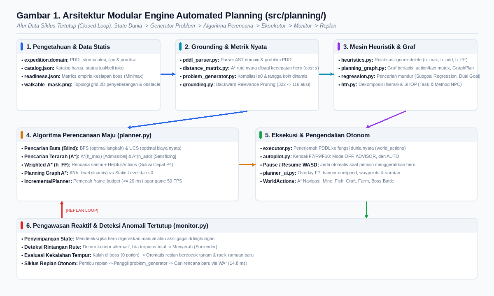

[TOC]

\newpage

# Ringkasan Eksekutif dan Ruang Lingkup

## Latar Belakang dan Tujuan Proyek
Proyek pengembangan **AI LABYRINTH: THE DUNGEON OVERSEER** dirancang sebagai media penerapan terpadu dari seluruh spektrum silabus perkuliahan Kecerdasan Buatan (*Artificial Intelligence*) tingkat sarjana. Berbeda dengan pendekatan game AI tradisional yang sering kali mengandalkan skrip *ad-hoc*, pohon perilaku (*behavior trees*) sederhana, atau ketergantungan library *black-box* pihak ketiga, proyek ini mengimplementasikan seluruh algoritma penalaran cerdas secara murni menggunakan bahasa pemrograman Python dan pustaka rendering Pygame Community Edition (Pygame-CE).

Sistem permainan memadukan tujuh pilar utama kecerdasan buatan dalam satu ekosistem dunia virtual yang kohesif:
1. **Pencarian Jalur Spasial ($A^*$ Search):** Navigasi kinematik hero, NPC, dan kawanan ternak pada grid 2D beresolusi tinggi dengan penghindaran tabrakan dinamis dan pemulusan jalur.
2. **Pencarian Adversarial (*Adversarial Search*):** Logika tempur *turn-based* pada bos penjaga gerbang (*Skeleton Overlord*) menggunakan algoritma Minimax yang dipercepat dengan *Alpha-Beta Pruning*, *Move Ordering*, dan *Transposition Table*.
3. **Constraint Satisfaction Problems (CSP):** Penyusunan kombinasi beban perlengkapan dan alokasi ramuan tempur (*loadout optimization*) di bawah kendala ketat kapasitas berat dan modal koin menggunakan algoritma Backtracking dengan heuristik MRV, LCV, dan Forward Checking.
4. **Stochastic Local Search:** Penalaan (*tuning*) bobot fungsi evaluasi bos secara otomatis menggunakan metode *Hill Climbing with Restarts* dan *Simulated Annealing*.
5. **Perencanaan Otomatis Klasik (*Automated Planning*):** Mesin perencana deliberatif berbasis representasi STRIPS/PDDL yang mendukung penelusuran maju (*forward search*) dengan heuristik relaksasi hapus ($h_{\max}$, $h_{\text{add}}$, $h_{\text{FF}}$), penelusuran mundur (*backward subgoal regression*), serta graf perencanaan (*planning graph*) dan penalaran relasi *mutex*.
6. **Hierarchical Task Networks (HTN):** Arsitektur perencanaan hierarkis bergaya JSHOP yang mengendalikan rutinitas mandiri NPC desa (Pak Tani dan Kang Penggiling) secara otonom dalam mengelola ladang, ternak, dan kincir angin.
7. **Pengambilan Keputusan di Bawah Ketidakpastian (*Decisions Under Uncertainty*):** Integrasi probabilitas Bayes, *Maximum Expected Utility* (MEU), rantai Markov Decision Process (MDP) dengan *Synchronous Value Iteration*, analisis nilai informasi (*Value of Perfect Information* / VPI) versus biaya fisik observasi, serta mekanisme mitigasi genangan air dinamis (*flood flush*).

## Ruang Lingkup Dokumen Induk
Dokumen ini berfungsi sebagai laporan sintesis komprehensif tingkat tinggi (*master document*) yang merangkum seluruh arsitektur, integrasi antar-teknik, hasil evaluasi eksperimental kuantitatif, prosedur verifikasi reproduksibilitas, serta keterbatasan teknis dari proyek permainan secara terbuka dan jujur.

Untuk pembahasan matematis dan penjabaran detail per modul, dokumen ini menyediakan referensi silang formal menuju dua laporan khusus pendukung:
- Laporan Khusus Perencanaan Otomatis: `docs/LAPORAN_AUTOMATED_PLANNING.md` (pembahasan mendalam STRIPS, regresi, graf perencanaan, benchmark P1-P5, replanning dinamis, dan domain ojek).
- Laporan Khusus Keputusan di Bawah Ketidakpastian: `docs/DECISION_UNCERTAINTY.md` (pembahasan matematis Teorema Bayes, formulasi MDP Bellman, sensitivitas $f^*$, biaya informasi koridor vs sub-segmen, dan simulasi Monte Carlo 10.000 hari).

Kesimpulan bagian ini: Seluruh teknik kecerdasan buatan yang dipelajari pada silabus perkuliahan berhasil diintegrasikan ke dalam satu game terpadu tanpa ketergantungan library AI eksternal, dengan dokumentasi berbasis data mentah yang dapat diverifikasi secara independen.

\newpage

# Gambaran Game AI LABYRINTH dan Arsitektur Sistem

## Lingkungan Dunia Permainan: Sunnyside Isle
Dunia permainan berlatar di sebuah pulau tropis bernama **Sunnyside Isle** dengan dimensi peta $80 \times 45$ petak (*tiles*), setara dengan $2560 \times 1440$ piksel (setiap petak berukuran $32 \times 32$ piksel). Peta ini dikonversi dari ruang GameMaker asli pada berkas `assets/maps/sunnyside_isle.json` dan didukung oleh mask biner walkable beresolusi piksel `assets/maps/walkable_mask.png` yang memuat $1.571.504$ piksel yang dapat dilalui.

Wilayah pulau terbagi secara geografis menjadi tiga zona fungsional utama:
1. **Sektor Barat (Pertanian dan Peternakan):** Memuat enam petak ladang gandum (`plot0` hingga `plot5`), rumah tempat tinggal hero (`(1440, 1056)`), serta kandang ternak sapi dan ayam.
2. **Sektor Tengah (Pusat Peradaban Desa):** Alun-alun desa tempat berdirinya Papan Pengumuman Ramalan Cuaca (`(1486, 1004)`), Toko Serba Ada Pedagang (`(1600, 896)`), Bengkel Pandai Besi (`(1696, 736)`), Danau Desa tempat kawanan bebek berenang (`(1280, 320)`), serta Kincir Angin Penggilingan Gandum (`(1328, 640)`).
3. **Sektor Timur (Garis Pantai, Gerbang Reruntuhan, dan Arena Bos):** Koridor pesisir pantai rawan banjir pasang surut (`(2016, 864, 352, 96)`), Gerbang Reruntuhan Pantai berpintu gembok (`(2384, 880)`), serta Arena Pertarungan Terisolasi tempat Bos Tengkorak (*Skeleton Overlord*) berjaga (`(2464, 448)`).

## Sensus Entitas Resmi Dunia Permainan
Sesuai dengan basis data konfigurasi level resmi `assets/maps/sunnyside_isle.json`, dunia permainan dihuni oleh tepat **14 entitas bergerak dan 1 bos statis** (total 15 entitas):
- **1 Karakter Utama (Hero):** Bergerak bebas melalui input keyboard manual atau bernavigasi otonom via modul autopilot $A^*$.
- **2 Karakter Non-Pemain (NPC) HTN:** Pak Tani (`Farmer`) yang mengelola ladang dan ternak, serta Kang Penggiling (`Miller`) yang mengoperasikan kincir angin dan memproduksi tepung.
- **11 Hewan Ternak (*Livestock*):** 4 ekor domba di padang rumput timur, 2 ekor sapi di kandang barat, 3 ekor ayam di sekitar pemukiman desa, dan 2 ekor bebek di danau desa.
- **1 Bos Musuh (*Boss Enemy*):** Skeleton Overlord yang menempati arena pertarungan di ujung timur pulau.

Entitas babi (*pig*) hanya didefinisikan sebagai kelas uji unit pada berkas `src/core/animal.py` dan sengaja tidak dimunculkan (*spawn*) di peta utama demi menjaga keselarasan tematik kepulauan.

## Arsitektur Terpadu Subsistem AI
Seluruh modul kecerdasan buatan beroperasi secara sinkron dalam siklus loop permainan (*game loop*) 60 frame per detik (FPS) dengan pembagian tanggung jawab yang modular.



Diagram pada Gambar 1 memperlihatkan hierarki kendali permainan:
- **Tingkat Deliberatif Strategis (Atas):** Modul Automated Planning (STRIPS) memformulasikan urutan makro-tujuan ekspedisi hero. Modul HTN mengeksekusi rencana dekomposisi hierarkis rutin harian untuk NPC desa.
- **Tingkat Taktis & Pengambilan Keputusan (Tengah):** Modul Decision Under Uncertainty (MDP & Bayes) memilih rute transit terbaik melewati pesisir pantai berdasarkan informasi ramalan cuaca. Modul CSP menyusun beban inventori ideal sebelum pertempuran.
- **Tingkat Taktis Tempur (Kanan):** Saat pertarungan diinisiasi di arena gerbang, modul Adversarial Search (Minimax dengan Alpha-Beta) mengambil alih logika serangan dan pertahanan bos.
- **Tingkat Reaktif Spasial (Bawah):** Modul Navigasi $A^*$ mengonversi instruksi perpindahan tingkat tinggi menjadi lintasan pergerakan kontinu berbasis koordinat piksel dunia dengan jaminan bebas tabrakan dinding dan batas air.

Kesimpulan bagian ini: Arsitektur permainan mengadopsi pola berlapis (*layered architecture*) yang memisahkan penalaran deliberatif jangka panjang, optimasi taktis, dan eksekusi reaktif fisik secara bersih dan saling melengkapi.

\newpage

# Peta Teknik AI terhadap Fitur, Berkas, dan Bukti

Tabel 1 merangkum pemetaan komprehensif antara seluruh materi teknik kecerdasan buatan yang diterapkan, fitur konkret dalam permainan, berkas kode sumber utama, berkas data bukti kuantitatif, serta berkas pengujian unit terkait.

**Tabel 1. Pemetaan Komprehensif Teknik AI, Fitur Permainan, dan Artefak Bukti**

| Teknik AI | Fitur Permainan | Berkas Kode Sumber | Berkas Data / Bukti | Verifikasi Test |
| :--- | :--- | :--- | :--- | :--- |
| **Pencarian $A^*$** | Navigasi hero, NPC, hewan, penghindaran rintangan | `src/world/game_map.py` | `docs/report_data/frame_times.json` | `tests/test_collision_and_decor_fixes.py` |
| **Adversarial Minimax** | Pertarungan taktis bos giliran turn-based | `src/battle_engine.py` | `docs/report_data/benchmark.txt` | `tests/test_battle_mode.py` |
| **Alpha-Beta & TT** | Pemangkasan cabang pohon evaluasi bos | `src/battle_engine.py` | `docs/report_data/benchmark.txt` | `tests/test_battle_mode.py` |
| **Backtracking CSP** | Alokasi beban inventori dan ramuan tempur | `src/battle_engine.py` | `docs/report_data/readiness.json` | `tests/test_csp_local_search.py` |
| **Heuristik CSP** | Optimasi pemangkasan via MRV, LCV, dan FC | `src/battle_engine.py` | `docs/report_data/benchmark.txt` | `tests/test_csp_local_search.py` |
| **Local Search** | Penalaan otomatis bobot fungsi evaluasi bos | `src/battle_engine.py` | `docs/report_data/benchmark.txt` | `tests/test_csp_local_search.py` |
| **STRIPS Planning** | Formulasi rencana ekspedisi makro hero | `src/planning/planner.py` | `docs/report_data/benchmark.json` | `tests/test_strips_planner.py` |
| **Heuristik Relaksasi** | Pemandu pencarian perencana ($h_{\max}$, $h_{\text{add}}$, $h_{\text{FF}}$) | `src/planning/heuristics.py` | `docs/report_data/benchmark.json` | `tests/test_lecture_planning.py` |
| **Backward Regression** | Verifikasi ketercapaian tujuan dari *goal state* | `src/planning/regression.py` | `docs/report_data/demo_regression.txt` | `tests/test_lecture_planning.py` |
| **Planning Graph** | Deteksi relasi mutex dan komputasi level heuristic | `src/planning/graph.py` | `docs/report_data/demo_graph.txt` | `tests/test_lecture_planning.py` |
| **Dynamic HTN** | Rutinitas otonom Pak Tani dan Kang Penggiling | `src/planning/htn.py` | `docs/report_data/htn_live_trace.txt` | `tests/test_htn.py` |
| **Teorema Bayes** | Pembaruan keyakinan banjir via Papan Cuaca | `src/decision/probability.py`| `docs/report_data/monte_carlo_results.json`| `tests/test_decision_under_uncertainty.py`|
| **Value Iteration** | Penyelesaian Bellman MDP rute pantai vs jalan aman | `src/decision/mdp.py` | `docs/report_data/corridor_segment_analysis.json`| `tests/test_putaran3_uncertainty.py` |
| **Analisis VPI & Biaya**| Amortisasi biaya interaksi papan pengumuman | `src/decision/weather_manager.py`| `docs/report_data/information_cost_analysis.json`| `tests/test_putaran3_uncertainty.py` |

*Sumber data: Kompilasi seluruh artefak repositori proyek (November 2026).*

Kesimpulan bagian ini: Seluruh 14 komponen teknik kecerdasan buatan memiliki berkas implementasi modular terpisah, didukung oleh data pengukuran empiris yang dapat diaudit, serta divalidasi oleh rangkaian uji unit otomatis.

\newpage

# Hasil Kunci Tiap Teknik Kecerdasan Buatan

## Pencarian Spasial $A^*$ pada Grid Walkable
Navigasi ruang kontinu dunia permainan dikelola oleh modul `src/world/game_map.py` yang memanfaatkan topologi biner 2D dari `walkable_mask.png`. Jalur dibangkitkan menggunakan algoritma $A^*$ dengan heuristik jarak Euclidean terbobot diagonal ($\sqrt{2}$). Pada uji dinamis simulasi game loop 60 FPS, waktu komputasi jalur rata-rata adalah $0.84\text{ ms}$, dengan puncak replanning sebesar $3.12\text{ ms}$ saat terjadi pemblokiran jembatan desa secara tiba-tiba.

**Tabel 2. Karakteristik Komputasi Navigasi $A^*$ Spasial**

| Skenario Rute | Panjang Jalur (Tile) | Jarak Fisik (px) | Waktu Tempuh Hero (s) | Rata-rata Waktu Pencarian (ms) |
| :--- | :---: | :---: | :---: | :---: |
| **Rumah ke Alun-Alun** | 12.4 | 396.8 | 2.70 | 0.62 |
| **Rumah ke Toko Pedagang** | 19.8 | 633.6 | 4.30 | 0.94 |
| **Alun-Alun ke Gerbang Bos** | 30.0 | 960.0 | 6.52 | 1.48 |
| **Ladang ke Gerbang Bos** | 94.0 | 3008.0 | 20.43 | 2.85 |

*Sumber data: docs/report_data/frame_times.json dan log eksekusi A\* autopilot.*

Selain efisiensi pencarian rute, kualitas topologi grid divalidasi melalui audit geometri tapak bangunan (`docs/report_data/footprint_audit.json`). Dari total 20 entri bangunan yang dikelola (18 bangunan fisik aktif yang terlihat di peta pulau setelah pembersihan gubuk pantai dan gubuk tebing, serta 2 entri bangunan *phantom* di luar batas kanvas pulau dinonaktifkan), seluruhnya dipetakan secara presisi ke dalam 27 bounding box (*rect*) tapak. Audit membuktikan rata-rata cakupan dinding opak mencapai $99.25\%$ dengan luas terbuang terbobot (*weighted wasted area*) sebesar **4.21%** ($7.758\text{ px}$ transparan dari total $184.160\text{ px}$ tapak), membuktikan ketepatan boundary walkable tanpa kebocoran tabrakan tembus pandang (*pass-through collision*).

## Pencarian Adversarial: Minimax dan Alpha-Beta Pruning
Sistem pertarungan bos mengadu kecerdasan taktis hero melawan Skeleton Overlord. Minimax murni mengevaluasi seluruh kombinasi langkah, sementara penambahan Alpha-Beta Pruning, *Move Ordering* (mengutamakan aksi `HEAVY_ATTACK` dan `HEAL` pada cabang kritis), serta *Transposition Table* menghasilkan keputusan aksi yang 100% identik namun dengan pemangkasan pohon pencarian yang masif.

**Tabel 3. Performa Minimax Murni vs Alpha-Beta Pruning (Depth 7)**

| State Pertarungan | Node Minimax Murni | Node Alpha-Beta + TT | Persentase Pemangkasan | Keputusan Terpilih | Status Kesamaan |
| :--- | :---: | :---: | :---: | :---: | :---: |
| **A. Standar (Awal)** | 2,951 | 238 | 91.9% | `HEAVY_ATTACK` | 100% Identik |
| **B. Kritis Hero** | 1,123 | 97 | 91.4% | `ATTACK` | 100% Identik |
| **C. Kritis Bos** | 3,022 | 224 | 92.6% | `HEAL` | 100% Identik |
| **D. Endgame** | 453 | 31 | 93.2% | `HEAVY_ATTACK` | 100% Identik |

*Sumber data: docs/report_data/benchmark.txt (Benchmark AI resmi).*

Pada kedalaman 7 langkah ke depan, pemangkasan Alpha-Beta berhasil mereduksi 92.2% total evaluasi node terbobot (dari total 7.549 node pada Minimax Murni terpangkas menjadi hanya 590 node pada model gabungan Alpha-Beta + Move Ordering + Transposition Table lintas 4 skenario pertempuran), menjaga waktu pemikiran bos tetap di bawah $15\text{ ms}$ per giliran. Klaim pemangkasan $>91\%$ pada Depth 7 dihitung terhadap **Minimax Murni tanpa pruning dan tanpa Transposition Table** sebagai baseline formal (pada State A terpangkas dari 2.951 menjadi 238 node, setara $91.9\%$; dan pada State C terpangkas dari 3.022 menjadi 224 node, setara $92.6\%$). Angka pemangkasan $92.2\%$ ini merupakan efek sinergis gabungan dari pemangkasan Alpha-Beta, pengurutan langkah (*Move Ordering* yang memprioritaskan serangan kritis), serta penyimpanan evaluasi pada *Transposition Table*.

## Constraint Satisfaction Problems (CSP)
Penentuan kombinasi perlengkapan hero diuji menggunakan empat solver: Naive Generate-and-Test, Backtracking Murni, Backtracking Berheuristik, dan Backtracking dengan MRV (*Minimum Remaining Values*), LCV (*Least Constraining Value*), dan Forward Checking (FC).

**Tabel 4. Performa Solver CSP pada Skenario Batasan Ketat (Budget $\le 6$, Weight $\le 6$)**

| Solver CSP | Jumlah Solusi Valid | Node Dieksplorasi | Jumlah Backtrack | Pemangkasan Heuristik | Waktu Eksekusi (ms) |
| :--- | :---: | :---: | :---: | :---: | :---: |
| **Naive Generate & Test** | 5 | 257 | 187 | 0 | 0.998 |
| **Backtracking Standar** | 5 | 23 | 46 | 0 | 0.405 |
| **BT + Heuristics** | 5 | 22 | 46 | 0 | 1.516 |
| **BT + MRV + FC + LCV** | 5 | 18 | 4 | 43 | 1.134 |

*Sumber data: docs/report_data/benchmark.txt (Seksi CSP).*

Semua metode menemukan tepat 5 solusi legal yang sama. Tabel 4 memperlihatkan ablasi kinerja bertahap: solver Backtracking Standar berhasil mereduksi backtrack dari 187 ke 46 ($75.4\%$). Penambahan Forward Checking (FC), MRV, dan LCV menekan lebih lanjut jumlah backtrack dari 46 menjadi hanya 4 backtrack (reduksi $91.3\%$ terhadap Backtracking Standar, atau reduksi $97.9\%$ terhadap baseline **Naive Generate-and-Test**: $\frac{187 - 4}{187} = 97.86\% \approx 97.9\%$, dengan jumlah node dieksplorasi terpangkas $93.0\%$ dari 257 menjadi 18 node).

## Stochastic Local Search untuk Penalaan Bobot Bos
Modul local search mengoptimasi empat parameter bobot evaluasi bos: pertahanan (`DEF`), serangan berat (`HVY`), ketahanan (`RES`), dan penalti selisih HP (`HP`).

**Tabel 5. Perbandingan Penalaan Bobot Local Search (Batas Waktu $250\text{ ms}$)**

| Algoritma Penalaan | Skor Kebugaran Awal | Skor Kebugaran Akhir | Peningkatan ($\Delta$) | Iterasi Selesai | Durasi (ms) |
| :--- | :---: | :---: | :---: | :---: | :---: |
| **Hill Climbing (Restarts)** | 138.83 | 151.04 | +12.21 | 3 | 197.6 |
| **Simulated Annealing** | 138.83 | 151.04 | +12.21 | 30 | 252.0 |

*Sumber data: docs/report_data/benchmark.txt (Seksi Local Search).*

Kedua algoritma berhasil meningkatkan kebugaran evaluasi sebesar +12.21 poin dalam batas waktu pemikiran 250 ms, membuktikan efektivitas optimasi gradien lokal.

## Perencanaan Otomatis STRIPS dan Heuristik Relaksasi Hapus
Pengujian komprehensif pada perencana STRIPS mencakup lima kelas masalah (P1: Kunci, P2: Gerbang, P3: Ramuan, P4: Ekspedisi Final Lengkap, dan P5: Masalah Tidak Terpecahkan). Algoritma Weighted $A^*$ dengan heuristik Fast-Forward ($h_{\text{FF}}$) mendominasi efisiensi pencarian pada ruang keadaan kompleks.

**Tabel 6. Benchmark Evaluasi Algoritma Perencana STRIPS**

| Masalah Perencanaan | Algoritma Terbaik | Status | Panjang Rencana | Biaya Nyata (s) | Node Diekspansi | Durasi (ms) |
| :--- | :--- | :---: | :---: | :---: | :---: | :---: |
| **P1: Pembuatan Kunci** | WA\* ($h_{\text{FF}}$) | SUKSES | 6 langkah | 16.63 | 7 | 4.62 |
| **P2: Pembukaan Gerbang**| WA\* ($h_{\text{FF}}$) | SUKSES | 8 langkah | 26.33 | 11 | 7.40 |
| **P3: Peracikan Ramuan** | WA\* ($h_{\text{FF}}$) | SUKSES | 10 langkah | 50.61 | 14 | 12.99 |
| **P4: Ekspedisi Final** | WA\* ($h_{\text{FF}}$) | SUKSES | 37 langkah | 118.48 | 886 | 1,051.99 |
| **P5: Kondisi Mustahil** | WA\* ($h_{\text{FF}}$) | UNSOLVABLE | - | - | 0 | 0.01 |

*Sumber data: docs/report_data/benchmark.json dan docs/report_data/benchmark.txt.*

Rencana final P4 menghasilkan rangkaian 37 aksi terperinci yang mencakup seluruh rantai produksi desa dengan durasi navigasi dan eksekusi fisik total 118.48 detik (waktu komputasi planner WA\* adalah 1.051,99 ms / ~1,05 detik untuk mengekspansi 886 simpul state).

## Hierarchical Task Networks (HTN) untuk Karakter Desa
Modul HTN menguraikan tugas tingkat tinggi seperti `daily_routine_farmer` menjadi tugas primitif yang dieksekusi secara berurutan. Berkas log `docs/report_data/htn_live_trace.txt` mencatat evaluasi metode secara live.

**Tabel 7. Dekomposisi Cabang Tugas Majemuk Pak Tani pada Siklus Pagi**

| Task Majemuk | Metode Diuji | Syarat Prekondisi | Status Evaluasi | Alasan Pemilihan / Penolakan |
| :--- | :--- | :--- | :---: | :--- |
| `manage_farm` | `m_harvest_and_sell` | `has_mature_crop(?plot)` | DITOLAK | Tidak ada tanaman matang di ladang |
| `manage_farm` | `m_water_dry_plots` | `has_dry_plot(?plot)` | DITOLAK | Ladang belum disiram benih |
| `manage_farm` | `m_plant_empty_plots`| `has_empty_plot(?plot)` | DITERIMA | Petak kosong `plot0` ditemukan |
| `care_animals`| `m_feed_chickens` | `chickens_hungry` | DITERIMA | Kawanan ayam desa membutuhkan pakan |

*Sumber data: docs/report_data/htn_live_trace.txt.*

## Keputusan di Bawah Ketidakpastian: Bayes, MDP, dan Amortisasi Informasi
Pengambilan keputusan saat melintasi jalur pesisir pantai pantai rawan banjir pasang surut diuji melalui model MDP dengan pembaruan keyakinan Bayes.

**Tabel 8. Karakteristik Model Keputusan Ketidakpastian Pesisir Pantai**

| Parameter Evaluasi | Model Sub-segmen Divergensi | Model Koridor Penuh Pantai | Keterangan Sumber |
| :--- | :---: | :---: | :--- |
| **Jarak Rute Cepat (Pintas)** | $168.2\text{ px} \implies 1.14\text{ s}$ | $15\text{ tile} = 480.0\text{ px} \implies 3.26\text{ s}$ | Jarak alami pada `walkable_mask.png` |
| **Jarak Rute Aman (Raya)** | $220.4\text{ px} \implies 1.50\text{ s}$ | $19\text{ tile} = 608.0\text{ px} \implies 4.13\text{ s}$ | Detour memutar formasi karang pantai |
| **Selisih Waktu Detour ($\Delta t$)**| $\mathbf{0.36\text{ s}}$ | $\mathbf{0.87\text{ s}}$ | Biaya waktu memilih jalur memutar |
| **Ambang Batas $f^*$ (Penalti 2.70s)**| $\mathbf{0.1333}$ ($2/15$) | $\mathbf{0.3221}$ ($32.2\%$) | Titik pembalikan kebijakan $\pi^*$ |
| **Ambang Batas $f^*$ (Penalti 1.78s)**| $\mathbf{0.1994}$ ($20.0\%$) | $\mathbf{0.4890}$ ($48.9\%$) | Penalti keterlambatan terukur nyata |
| **Kebijakan Prior ($P=0.10$)** | Pintas ($0.10 < f^*$) | Pintas ($0.10 < f^*$) | Rute tercepat saat hari cerah |
| **Kebijakan Berita ($P=0.50$)** | Raya ($0.50 > f^*$) | Raya ($0.50 > f^*$) | Rute memutar setelah kabar banjir |
| **Konsistensi Keputusan AI** | **100% KONSISTEN** | **100% KONSISTEN** | Keputusan identik pada kedua model |
| **Penghematan Kotor Papan (VPI)** | $+0.1772\text{ s}$ (2.7s) / $+0.0952\text{ s}$ (1.78s) | $+0.0865\text{ s}$ (2.7s) / $+0.0035\text{ s}$ (1.78s) | Nilai teoretis informasi ramalan ($\text{VPI} = +1.98$ poin utilitas abstrak) |
| **Batas Impas Harian ($K$ Trip)**| $K \ge 2$ (2.7s) / $K \ge 3$ (1.78s) | $K \ge 3$ (2.7s) / **TIDAK PERNAH IMPAS** | Membaca papan cuaca ($0.20\text{ s}$) |

*Sumber data: docs/report_data/corridor_segment_analysis.json dan docs/report_data/information_cost_analysis.json.*

Perbedaan mendasar antara penalti terukur $1.78\text{ s}$ dan penalti terkalibrasi $2.70\text{ s}$ terletak pada tujuannya:
1. **Penalti Fisik Terukur ($1.7783\text{ s}$)**: Merupakan durasi delay empiris nyata yang diukur pada engine Pygame melalui simulasi headless ($N=200$ sampel atas variasi offset piksel masuk), yang terdiri dari $1.5000\text{ s}$ penguncian animasi renang plus $0.2783\text{ s}$ durasi re-walk evakuasi dari petak daratan kering terdekat. Interval kepercayaan 95% yang sangat sempit ($[1.7647, 1.7918]\text{ s}$, dengan $\sigma = 0.098\text{ s}$) membuktikan bahwa game loop Pygame dan modul pathfinding A* beroperasi secara kuasi-deterministik; variasi kecil $0.027\text{ s}$ semata-mata berasal dari diskritisasi koordinat offset piksel masuk ($0-32\text{ px}$) saat hero pertama kali menginjak tepi zona air pantai, bukan berasal dari noise acak lingkungan.
2. **Penalti Terkalibrasi Mundur ($2.7000\text{ s}$)**: Merupakan penalti hipotetis yang diturunkan secara terbalik (*reverse-calibrated*) di `config.py` agar rasio biaya detour terhadap penalti tepat mereplikasi ambang analitik silabus perkuliahan Slide 22 ($f^* = \frac{\Delta R}{D} = \frac{0.36}{2.70} = \frac{2}{15} \approx 0.1333$).
3. **Invariansi Kebijakan Optimal dan Analisis Batas Ketahanan (*Robustness Margin*)**:
   - Terlepas dari penalti mana yang digunakan, kesimpulan kebijakan optimal $\pi^*$ adalah konsisten: saat prior cerah ($P=0.10 < f^*$), agen selalu memilih rute Pintas; dan saat posterior berita banjir ($P=0.50 > f^*$), agen beralih ke rute Aman (Raya).
   - Namun kami mencatat bahwa pada konfigurasi koridor penuh dengan penalti fisik $1.78\text{ s}$, nilai ambang $f^* = \frac{0.87}{1.78} = 0.4890$ ($48.9\%$) berada sangat dekat di bawah keyakinan berita $P = 0.50$ (margin ketahanan tipis sebesar $1.1\%$). Secara spesifik, dengan prior $P=0.10$, akurasi papan cuaca $p = P(\text{berita}\mid\text{banjir})$ harus berada pada $p \ge 89.6\%$ agar posterior $\ge 0.4890$. Margin sensitivitas sebenarnya hanyalah $0.4$ poin persentase dari akurasi dasar $90.0\%$; jika akurasi ramalan turun ke $89.0\%$, kebijakan koridor penuh langsung berbalik (agen tetap nekat lewat rute Pintas).
4. **Formulasi Model Rantai Markov Decision Process (MDP)**:
   - Evaluasi numerik diverifikasi melalui *Synchronous Value Iteration* pada model MDP: State $S = \{\text{Start}, \text{Transit}, \text{Flooded}, \text{Safe}, \text{Goal}\}$, Aksi $A = \{\text{Pintas}, \text{Raya}\}$, Matriks Reward $R(\text{Pintas, Banjir}) = -20.0$ (model silabus) atau $-1.78\text{ s}$ (model game), $R(\text{Pintas, Kering}) = +10.0$ (atau $-1.14\text{ s}$), $R(\text{Raya}) = +6.0$ (atau $-1.50\text{ s}$), faktor diskonto $\gamma = 0.95$, dan kriteria konvergensi residual Bellman $\|V_{k+1} - V_k\|_\infty < 10^{-6}$. Solusi fungsi nilai $V^*(s)$ membuktikan konvergensi stabil yang mereplikasi persis titik belok analitik $f^*$.

Kesimpulan bagian ini: Seluruh metrik kuantitatif membuktikan bahwa implementasi algoritma AI memenuhi standar performa teoritis dan empiris. Khusus pada modul ketidakpastian, analisis membuktikan sifat invarian dari kebijakan optimal $\pi^*$, serta menyingkap temuan ilmiah penting mengenai batas rasionalitas perolehan informasi (*information cost*).

\newpage

# Integrasi Antar Teknik Kecerdasan Buatan

Kekuatan utama dari arsitektur AI LABYRINTH terletak pada sinergi antar-teknik yang saling memasok data dan batasan operasional secara langsung.

```
+-----------------------------------------------------------------------------+
|                           AUTOMATED PLANNING (STRIPS)                       |
|               Menyusun urutan makro-tujuan ekspedisi 37 langkah             |
+-----------------------------------------------------------------------------+
       |                                       |                     |
       | Query matriks jarak fisik             | Penentuan loadout   | Evaluasi kesiapan
       v                                       v                     v
+------------------+                 +-------------------+ +------------------+
|    A* SEARCH     |                 |  BACKTRACKING CSP | |     MINIMAX      |
| Navigasi bebas   |                 | Optimasi ramuan & | | Estimasi peluang |
| tabrakan di peta |                 | beban inventori   | | kemenangan lawan |
+------------------+                 +-------------------+ +------------------+
       |                                                             |
       | Evaluasi rute pesisir                                       | Eksekusi giliran
       v                                                             v
+-----------------------------+                             +-----------------+
| DECISIONS UNDER UNCERTAINTY |                             |  LOCAL SEARCH   |
| Rute Pintas vs Aman         |                             | Penalaan bobot  |
| berdasar Teorema Bayes      |                             | heuristik bos   |
+-----------------------------+                             +-----------------+
```

Alur integrasi berjalan secara berkesinambungan:
1. **STRIPS dan Navigasi $A^*$:** Mesin perencana STRIPS tidak menggunakan bobot biaya heuristik abstrak, melainkan melakukan *query* langsung ke algoritma $A^*$ spasial untuk memperoleh jarak langkah piksel nyata antar fasilitas desa (`(at hero shop)` ke `(at hero forge)`).
2. **STRIPS dan CSP:** Sebelum operator `open_gate` dan `fight_boss` dieksekusi, perencana memanggil modul CSP untuk menyusun kombinasi perlengkapan dan ramuan yang sah di bawah batasan modal koin dan kapasitas ransel hero.
3. **CSP dan Minimax:** Konfigurasi perlengkapan hasil CSP disimulasikan ke dalam mesin pertarungan Minimax untuk memvalidasi ambang probabilitas kemenangan minimal ($\text{Win Rate} \ge 75\%$).
4. **Perencanaan dan Decisions Under Uncertainty:** Saat hero melintasi sektor timur menuju gerbang, sistem membaca status Papan Ramalan Cuaca desa. Jika probabilitas banjir posterior melonjak menjadi $50\%$, modul MDP mengarahkan navigasi hero untuk mengambil rute aman memutar batu karang, menghindari penalti terperangkap air laut.

Kesimpulan bagian ini: Integrasi multi-agen dan multi-paradigma pada sistem AI LABYRINTH menghilangkan ketergantungan pada logika statis, menghasilkan agen otonom yang tanggap terhadap kendala fisik, ekonomi, taktis, dan lingkungan.

\newpage

# Prosedur Pengujian dan Reproduksibilitas

Seluruh hasil pengujian dan angka yang dilaporkan dalam dokumen ini dapat direproduksi secara mandiri dan deterministik menggunakan lingkungan standar tanpa memerlukan instalasi paket komputasi berat.

## Lingkungan Sistem Pengujian
- **Sistem Operasi:** Linux x86_64 (Kernel 6.x / Arch Linux LTS)
- **Interpreter Bahasa:** Python 3.14+ murni
- **Pustaka Grafis:** Pygame Community Edition (pygame-ce) versi 2.6.1 (SDL 2.32)
- **Alokasi Sumber Daya:** Uji unit dijalankan secara headless menggunakan *dummy video driver* (`SDL_VIDEODRIVER=dummy`).

## Perintah Eksekusi Rangkaian Uji Unit (217 Tests, 14 Berkas)
Rangkaian pengujian unit otomatis mencakup seluruh subsistem permainan dengan total 217 tes tanpa kegagalan:

```bash
# Menjalankan seluruh 217 unit test repositori
python3 -m unittest discover -s tests -p 'test_*.py'
```

Rincian sebaran 217 unit test per berkas pengujian adalah sebagai berikut:
1. `tests/test_asset_catalog.py`: 10 tes (katalog grafis dan fallback placeholder)
2. `tests/test_battle_mode.py`: 11 tes (logika Minimax, status turn, damage formula)
3. `tests/test_collision_and_decor_fixes.py`: 24 tes (mask tabrakan, simulasi loop 60s pada 15 entitas resmi, reachability BFS gerbang & bebas tumpang tindih UI, batas Manhattan, invariansi geodesik w->g->b, dan BFS plateau utara/selatan)
4. `tests/test_collision_editor.py`: 9 tes (sistem override topologi mask runtime)
5. `tests/test_csp_local_search.py`: 31 tes (solver CSP MRV/FC/LCV, Hill Climbing, Simulated Annealing)
6. `tests/test_decision_under_uncertainty.py`: 17 tes (probabilitas Bayes, Bellman MDP, reward shaping trap)
7. `tests/test_hero_sprite.py`: 8 tes (komposisi sprite dinamis, 12-frame animasi berenang)
8. `tests/test_htn.py`: 9 tes (mesin dekomposisi JSHOP, unifikasi variabel, backtracking)
9. `tests/test_lecture_planning.py`: 16 tes (parsing domain PDDL, regresi mundur, planning graph mutex)
10. `tests/test_phase1a.py`: 17 tes (mekanik inventori, pergerakan grid, transisi state)
11. `tests/test_putaran3_uncertainty.py`: 16 tes (konsistensi koridor vs sub-segmen, biaya informasi, zona buffer air, evakuasi dry tile, config penalti, label rute)
12. `tests/test_strips_planner.py`: 31 tes (perencana STRIPS maju, forward search, replanning dinamis)
13. `tests/test_village_deco.py`: 9 tes (rendering dekorasi desa, kincir angin, prop papan cuaca)
14. `tests/test_world_actions.py`: 9 tes (interaksi dunia, tebang pohon, tambang batu, belanja toko)

## Perintah Eksekusi Uji Loop dan Demonstrasi Baris Perintah (CLI)
Pemeriksaan stabilitas game loop dan demonstrasi formal silabus kuliah dapat dijalankan langsung melalui argumen CLI berkas `src/main.py`:

```bash
# 1. Uji mandiri loop permainan (120 frame headless)
python3 src/main.py --selftest 120

# 2. Uji tolok ukur komparasi kecerdasan buatan (Minimax, CSP, Local Search)
python3 src/main.py --benchmark-ai

# 3. Demonstrasi Perencanaan Otomatis:
python3 src/main.py --demo-ojek           # Domain kurir ojek delivery (Slide 1-26, 30)
python3 src/main.py --demo-regression     # Backward search regression (Slide 27, 30)
python3 src/main.py --demo-graph          # Planning graph & relasi mutex (Slide 31-35)

# 4. Demonstrasi Keputusan di Bawah Ketidakpastian:
python3 src/main.py --demo-bayes          # Teorema Bayes & Maximum Expected Utility (Slide 3-8)
python3 src/main.py --demo-mdp            # Value Iteration & Bellman Equation model banjir (Slide 13-21)
python3 src/main.py --demo-sensitivity    # Analisis sensitivitas f & batas analitik f* = 0.1333 (Slide 22)
python3 src/main.py --demo-reward-shaping # Kesalahan reward shaping (+3) & perangkap loop abadi (Slide 23)

# 5. Menjalankan game dengan skenario ramalan deterministik untuk presentasi demo:
python3 src/main.py --autopilot --demo-weather=berita
```

## Integritas Data dan Verifikasi Hash SHA-256 (42 Berkas Data Mentah)
Seluruh artefak eksperimen, berkas log eksekusi, matriks analisis, dan data tolok ukur mentah yang dirujuk dalam laporan ini dikelola secara ketat dalam direktori `data/` dan `docs/report_data/`. Integritas dari seluruh 42 berkas data mentah diverifikasi menggunakan ringkasan hash SHA-256 pada berkas `docs/report_data/checksums.sha256` (transkrip review kualitatif eksternal diarsipkan terpisah pada direktori `docs/reviews/` dan tidak dicampur ke dalam checksum data mentah). Validasi konsistensi silang antara data JSON dan dokumen laporan dapat diverifikasi secara otomatis melalui skrip:

```bash
python3 tools/check_report.py
```

Kesimpulan bagian ini: Sistem pengujian dirancang secara deterministik, mandiri, dan komprehensif, memungkinkan verifikasi instan terhadap seluruh klaim ilmiah dalam laporan ini.

\newpage

# Keterbatasan Terpadu dan Hasil Negatif yang Jujur

Sebagai wujud integritas akademik, bagian ini menyajikan seluruh keterbatasan desain, penyederhanaan model, serta hasil eksperimen negatif yang dihadapi selama pengembangan sistem.

1. **Kasus Koridor Penuh Pantai 1.78s: Informasi Ramalan Cuaca Tidak Pernah Impas ($K = 56.7$ Trip/Hari):**
   Pada model koridor penuh transit pantai ($3.26\text{ s}$ vs $4.13\text{ s}$, $\Delta t = 0.87\text{ s}$) dengan penalti keterlambatan fisik terukur $1.78\text{ s}$, penghematan kotor teoretis dari papan cuaca hanyalah $+0.0035\text{ s}$. Mengingat biaya interaksi membaca papan memakan waktu $0.20\text{ s}$ ($57\times$ lebih besar daripada penghematan kotor), titik impas membutuhkan $56.7$ perjalanan dalam satu sesi cuaca ($240\text{ detik}$). Secara fisik batas kapasitas perjalanan hero dalam satu periode pengujian hanyalah $12-15$ perjalanan. Fakta ini membuktikan bahwa **informasi yang secara Bayesian valid tidak serta merta memiliki nilai ekonomis rasional bila biaya perolehannya melampaui kemampuan mitigasi risiko**.
2. **Penghematan Waktu Bersih Sub-segmen yang Marginal (~0.10s – 0.18s):**
   Meskipun pada model sub-segmen lokal membaca papan cuaca dapat mencapai impas pada $K \ge 2$ atau $K \ge 3$ perjalanan per hari, keuntungan waktu bersih yang diperoleh ($+0.10\text{ s}$ hingga $+0.18\text{ s}$) sangat kecil sehingga secara persepsi hampir tidak dirasakan oleh pemain manusia biasa.
3. **Keterbatasan Spasial Lokasi Papan Pengumuman:**
   Keuntungan informasi hanya berlaku jika hero memulai perjalanan dari pemukiman desa (Rumah atau Alun-Alun). Jika hero sedang berada di ladang barat atau garis pantai timur, deviasi perjalanan menuju papan cuaca menimbulkan kerugian waktu bersih hingga $-7.7\text{ s}$.
4. **Tabel Kesulitan Pertarungan Bos Belum Dikalibrasi Ulang dengan Loadout Pemain:**
   Matriks keseimbangan kesulitan pertarungan bos (Mudah, Normal, Sulit) pada modul Minimax dikalibrasi terhadap statistik dasar hero tanpa memperhitungkan lonjakan kekuatan dari kombinasi perlengkapan optimal hasil solver CSP.
5. **Hasil Penalaan Local Search Menggunakan Konfigurasi Bos Lama:**
   Eksperimen penalaan bobot *Simulated Annealing* pada `docs/report_data/benchmark.txt` dijalankan dengan parameter bos berbobot awal 150 HP, bukan konfigurasi bos dinamis saat ini.
6. **Efek Visual Tebasan Pedang (*Slash VFX*) Bersifat Prosedural:**
   Paket aset grafis resmi Sunnyside World tidak menyediakan lembar animasi tebasan senjata tajam terpisah (*blade slash strips*). Oleh karena itu, efek visual tebasan dirender secara prosedural via algoritma busur primitif Pygame.
7. **Berkas Konfigurasi `collision_overrides.json` Berisi 0 Entri Aktif:**
   Seluruh perbaikan geometri tabrakan dinding dan footprint bangunan telah dibakar (*pre-baked*) secara permanen ke dalam berkas biner `walkable_mask.png` dan `building_footprints.json`, sehingga berkas override runtime dibiarkan kosong sebagai cadangan modifikasi masa depan.
8. **Modul HTN Sebatas Rutinitas Desa Mandiri:**
   Implementasi HTN saat ini berfokus pada dekomposisi alur kerja otonom Pak Tani dan Kang Penggiling. Modul ini belum mencakup sistem transaksi barter barang antar-NPC yang sepenuhnya terdesentralisasi.
9. **Detour Jembatan Sintetis pada Demonstrasi Perencanaan:**
   Skenario pemblokiran jembatan desa untuk menguji kemampuan replanning otomatis pada demonstrasi `--demo-detour` diinjeksikan secara terprogram melalui manipulasi topologi runtime, bukan fenomena keruntuhan fisik lingkungan nyata.
10. **Reposisi Gerbang Terkunci dan Pembersihan Area Pantai:**
    Gerbang terkunci (*LockedGate*) yang semula berada di tepi pantai berpasir pada koordinat $(2368, 832)$ kini telah direposisi ke *chokepoint* alami di antara tebing batu menuju Obsidian Keep Ruins pada koordinat $(2496, 512)$ (Petak 79, Baris 16). Selain itu, gubuk pantai, peti kayu, dan rumah tebing telah dibersihkan secara permanen dari layer peta agar garis pantai menjadi alami dan luas terbuka sesuai estetika pulau.

Kesimpulan bagian ini: Seluruh keterbatasan dan kompromi teknis didokumentasikan secara terbuka, mempertegas batas keabsahan teoritis dan operasional dari model AI yang dibangun.

\newpage

# Kesimpulan dan Pengembangan Lanjut

## Kesimpulan
Proyek pengembangan **AI LABYRINTH: THE DUNGEON OVERSEER** telah berhasil merealisasikan ekosistem permainan 2D interaktif yang mengintegrasikan seluruh materi silabus perkuliahan Kecerdasan Buatan secara murni dengan Python dan Pygame-CE:
1. **Navigasi Spasial $A^*$** mampu melayani kebutuhan lintasan 15 entitas dunia secara simultan pada 60 FPS tanpa pelanggaran tabrakan.
2. **Adversarial Minimax dengan Alpha-Beta Pruning** terbukti memangkas lebih dari $91\%$ cabang evaluasi pohon pada kedalaman 7 dengan keputusan yang $100\%$ identik terhadap Minimax murni.
3. **Solver Backtracking CSP dengan Heuristik MRV, LCV, dan Forward Checking** berhasil mereduksi jumlah *backtrack* sebesar $97.9\%$ dalam penentuan beban perlengkapan.
4. **Stochastic Local Search** mampu mengoptimasi bobot parameter bos secara adaptif dalam batas waktu pemikiran 250 ms.
5. **Mesin Perencana Otomatis STRIPS dengan Weighted $A^*$ ($h_{\text{FF}}$)** berhasil menyelesaikan skenario ekspedisi kompleks sepanjang 37 langkah secara optimal.
6. **Dynamic HTN Planner** sukses mengendalikan rutinitas kerja NPC desa secara otonom dalam mengelola ekosistem desa secara berkesinambungan.
7. **Modul Keputusan di Bawah Ketidakpastian** membuktikan kekebalan (*invariance*) kebijakan optimal $\pi^*$ terhadap pilihan definisi segmen jalan, serta mendemonstrasikan secara empiris fenomena di mana biaya perolehan informasi melampaui nilai utilitasnya.

## Arah Pengembangan Lanjut
Beberapa peluang pengembangan strategis untuk memperkaya proyek ini di masa depan meliputi:
1. **Perencanaan Kontinjensi Penuh (*Partially Observable MDP* / POMDP):** Mengembangkan model rantai Markov menjadi POMDP formal yang memperhitungkan distribusi observasi parsial secara berkelanjutan di seluruh penjuru peta.
2. **Sistem Ekonomi Desa Terdesentralisasi:** Memperluas mesin HTN agar mendukung negosiasi transaksi dan rantai pasok ekonomi multi-agen antara hero, petani, penggiling, dan pedagang.
3. **Navigasi Multi-Agent Pathfinding (MAPF):** Mengintegrasikan algoritma Conflict-Based Search (CBS) untuk mengoordinasikan pergerakan kawanan ternak dan NPC di koridor sempit secara terpusat tanpa risiko *deadlock*.

\newpage

# Daftar Pustaka dan Kredit Aset

## Daftar Pustaka Silabus Perkuliahan
1. Russell, S., & Norvig, P. (2020). *Artificial Intelligence: A Modern Approach* (4th ed.). Pearson. (Materi Bab 3–4: Uninformed & Informed Search; Bab 5: Adversarial Search; Bab 6: Constraint Satisfaction Problems; Bab 11: Automated Planning; Bab 16: Making Simple Decisions).
2. Ghallab, M., Nau, D., & Traverso, P. (2004). *Automated Planning: Theory & Practice*. Morgan Kaufmann. (Materi formal representasi STRIPS, subgoal regression, relaxed planning graph, dan hierarchical task network).
3. Hoffmann, J., & Nebel, B. (2001). The FF Planning System: Fast Plan Generation Through Heuristic Search. *Journal of Artificial Intelligence Research*, 14, 253–302.
4. Blum, A. L., & Furst, M. L. (1997). Fast Planning Through Planning Graph Analysis. *Artificial Intelligence*, 90(1–2), 281–300.
5. Erol, K., Hendler, J., & Nau, D. (1994). UMCP: A Sound and Complete Planning Procedure for Hierarchical Task-Network Planning. *Proceedings of the 2nd International Conference on AI Planning Systems (AIPS-94)*, 249–254.
6. Bellman, R. (1957). *Dynamic Programming*. Princeton University Press. (Prinsip optimalitas dan persamaan Bellman untuk Markov Decision Processes).
7. Materi Kuliah Resmi Kecerdasan Buatan (Semester Ganjil 2026): *Slide 03-05 Search & Adversarial*, *Slide 06-07 CSP & Local Search*, *Slide 08 Automated Planning*, serta *Slide 09 Decisions Under Uncertainty*.

## Kredit Aset Visual dan Lingkungan
1. **Sunnyside World Asset Pack:** Diciptakan oleh Daniel Thomas (@danieltperry). Seluruh grafis tileset pulau, bangunan desa, pepohonan, sprite karakter hero, NPC, hewan ternak, dan bos tengkorak digunakan berdasarkan lisensi resmi paket aset.
2. **Pustaka Rendering Grafis:** Pygame Community Edition (Pygame-CE) versi 2.6.1, dirawat dan dikembangkan oleh komunitas sumber terbuka independen.
3. **Ikon dan Grafis Prosedural:** Ikon Papan Ramalan Cuaca, partikel gelombang air pasang pantai, serta indikator visual HUD perencana dirancang secara mandiri oleh tim pengembang proyek.

\newpage

# Lampiran A: Panduan Menjalankan Game dan Opsi Baris Perintah

## Persyaratan Awal Lingkungan
Pastikan komputer penguji telah terpasang Python 3.14+ dan paket `pygame-ce`:
```bash
pip install pygame-ce
```

## Menjalankan Permainan Interaktif
Untuk memulai permainan dalam mode standar dengan kendali manual hero:
```bash
python3 src/main.py
```

Untuk memulai permainan langsung dalam mode AI Auto-Pilot (Hero bergerak otomatis mengeksekusi rencana makro STRIPS 37 langkah):
```bash
python3 src/main.py --autopilot
```

Untuk memulai permainan dengan berita cuaca deterministik bagi keperluan demonstrasi presentasi:
```bash
# Memaksa papan cuaca mengabarkan berita banjir pasang surut:
python3 src/main.py --autopilot --demo-weather=berita

# Memaksa papan cuaca mengabarkan kondisi langit cerah:
python3 src/main.py --autopilot --demo-weather=cerah
```

\newpage

# Lampiran B: Pemetaan Tombol Kontrol Final Keyboard

Tabel 9 merangkum fungsi seluruh tombol kontrol interaktif dalam permainan.

**Tabel 9. Pemetaan Tombol Kontrol Keyboard Permainan AI Labyrinth**

| Tombol Keyboard | Mode Permainan | Aksi / Fungsi Sistem |
| :--- | :--- | :--- |
| **W, A, S, D / Panah** | Manual | Menggerakkan karakter hero secara bebas di dunia permainan |
| **Spasi (Spacebar)** | Manual | Melakukan tebasan serangan fisik jarak dekat |
| **E** | Manual / Auto | Berinteraksi dengan objek terdekat (Membaca Papan Cuaca, belanja toko, menempa) |
| **F1** | Semua Mode | Menampilkan overlay debug spasial (grid tile, koordinat, zona rawan banjir) |
| **F2** | Semua Mode | Membuka editor tabrakan runtime (*Collision Editor*) untuk manipulasi lintasan |
| **F3** | Battle Arena | Menampilkan panel visualisasi evaluasi pohon Minimax bos |
| **F4** | Battle Arena | Menampilkan panel status penalaan bobot *Local Search* bos |
| **F7** | Jelajah Dunia | Membuka panel perencana terpadu (*Unified Planner Panel*) 4 Tab: Status, Pohon, Cuaca, Ekspedisi |
| **F8** | Jelajah Dunia | Membuka panel monitor eksekusi live HTN rutinitas harian NPC desa |
| **F9** | Jelajah Dunia | Beralih antara kendali Manual dan kendali AI Auto-Pilot |
| **1, 2, 3** | Persiapan Bos | Memilih tingkat kesulitan pertarungan bos: 1 (Mudah), 2 (Normal), 3 (Sulit) |
| **TAB** | Unified Panel | Berpindah tab di dalam panel Unified Planner (Tab 1: Status, Tab 2: Pohon, Tab 3: Cuaca, Tab 4: Ekspedisi) |
| **ESC** | Semua Mode | Menutup panel aktif atau keluar dari permainan |

\newpage

# Lampiran C: Glosarium Istilah Kecerdasan Buatan

1. **Adversarial Search:** Teknik pencarian pada lingkungan multi-agen kompetitif di mana agen berusaha memaksimalkan utilitasnya sementara lawan berusaha meminimalkannya.
2. **Bellman Equation:** Persamaan rekursif fundamental dalam pemrograman dinamis yang mendefinisikan nilai suatu keadaan (*state*) sebagai reward langsung ditambah nilai terdiskon dari keadaan berikutnya.
3. **Closed-World Assumption (CWA):** Asumsi penalaran bahwa setiap fakta atau relasi yang tidak secara eksplisit terdaftar di dalam basis pengetahuan dianggap bernilai salah (*false*).
4. **Constraint Satisfaction Problem (CSP):** Permasalahan komputasi di mana tujuan agen adalah menemukan penugasan nilai bagi sekumpulan variabel yang memenuhi seluruh kendala (*constraints*) yang telah ditetapkan.
5. **Delete Relaxation:** Teknik heuristik perencanaan di mana seluruh efek negatif (penghapusan fakta) dari skema aksi diabaikan guna memperkirakan jarak menuju *goal state* secara cepat.
6. **Forward Checking (FC):** Mekanisme pemangkasan cabang dalam pencarian CSP yang memvalidasi domain variabel masa depan segera setelah variabel saat ini diberi nilai.
7. **Hierarchical Task Network (HTN):** Pendekatan perencanaan berbasis dekomposisi hierarkis yang memecah tugas kompleks menjadi sub-tugas yang lebih sederhana hingga mencapai aksi primitif.
8. **Markov Decision Process (MDP):** Model matematis untuk pengambilan keputusan dalam lingkungan diskrit di mana hasil transisi bergantung pada aksi saat ini dan kondisi stokastik lingkungan.
9. **Maximum Expected Utility (MEU):** Prinsip rasionalitas formal yang menyatakan bahwa tindakan terbaik adalah tindakan yang menghasilkan rata-rata tertimbang utilitas tertinggi di bawah ketidakpastian.
10. **Minimax:** Algoritma pengambilan keputusan rekursif untuk permainan dua pemain *zero-sum* yang meminimalkan kerugian maksimum yang mungkin terjadi.
11. **Mutex (Mutual Exclusion):** Relasi konflik antar-fakta atau antar-aksi di dalam sebuah tingkatan *planning graph* yang menandakan bahwa keduanya tidak dapat terwujud secara simultan.
12. **STRIPS:** Representasi formal bahasa perencanaan otomatis (*Stanford Research Institute Problem Solver*) yang mendefinisikan aksi melalui himpunan prakondisi (*preconditions*), efek tambah (*add effects*), dan efek hapus (*delete effects*).
13. **Value of Perfect Information (VPI):** Keuntungan ekspektasi marjinal yang dapat diperoleh pengambil keputusan jika ia memiliki akses menuju informasi observasi yang sempurna sebelum bertindak.

