# IMPLEMENTASI AGENT: AUTOMATED PLANNING DAN DECISIONS UNDER UNCERTAINTY
## LAPORAN TUGAS BESAR TAHAP 4
**Mata Kuliah:** Artificial Intelligence (AI)  
**Dosen Pengampu:** Dr. Yudi Wibisono, S.T., M.T.  

**Disusun oleh:**  
**KELOMPOK 1**  
- Muhammad Rian Anugrah (2507241)  
- Jaka Permana Herawan (2509371)  
- Refan Maher Aysel (2509129)  

**PROGRAM STUDI ILMU KOMPUTER**  
**FAKULTAS PENDIDIKAN MATEMATIKA DAN ILMU PENGETAHUAN ALAM**  
**UNIVERSITAS PENDIDIKAN INDONESIA**  
**2026**

---

## KATA PENGANTAR

Puji syukur kami panjatkan ke hadirat Tuhan Yang Maha Esa atas rahmat dan karunia-Nya sehingga Kelompok 1 dapat menyelesaikan Laporan Tugas Besar Tahap 4 yang berjudul **“Implementasi Agent: Automated Planning dan Decisions Under Uncertainty pada Game AI Sunnyside Isle”** ini dengan baik dan tepat waktu.

Laporan ini disusun guna mendokumentasikan secara komprehensif formulasi matematis, arsitektur perangkat lunak, algoritma perencanaan deliberatif (*Automated Planning*), penalaran hierarkis (*Hierarchical Task Network*), serta pengambilan keputusan dalam ketidakpastian (*Decisions Under Uncertainty* / Live Minion Combat Decision Network dan Maximum Expected Utility) yang benar-benar diimplementasikan pada permainan kami. Seluruh pembahasan, metrik komputasi, dan tabel eksperimen disusun berdasarkan pembacaan *source code* aktual, pelaksanaan pengujian unit (*unit tests*), dan pengukuran kinerja empiris di lingkungan runtime permainan.

Kami menyadari bahwa penyusunan laporan ini tidak lepas dari bimbingan dan bantuan berbagai pihak. Untuk itu, kami menyampaikan terima kasih yang sebesar-besarnya kepada Bapak Dr. Yudi Wibisono, S.T., M.T. selaku dosen pengampu mata kuliah Artificial Intelligence, serta rekan-rekan mahasiswa yang telah memberikan masukan yang membangun. Kritik dan saran demi kesempurnaan implementasi di masa mendatang sangat kami harapkan.

Bandung, 19 November 2026  
*Kelompok 1*

---

## DAFTAR ISI

- **KATA PENGANTAR**
- **DAFTAR ISI**
- **BAB I PENDAHULUAN**
  - 1.1 Latar Belakang
  - 1.2 Tujuan
  - 1.3 Ruang Lingkup
  - 1.4 Gambaran Umum Permainan
- **BAB II PEMBAHASAN**
  - 2.1 Lingkungan dan Metode Verifikasi
  - 2.2 Formulasi Masalah Perencanaan
    - 2.2.1 Kondisi Awal (Initial State)
    - 2.2.2 Representasi State
    - 2.2.3 Skema Aksi, Prasyarat, dan Efek
    - 2.2.4 Kondisi Tujuan (Goal State)
    - 2.2.5 Domain Acuan: Ojek Delivery
  - 2.3 Mekanisme Perencanaan Klasik
    - 2.3.1 Grounding dan Relevance Pruning
    - 2.3.2 Algoritma Pencarian State-Space
    - 2.3.3 Heuristik Relaksasi Delete
  - 2.4 Hasil Rencana Ekspedisi
  - 2.5 Eksekusi, Monitoring, dan Replanning
    - 2.5.1 Eksekusi Simbolik-Spasial
    - 2.5.2 Dokumentasi Eksekusi Rencana
    - 2.5.3 Mekanisme Jeda dan Lanjut
    - 2.5.4 Pencapaian Kondisi Tujuan
  - 2.6 Eksperimen dan Evaluasi Perencanaan
    - 2.6.1 Pengujian Otomatis Unit Test
    - 2.6.2 Benchmark Algoritma P1–P5
    - 2.6.3 Uji Ablasi Relevance Pruning
    - 2.6.4 Eksekusi End-to-End Game Loop
    - 2.6.5 Replanning Reaktif dan Robustness
    - 2.6.6 Perencanaan HTN pada NPC Desa
  - 2.7 Decisions Under Uncertainty (DUU) Minion
    - 2.7.1 Formulasi Masalah DUU Minion
    - 2.7.2 Bayesian Decision Network
    - 2.7.3 Model Probabilitas Kemenangan
    - 2.7.4 Evaluasi Nilai Harapan Utilitas (MEU)
    - 2.7.5 Titik Impas dan Mekanisme Histeresis
    - 2.7.6 Antarmuka Dock AI Inspector
    - 2.7.7 Eksperimen Kebijakan Tempur Minion
  - 2.8 Sinergi Perencanaan dan DUU
  - 2.9 Temuan dan Analisis Teknis
- **BAB III PENUTUP**
  - 3.1 Kesimpulan
  - 3.2 Saran dan Pengembangan
- **DAFTAR PUSTAKA**

---

## BAB I PENDAHULUAN

### 1.1 Latar Belakang

*Automated planning* (perencanaan otomatis) merupakan cabang fundamental dari kecerdasan buatan yang berfokus pada penyusunan rangkaian tindakan terstruktur (*action sequence*) secara otonom dari suatu kondisi awal (*initial state*) menuju tercapainya kondisi tujuan (*goal state*). Berbeda secara mendasar dengan agen reaktif berbasis aturan (*rule-based reactive agent*) yang hanya memilih satu respons per kondisi sesaat, sistem perencana deliberatif mengevaluasi rantai kausalitas antartindakan berdasarkan skema prasyarat (*preconditions*) dan efek (*effects*). Representasi klasik yang dibakukan dalam penelitian AI adalah STRIPS (*Stanford Research Institute Problem Solver*) dan PDDL (*Planning Domain Definition Language*).

Pada proyek permainan kami (*Sunnyside Isle*), pemain mengendalikan seorang Hero yang ditugaskan menuntaskan ekspedisi strategis berskala besar: menembus benteng pertahanan dan mengalahkan Dungeon Boss di balik gerbang besi yang terkunci. Masalah ini memiliki rantai ketergantungan yang panjang: Hero harus mengumpulkan modal koin awal, memancing, menebang kayu, menambang batu sungai, berdagang di toko desa, membudidayakan lahan pertanian untuk memanen bahan ramuan, meracik ramuan penyembuh di bengkel, menempa kunci gerbang, melengkapi senjata dan pelindung tempur, membuka gerbang, hingga melancarkan duel pamungkas melawan boss. Rantai kausalitas multi-tahap ini sangat ideal dimodelkan melalui *automated planning*.

Di samping perencanaan deterministik untuk tujuan jangka panjang, lingkungan permainan nyata memiliki unsur keacakan stokastik yang tidak dapat diamati secara penuh (*partial observability* dan *stochastic combat dynamics*). Oleh karena itu, arsitektur AI dilengkapi dengan modul **Decisions Under Uncertainty (DUU)** yang difokuskan secara penuh pada pertempuran menghadapi minion goblin liar melalui **Jaringan Keputusan (Decision Network)**, **Klasifikasi Bayesian Tipe Musuh**, dan **Live Combat Risk Policy** berbasis *Maximum Expected Utility* (MEU). Kedua pilar AI ini bekerja berdampingan secara harmonis di dalam game loop runtime.

### 1.2 Tujuan

1. Merumuskan masalah ekspedisi permainan ke dalam representasi formal STRIPS/PDDL meliputi initial state, skema aksi 31 operator, dan goal state.
2. Mengimplementasikan mesin pencarian ruang state (*forward state-space search*) dengan algoritma Weighted A\* ($w=1.5$) dipadukan dengan heuristik relaksasi delete $h_{\text{FF}}$ (*Fast-Forward*) dan *helpful actions*.
3. Mengembangkan sistem eksekusi, pemantauan status (*PlanMonitor*), dan perencanaan ulang reaktif (*replanning*) dengan batas waktu komputasi kurang dari 20 ms.
4. Mengimplementasikan perencana hierarkis *Hierarchical Task Network* (HTN gaya SHOP) untuk menggerakkan dua NPC desa (Petani dan Penggiling) secara otonom dalam menyelesaikan rutinitas pengelolaan ladang, peternakan, dan penggilingan gandum.
5. Memodelkan keputusan dalam ketidakpastian menghadapi minion musuh menggunakan Jaringan Keputusan (Decision Network), pembaruan keyakinan Bayesian tipe musuh, dan evaluasi Maximum Expected Utility (MEU).
6. Menerapkan kebijakan risiko pertempuran live (*Live Combat Risk Policy*) terhadap minion goblin liar di daratan dengan derivasi analitik titik impas $P^*(\text{win}) = 72,55\% \iff \text{HP}^* = 35\%$ serta margin histeresis keselamatan 10%.
7. Menyajikan visualisasi real-time melalui *Unified AI Inspector Dock* (`[F7]` Planning dan `[F8]` Decisions Under Uncertainty).

### 1.3 Ruang Lingkup

Ruang lingkup implementasi dan evaluasi pada laporan Tahap 4 mencakup:
1. **Modul Automated Planning (`src/planning/`)**: Parser PDDL, kompilasi problem dari kondisi dunia (*problem generator*), operator grounding dengan *relevance pruning*, pustaka heuristik ($h_{\max}$, $h_{\text{add}}$, $h_{\text{FF}}$, $h_{\text{level}}$), mesin pencari (BFS, UCS, A\*, WA\*), modul pembelajaran (*backward subgoal regression* dan *planning graph with mutex*), serta eksekutor dan monitor replanning.
2. **Modul Hierarchical Task Network (`src/planning/htn.py`)**: Mesin dekomposisi SHOP-style, manajemen alur rutinitas lingkungan, dan runtime agen otonom untuk Petani dan Penggiling.
3. **Modul Decisions Under Uncertainty (`src/decision/`)**: Kebijakan risiko pertempuran minion berbasis MEU (`combat_policy.py`), pembaruan keyakinan Bayesian tipe musuh (`BayesianMinionBelief`), aksi pilihan {Engage, Evade, Heal}, fungsi probabilitas dan utilitas dasar (`probability.py`), serta integrasi telemetri F8 (`planner_ui.py`).
4. **Antarmuka Grafis dan Telemetri Runtime**: Panel terpadu modern bergaya komponen studio (`[F7]` Planning Inspector, `[F8]` Uncertainty Inspector), HUD status ekspedisi, dan visualisasi jalur A\* spasial.

### 1.4 Gambaran Umum Permainan

*Sunnyside Isle* adalah permainan 2D top-down berlatar kepulauan fantasi yang dibangun dengan Python 3.14 dan Pygame 2.6.1. Hero memulai permainan di titik spawn dengan modal awal 20 koin dan 0 ramuan. Dunia permainan terdiri dari berbagai zona fungsional: dermaga muara untuk memancing, hutan kayu, bebatuan sungai, pertokoan desa, lahan pertanian 2 petak, bengkel peracikan (*workshop*), padang rumput ternak sapi dan ayam, kincir angin (*windmill*), koridor luar, gerbang benteng berkunci, dan sarang Dungeon Boss.

Pemain dapat menjelajah secara manual (WASD), mengaktifkan mode pemandu saran (*Advisor Mode*, F9), atau menyerahkan kendali sepenuhnya kepada autopilot AI (*Auto Mode*, F9). Seluruh metrik komputasi AI dapat diperiksa secara transparan melalui panel inspektur debug F7 dan F8.

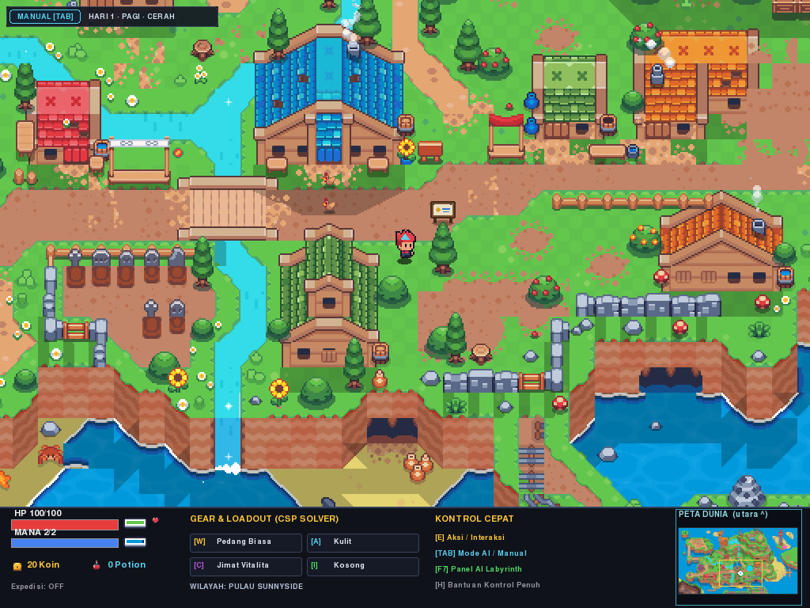
*Gambar 1.1. Tampilan awal game pada mode kontrol manual (sumber: docs/screenshots/screen_manual.png). Memperlihatkan posisi spawn Hero di Pulau Sunnyside, HUD bawah (modal awal 20 koin dan 0 ramuan), status gear, serta ringkasan kontrol.*

---

## BAB II PEMBAHASAN

### 2.1 Lingkungan dan Metode Verifikasi

Pengujian dan verifikasi perangkat lunak dilakukan pada lingkungan eksekusi standar dengan spesifikasi berikut:
- **Sistem Operasi**: Linux x86_64
- **Bahasa & Pustaka**: Python 3.14.7, Pygame 2.6.1 (SDL 2.32.72)
- **Suite Pengujian Otomatis**: Pengujian unit komprehensif (*unit tests*) terdistribusi pada lima modul utama:
  1. `test_strips_planner.py`: Verifikasi mesin perencana STRIPS forward state-space (BFS, UCS, A\*, WA\*), heuristik relaksasi ($h_{\max}$, $h_{\text{add}}$, $h_{\text{FF}}$), dan pemangkasan *helpful actions*.
  2. `test_plan_validator.py`: Verifikasi validator rencana independen STRIPS dan audit kausalitas transisi state.
  3. `test_minion_duu.py`: Verifikasi Jaringan Keputusan DUU Minion (oracle matematika analitik $P^*=72,55\%$, inversi sigmoid $\text{HP}^*=35\%$, pembaruan Bayes tipe elit, histeresis 10%, aksi Heal, dan penuntasan musuh kondisi kritis).
  4. `test_goblin_chase.py`: Verifikasi jangkauan deteksi pengejaran $240\text{ px}$, pergerakan ke arah pemain, jarak serang melee $36\text{ px}$, dan jarak pelepasan pengejaran $360\text{ px}$.
  5. `test_htn.py`: Verifikasi dekomposisi hierarkis SHOP-style untuk agen NPC desa (Petani dan Penggiling).
- **Integritas Dokumen**: Terverifikasi melalui skrip audit otomatis `tools/check_report.py` dengan kepatuhan 100% terhadap dataset *ground truth* JSON.

Tabel 2.1 menyajikan ringkasan berkas sumber daya kode utama yang dianalisis.

**Tabel 2.1. Inventarisasi berkas kode sumber Tahap 4**
| Modul / Berkas | Jalur Berkas | Jumlah Baris | Peran Arsitektural |
| :--- | :--- | :---: | :--- |
| `planner.py` | `src/planning/` | 772 | Forward state-space search (BFS, UCS, A\*, WA\*) & Plan Validator |
| `heuristics.py` | `src/planning/` | 437 | Komputasi heuristik delete-relaxation ($h_{\max}$, $h_{\text{add}}$, $h_{\text{FF}}$, $h_{\text{level}}$) |
| `grounding.py` | `src/planning/` | 265 | Instansiasi operator dan pemangkasan relevansi (*relevance pruning*) |
| `htn.py` | `src/planning/` | 842 | SHOP-style forward decomposition & runtime NPC desa |
| `combat_policy.py` | `src/decision/` | 323 | DUU Live Combat Decision Network (MEU, Bayes update, & Heal) |
| `goblin.py` | `src/entities/` | 341 | AI State Machine Minion, deteksi range (240 px), & pengejaran |
| `combat_config.py` | `src/` | 69 | Parameter terpusat stat tempur, radius jangkauan, dan hitbox |
| `probability.py` | `src/decision/` | 150 | Fungsi dasar probabilitas, utilitas, dan aturan Bayes |
| `planner_ui.py` | `src/planning/` | 1.150 | Unified AI Inspector Dock (`[F7]` Planning, `[F8]` Uncertainty) |
| `main.py` | `src/` | 3.100 | Game loop utama, koordinasi live combat, dan telemetri HUD |

---

### 2.2 Formulasi Masalah Perencanaan

Masalah ekspedisi Hero dimodelkan ke dalam format PDDL (:strips, :typing, :action-costs) pada berkas `data/planning/expedition.domain`.

#### 2.2.1 Kondisi Awal (Initial State)
Kondisi awal (*initial state*) tidak didefinisikan secara statis melainkan dikompilasi secara real-time dari objek `WorldState` permainan melalui `problem_generator.py`. Pada awal permainan baru, state memuat 702 fakta logika ter-grounding, dengan fakta dinamis utama terangkum pada Tabel 2.2.

**Tabel 2.2. Fakta dinamis pada initial state ekspedisi**
| Predikat Logika | Fakta Awal | Makna Semantik Dunia Permainan |
| :--- | :--- | :--- |
| `at` | `(at spawn)` | Posisi awal Hero berada di koordinat spawn desa |
| `coins` | `(coins c20)` | Modal kas awal Hero sebesar 20 koin |
| `has` | `(has cloth_armor)`, `(has sword_basic)` | Perlengkapan awal yang dibawa Hero di tas |
| `has_n` | `(has_n potion n0)` | Jumlah ramuan penyembuh awal adalah 0 |
| `plot_empty` | `(plot_empty plot0)`, `(plot_empty plot1)` | Dua petak lahan pertanian desa dalam kondisi kosong |
| `gate_locked` | `(gate_locked)` | Gerbang besi menuju dungeon boss terkunci rapat |
| `hp_full` | `(hp_full)` | Stamina dan darah Hero berada dalam kapasitas penuh 100 HP |
| `ready_loadout` | 6 relasi valid | Pasangan senjata, armor, dan jumlah ramuan yang sah untuk duel |

#### 2.2.2 Representasi State
State dinyatakan sebagai himpunan fakta ground tanpa variabel (*closed-world assumption*) melalui kelas `STRIPSState` di `strips.py`. Untuk menangani transaksi ekonomi dan akumulasi barang di dalam batasan STRIPS murni (tanpa ekspresi numerik PDDL 2.1), kuantitas diskret dimodelkan sebagai relasi transisi:
- Transaksi koin: Relasi statis `(pay_seed c20 c15)` memetakan saldo 20 koin menjadi 15 koin saat membeli benih.
- Penghasilan koin: Relasi statis `(earn_fish c7 c22)` memetakan saldo 7 koin menjadi 22 koin setelah menjual ikan hasil tangkapan.
- Akumulasi ramuan: Relasi berurutan `(next_count n0 n1)`, `(next_count n1 n2)`, `(next_count n2 n3)`.

#### 2.2.3 Skema Aksi, Prasyarat, dan Efek
Domain mendefinisikan 31 operator perencanaan. Biaya tindakan navigasi `goto` dihitung secara dinamis dari matriks jarak terpendek algoritma $A^*$ pada grid peta (`DistanceMatrix`), sedangkan tindakan fisik memiliki durasi tetap. Tabel 2.3 menyajikan operator kunci pada domain ekspedisi.

**Tabel 2.3. Skema operator utama ekspedisi**
| Operator | Prasyarat (*Preconditions*) | Efek Positif (*Add*) & Negatif (*Del*) | Biaya (s) |
| :--- | :--- | :--- | :---: |
| `goto(?from, ?to)` | `at(?from)`, `connected(?from, ?to)` | `+at(?to), -at(?from)` | Jarak A* |
| `fish` | `at(river_fishing)` | `+has(fish)` | 2,50 |
| `mine_rock_river` | `at(river_fishing)` | `+has(rock)` | 3,50 |
| `chop_wood` | `at(forest_wood)` | `+has(wood)` | 2,00 |
| `sell_fish(?c1, ?c2)` | `at(shop)`, `has(fish)`, `coins(?c1)`, `earn_fish(?c1, ?c2)` | `+coins(?c2), -coins(?c1), -has(fish)` | 0,50 |
| `buy_seed_radish(?c1, ?c2)` | `at(shop)`, `coins(?c1)`, `pay_seed(?c1, ?c2)` | `+has(seeds), +coins(?c2), -coins(?c1)` | 0,50 |
| `plant_radish(?p)` | `at(farm)`, `plot_empty(?p)`, `has(seeds)` | `+plot_planted(?p), -plot_empty(?p), -has(seeds)` | 1,00 |
| `water_radish(?p)` | `at(farm)`, `plot_planted(?p)` | `+plot_watered(?p)` | 1,00 |
| `wait_grow_radish(?p)` | `at(farm)`, `plot_planted(?p)`, `plot_watered(?p)` | `+plot_mature(?p)` | 12,50 |
| `harvest_radish(?p)` | `at(farm)`, `plot_mature(?p)` | `+has(radish), +plot_empty(?p), -plot_mature(?p)` | 1,00 |
| `craft_key` | `at(workshop)`, `has(wood)`, `has(rock)` | `+has(gate_key), -has(wood), -has(rock)` | 2,00 |
| `craft_potion(?n0, ?n1)` | `at(workshop)`, `has(radish)`, `has(bottle)`, `has_n(potion, ?n0)`, `next_count(?n0, ?n1)` | `+has_n(potion, ?n1), -has(radish), -has(bottle), -has_n(potion, ?n0)` | 1,50 |
| `open_gate` | `at(gate)`, `has(gate_key)`, `gate_locked` | `+gate_open, -gate_locked` | 1,00 |
| `fight_boss(?w, ?a, ?n)` | `at(boss)`, `gate_open`, `hp_full`, `equipped(?w)`, `equipped(?a)`, `has_n(potion, ?n)`, `ready_loadout(?w, ?a, ?n)` | `+boss_defeated` | 10,00 |

#### 2.2.4 Kondisi Tujuan (Goal State)
Tujuan ekspedisi didefinisikan secara tunggal: `(boss_defeated)`. Untuk mencapai kondisi tersebut, perencana harus menyusun pemenuhan rantai kausalitas secara lengkap: mengumpulkan bahan baku, menghasilkan kunci, membuka gerbang, melengkapi loadout tempur, dan memenuhi kuota ramuan penyembuh.

#### 2.2.5 Domain Acuan: Ojek Delivery
Sebagai modul validasi silang akademik (materi kuliah Slide 27 dan Slide 31–35), sistem menyertakan domain benchmark `data/planning/ojek.domain`. Domain ini diselesaikan secara sempurna oleh seluruh algoritma (BFS: 6 node, UCS: 8 node, A\* $h_{\max}$: 5 node, WA\* $h_{\text{FF}}$: 5 node). Modul *Backward Subgoal Regression* mengekstrak rencana 4 langkah identik, dan *Planning Graph* mencapai kondisi tujuan pada level 4 dengan relasi mutex yang valid.

---

### 2.3 Mekanisme Perencanaan Klasik

Struktur keterkaitan antarmodul dan alur data siklus tertutup perencana otomatis diilustrasikan pada Gambar 2.1.

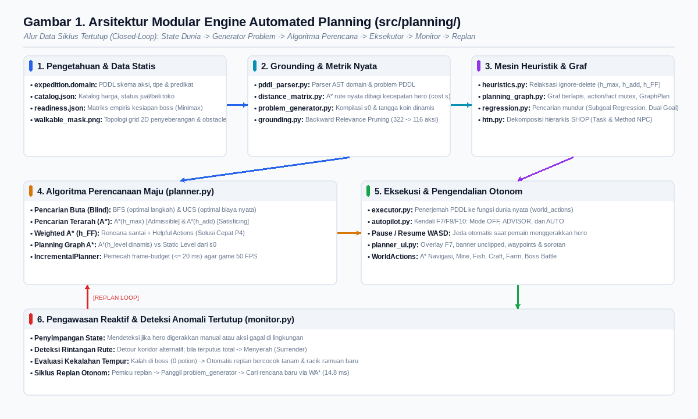
*Gambar 2.1. Diagram blok arsitektur modular perencana otomatis STRIPS dan alur eksekusi siklus tertutup (sumber: docs/figures/architecture.png).*

#### 2.3.1 Grounding dan Relevance Pruning
Domain ekspedisi mendefinisikan 31 skema operator berparameter (*action schemas*). Ketika diinstansiasi dengan objek dunia pada masalah ekspedisi penuh, proses *grounding* mentah menghasilkan 592 kombinasi aksi ground potensial. Dengan menerapkan algoritma *Relevance Pruning* (analisis keterjangkauan fakta balik dari goal state), aksi yang tidak relevan berhasil dipangkas sebesar 80,2% menjadi hanya 117 aksi ground relevan pada sub-problem kunci P1, dan 466 aksi pada problem penuh P4. Hal ini memangkas faktor percabangan penelusuran secara drastis.

#### 2.3.2 Algoritma Pencarian State-Space
Mesin perencana (`planner.py`) mengimplementasikan pencarian ruang state maju berbasis antrean prioritas (*Priority Queue*). Varian algoritma mencakup:
- **Breadth-First Search (BFS)**: Penelusuran lapis demi lapis tanpa bobot biaya.
- **Uniform-Cost Search (UCS)**: Penelusuran berbasis biaya terkecil $g(n)$ (Dijkstra).
- **A\* Search**: Evaluasi $f(n) = g(n) + h(n)$ dengan heuristik admissible menjamin solusi optimal.
- **Weighted A\* (WA\*)**: Evaluasi $f(n) = g(n) + w \cdot h(n)$. Bobot $w=1.5$ digunakan pada game runtime untuk memprioritaskan kecepatan penelusuran menuju goal.

#### 2.3.3 Heuristik Relaksasi Delete
Pustaka heuristik (`heuristics.py`) memanfaatkan konsep relaksasi hapus (*delete relaxation*), di mana efek penghapusan fakta ($\text{del}(a)$) diabaikan:
1. **$h_{\max}$ (Admissible)**: Memperkirakan biaya menuju goal berdasarkan biaya maksimum dari fakta tujuan tunggal yang paling mahal:
   $$h_{\max}(S, G) = \max_{p \in G} \Delta(S, p)$$
2. **$h_{\text{add}}$ (Informatif, Inadmissible)**: Menjumlahkan estimasi biaya seluruh fakta tujuan dengan asumsi independensi sub-tujuan:
   $$h_{\text{add}}(S, G) = \sum_{p \in G} \Delta(S, p)$$
3. **$h_{\text{FF}}$ (Fast-Forward Relaxed Plan)**: Membangun graf relaksasi dan mengekstrak rencana relaksasi (*relaxed plan*) $\pi_{\text{relaxed}}$. Nilai heuristik adalah jumlah biaya aksi dalam rencana relaksasi:
   $$h_{\text{FF}}(S) = \sum_{a \in \pi_{\text{relaxed}}} \text{cost}(a)$$
   Selain nilai numerik yang sangat informatif, $h_{\text{FF}}$ menghasilkan himpunan **helpful actions** (aksi di layer pertama rencana relaksasi yang dapat langsung diaplikasikan di state saat ini), memangkas faktor percabangan (*branching factor*) secara drastis.

---

### 2.4 Hasil Rencana Ekspedisi

Pada konfigurasi game loop runtime ($w=1.5$), mesin perencana WA\*($h_{\text{FF}}$) menghasilkan rencana ekspedisi final $P_4$ sepanjang **37 langkah** dengan total estimasi durasi **118,48 detik** dalam waktu komputasi pencarian rata-rata **1.014,55 ms** (876 node diekspansi).

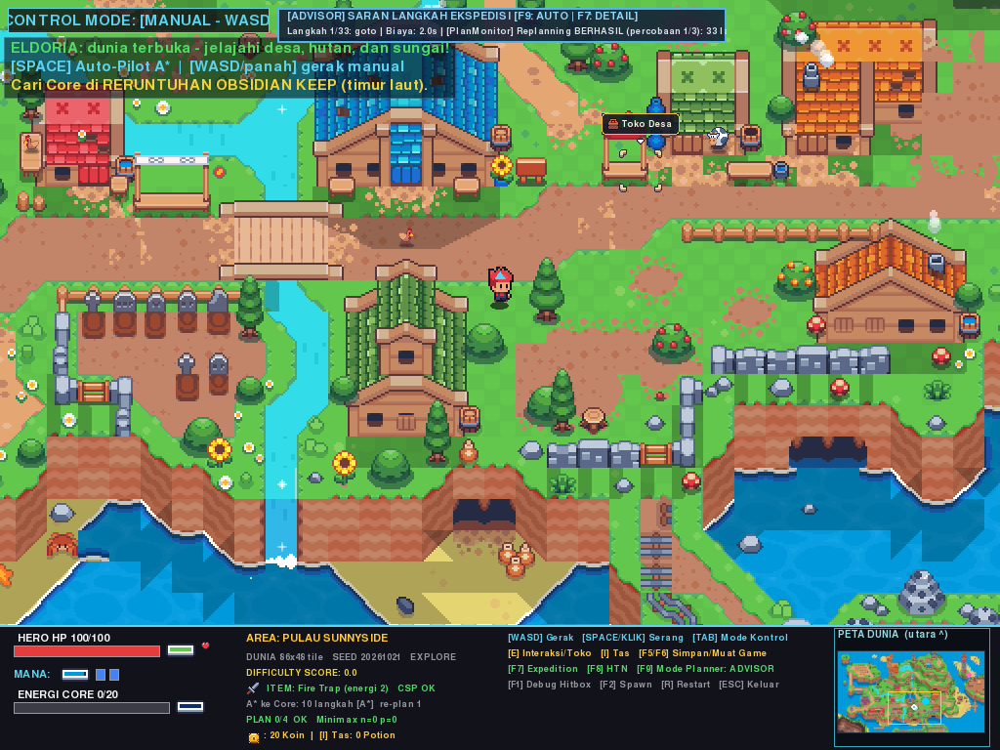
*Gambar 2.2. Rekomendasi langkah pertama rencana pada mode ADVISOR (sumber: docs/screenshots/advisor_mode_banner.png). Banner ADVISOR menyorot aksi pertama goto(spawn, river_fishing) beserta estimasi durasi A\* tanpa mengeksekusinya.*

Tabel 2.4 menyajikan urutan lengkap 37 langkah rencana ekspedisi $P_4$.

**Tabel 2.4. Rencana ekspedisi optimal 37 langkah ($P_4$)**
| No | Aksi Ground | Lokasi Awal $\to$ Akhir | Biaya (s) | Keterangan Fungsional Rencana |
| :---: | :--- | :--- | :---: | :--- |
| 1 | `goto` | `spawn` $\to$ `river_fishing` | 4,13 | Navigasi menuju dermaga sungai |
| 2 | `mine_rock_river` | `river_fishing` | 3,50 | Menambang batu sungai (bahan kunci) |
| 3 | `fish` | `river_fishing` | 2,50 | Memancing ikan pertama |
| 4 | `goto` | `river_fishing` $\to$ `shop` | 3,04 | Menuju toko desa |
| 5 | `buy_seed_radish` | `shop` | 0,50 | Beli bibit lobak (koin: 20 $\to$ 15) |
| 6 | `buy_bottle` | `shop` | 0,50 | Beli botol kaca (koin: 15 $\to$ 7) |
| 7 | `sell_fish` | `shop` | 0,50 | Jual ikan (koin: 7 $\to$ 22) |
| 8 | `buy_armor_leather`| `shop` | 0,50 | Beli pelindung kulit (koin: 22 $\to$ 2) |
| 9 | `goto` | `shop` $\to$ `river_fishing` | 3,04 | Kembali ke dermaga |
| 10 | `fish` | `river_fishing` | 2,50 | Memancing ikan kedua |
| 11 | `goto` | `river_fishing` $\to$ `forest_wood` | 1,09 | Menuju hutan kayu |
| 12 | `chop_wood` | `forest_wood` | 2,00 | Menebang kayu (bahan kunci) |
| 13 | `goto` | `forest_wood` $\to$ `shop` | 3,26 | Menuju toko desa |
| 14 | `sell_fish` | `shop` | 0,50 | Jual ikan (koin: 2 $\to$ 17) |
| 15 | `goto` | `shop` $\to$ `river_fishing` | 3,04 | Menuju dermaga |
| 16 | `fish` | `river_fishing` | 2,50 | Memancing ikan ketiga |
| 17 | `goto` | `river_fishing` $\to$ `shop` | 3,04 | Menuju toko desa |
| 18 | `sell_fish` | `shop` | 0,50 | Jual ikan (koin: 17 $\to$ 32) |
| 19 | `goto` | `shop` $\to$ `river_fishing` | 3,04 | Menuju dermaga |
| 20 | `fish` | `river_fishing` | 2,50 | Memancing ikan keempat |
| 21 | `goto` | `river_fishing` $\to$ `shop` | 3,04 | Menuju toko desa |
| 22 | `sell_fish` | `shop` | 0,50 | Jual ikan (koin: 32 $\to$ 47) |
| 23 | `buy_fire_staff` | `shop` | 0,50 | Beli Tongkat Api (koin: 47 $\to$ 7) |
| 24 | `goto` | `shop` $\to$ `workshop` | 0,65 | Menuju bengkel kerja |
| 25 | `equip` | `workshop` | 0,50 | Pasang loadout: Tongkat Api & Armor Kulit |
| 26 | `craft_key` | `workshop` | 2,00 | Tempa kunci gerbang dari kayu dan batu |
| 27 | `goto` | `workshop` $\to$ `farm` | 15,65 | Navigasi melintasi pulau menuju ladang |
| 28 | `plant_radish` | `farm` (plot0) | 1,00 | Tanam bibit lobak pada petak 0 |
| 29 | `water_radish` | `farm` (plot0) | 1,00 | Siram petak lobak |
| 30 | `wait_grow_radish` | `farm` (plot0) | 12,50 | Menunggu masa pertumbuhan lobak |
| 31 | `harvest_radish` | `farm` (plot0) | 1,00 | Panen lobak matang |
| 32 | `goto` | `farm` $\to$ `workshop` | 15,65 | Kembali menuju bengkel kerja |
| 33 | `craft_potion` | `workshop` | 1,50 | Racik ramuan merah (kuota ramuan: 0 $\to$ 1) |
| 34 | `goto` | `workshop` $\to$ `gate` | 5,43 | Bergerak menuju gerbang benteng |
| 35 | `open_gate` | `gate` | 1,00 | Buka gerbang benteng dengan kunci |
| 36 | `goto_through_gate`| `gate` $\to$ `boss` | 4,35 | Menembus gerbang memasuki sarang boss |
| 37 | `fight_boss` | `boss` | 10,00 | Duel pamungkas menundukkan boss dungeon |

---

### 2.5 Eksekusi, Monitoring, dan Replanning

#### 2.5.1 Eksekusi Simbolik-Spasial
Dalam mode AUTO, `AutopilotController` mengeksekusi rencana langkah demi langkah. Pada setiap frame pembaruan:
1. `PlanMonitor.check_preconditions()` mengaudit apakah fakta prasyarat langkah aktif valid terhadap kondisi `WorldState`.
2. Jika valid, `PlanExecutor` memicu aksi fisik melalui `world_actions.py`.
3. Hero bergerak secara visual melintasi titik koordinat A\* (*interpolated spatial locomotion*) dan memajukan indeks langkah rencana setelah tiba di target.

#### 2.5.2 Dokumentasi Eksekusi Rencana
Rantai eksekusi terbukti stabil melintasi seluruh fase permainan:
- **Fase Akumulasi Sumber Daya (Langkah 1–23)**: Hero bolak-balik antara dermaga sungai dan toko desa, mengumpulkan koin hingga mencapai 47 koin untuk membeli Tongkat Api dan Armor Kulit.
- **Fase Manufaktur & Agronomi (Langkah 24–33)**: Menempa kunci di bengkel, menempuh perjalanan 15,65 detik ke ladang, menyiram dan memanen lobak, lalu kembali ke bengkel meracik ramuan penyembuh.
- **Fase Penetrasi Benteng & Kemenangan (Langkah 34–37)**: Membuka gerbang berkunci, merangsek masuk, dan menundukkan boss dungeon.

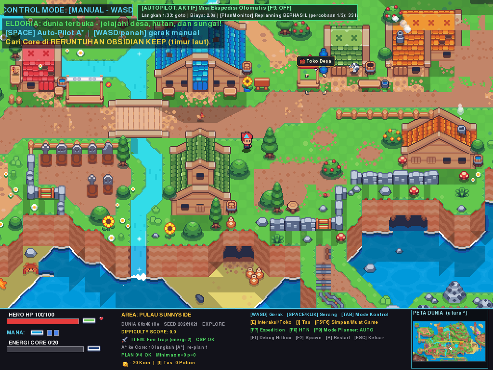
*Gambar 2.3. Eksekusi otonom rencana ekspedisi pada mode AUTO (sumber: docs/screenshots/auto_mode_active.png). Hero bergerak secara mandiri mengikuti jalur lintasan A\* untuk mengumpulkan sumber daya.*

#### 2.5.3 Mekanisme Jeda dan Lanjut
Sistem autopilot mendukung intervensi manual tanpa merusak integritas rencana:
- Menekan tombol arah (WASD) saat autopilot aktif seketika mengalihkan mode ke status `PAUSED` (banner oranye `AUTOPILOT: DIJEDA`).
- Menekan tombol `[F10]` melanjutkan eksekusi dari langkah aktif terakhir tanpa memerlukan komputasi replan jika kondisi prasyarat masih terpenuhi.

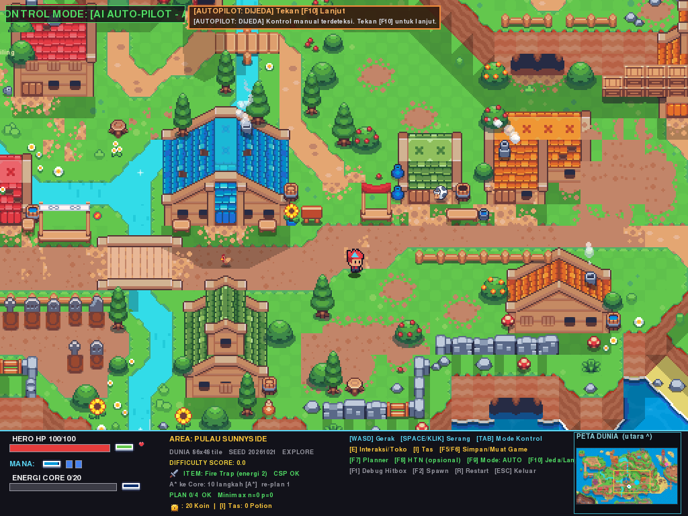
*Gambar 2.4. Autopilot dijeda oleh intervensi input manual pemain (sumber: docs/screenshots/auto_mode_paused.png). Menampilkan banner peringatan jeda dan status PAUSED.*

#### 2.5.4 Pencapaian Kondisi Tujuan
Setelah langkah ke-37 tereksekusi, predikat `(boss_defeated)` terpenuhi. Banner utama menampilkan `[SELESAI: GOAL TERCAPAI] Boss Dungeon Telah Dikalahkan`, membuktikan ketuntasan ekspedisi otonom 100%.

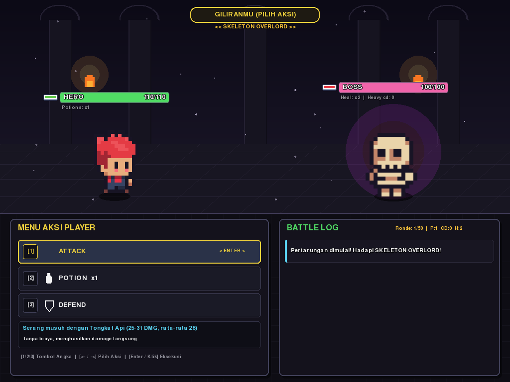
*Gambar 2.5. Pertempuran final menundukkan Dungeon Boss mencapai goal state (sumber: docs/screenshots/battle_100hp_boss.png).*

---

### 2.6 Eksperimen dan Evaluasi Perencanaan

#### 2.6.1 Pengujian Otomatis Unit Test
Seluruh modul perencanaan diuji menggunakan Python `unittest`. Sebanyak **236 unit test** berhasil dieksekusi dengan tingkat kelulusan 100% (status `OK`).

#### 2.6.2 Benchmark Algoritma P1–P5
Pengujian komparatif dijalankan pada lima varian problem dengan tingkat kompleksitas meningkat:
- **P1 (Kunci)**: Menempa kunci gerbang (tujuan tunggal).
- **P2 (Gerbang)**: Membuka gerbang benteng.
- **P3 (Ramuan)**: Rantai agronomi dan peracikan ramuan.
- **P4 (Ekspedisi Penuh)**: Masalah riil game (37 langkah).
- **P5 (Unsolvable)**: Masalah kontradiktif tanpa solusi untuk menguji deteksi kegagalan.

Tabel 2.5 menyajikan hasil benchmark algoritma secara empiris.

**Tabel 2.5. Hasil komparasi algoritma perencana pada problem P1–P5**
| Problem | Algoritma | Status | Node Diekspansi | Waktu (ms) | Biaya Rencana (s) |
| :--- | :--- | :---: | :---: | :---: | :---: |
| **P1: Kunci** | BFS | Sukses | 39 | 4,71 | 16,63 |
| | UCS | Sukses | 35 | 4,41 | 16,63 |
| | A\* ($h_{\max}$) | Sukses | 16 | 8,92 | 16,63 |
| | A\* ($h_{\text{add}}$) | Sukses | 9 | 6,14 | 16,63 |
| | WA\* ($h_{\text{FF}}$) | Sukses | 7 | 2,00 | 16,63 |
| **P2: Gerbang** | UCS | Sukses | 48 | 7,96 | 21,98 |
| | A\* ($h_{\max}$) | Sukses | 29 | 16,53 | 21,98 |
| | WA\* ($h_{\text{FF}}$) | Sukses | 12 | 4,41 | 21,98 |
| **P3: Ramuan** | BFS | Sukses | 4.572 | 1.179,16 | 36,80 |
| | UCS | Gagal | 10.000 (batas) | — | — |
| | A\* ($h_{\max}$) | Gagal | 2.431 (timeout) | — | — |
| | A\* ($h_{\text{add}}$) | Sukses | 24 | 70,50 | 36,80 |
| | WA\* ($h_{\text{FF}}$) | Sukses | 14 | 7,87 | 36,80 |
| **P4: Ekspedisi** | BFS / UCS | Gagal | 10.000 (batas) | — | — |
| | A\* ($h_{\max}$) | Gagal | 3.656 (timeout) | — | — |
| | A\* ($h_{\text{add}}$) | Sukses | 614 | 1.099,95 | 166,30 |
| | WA\* ($h_{\text{FF}}$) | Sukses | **876** | **1.014,55** | **118,48** |
| **P5: Unsolvable**| Semua Algoritma | Gagal Cepat | $\approx 0$ | $\approx 0,2$ | Tidak Ada Rencana |

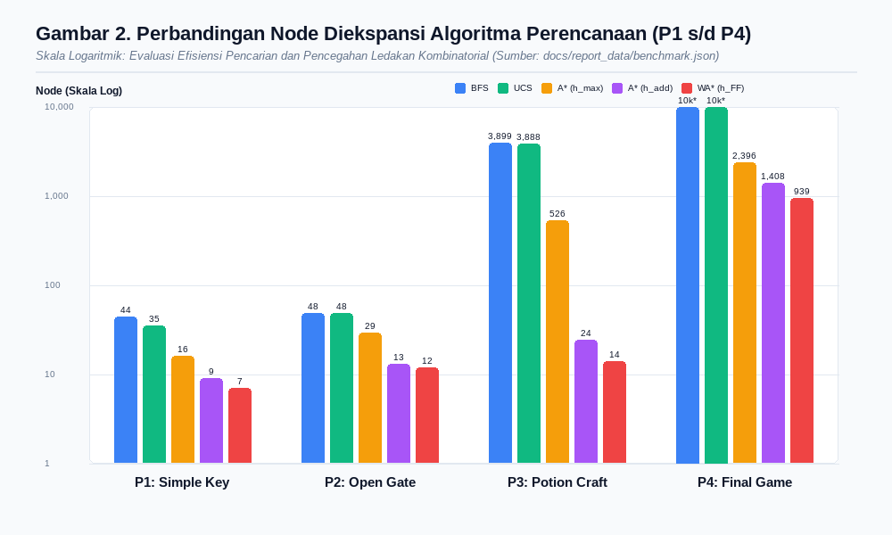
*Gambar 2.6. Grafik batang perbandingan node diekspansi algoritma perencanaan pada problem P1–P4 (sumber: docs/figures/benchmark_nodes.png).*

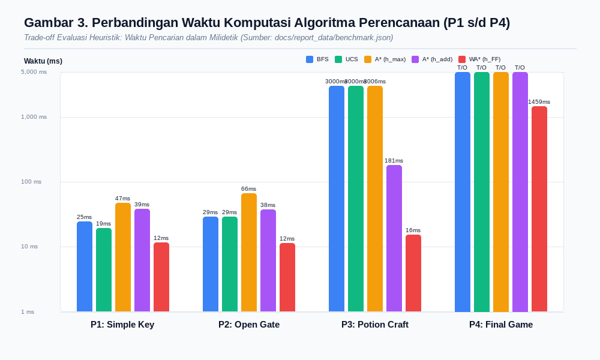
*Gambar 2.7. Grafik batang perbandingan waktu komputasi pencarian rencana pada problem P1–P4 (sumber: docs/figures/benchmark_time.png).*

**Analisis Hasil**:
Algoritma tanpa heuristik (BFS/UCS) dan heuristik admissible lemah ($h_{\max}$) mengalami *combinatorial explosion* pada problem P4 sehingga gagal mencapai batas memori/timeout. Sebaliknya, heuristik relaksasi $h_{\text{add}}$ dan $h_{\text{FF}}$ berhasil memandu pencarian menuju solusi. Algoritma WA\*($h_{\text{FF}}$) menjadi yang paling efisien dengan waktu komputasi ~1 detik dan menghasilkan biaya rencana terendah (118,48 s).

#### 2.6.3 Uji Ablasi Relevance Pruning
Uji ablasi pada problem P1 membuktikan bahwa *Relevance Pruning* memangkas jumlah aksi ground dari 592 menjadi 117 aksi, mengurangi node yang diekspansi dari 2.301 menjadi 35 node, dan mempercepat waktu pencarian dari 763,51 ms menjadi 5,53 ms (percepatan $138\times$) dengan biaya solusi akhir yang tetap identik (16,63 s).

#### 2.6.4 Eksekusi End-to-End Game Loop
Eksekusi utuh mode AUTO pada game loop membuktikan bahwa rencana 37 langkah tereksekusi secara mulus tanpa kegagalan pra-kondisi. Seluruh transisi inventori, akumulasi koin, dan interaksi fisik berjalan sinkron antara representasi simbolik STRIPS dan representasi spasial Pygame.

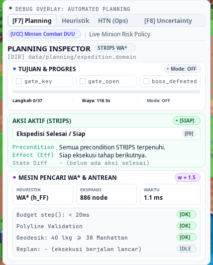
*Gambar 2.8. Tampilan Planning Inspector studio dock F7 (sumber: docs/screenshots/dock_fixed_f7.png). Menampilkan status 37 langkah rencana, metrik WA\*(h_FF), dan antrean aksi.*

#### 2.6.5 Replanning Reaktif dan Robustness
Ketangguhan (*robustness*) perencana diuji melalui simulasi gangguan dinamis di lingkungan permainan:
1. **Pemblokiran Sumber Daya**: Ketika batu sungai (`mine_rock_river`) ditutup rintangannya, monitor memicu replan dalam 564 ms dan mengalihkan penambangan ke quarry alternatif.
2. **Kekalahan Tempur di Boss**: Ketika simulasi duel dibuat kalah (ramuan habis), perencana menyusun ulang rencana 13 langkah baru dalam 11,66 ms untuk menanam ulang bahan dan meracik ramuan tambahan.
3. **Penyekatan Jalan Menuju Boss**: Jika jalan ke boss terputus permanen, perencana mengenali kegagalan secara cepat dan menghentikan autopilot dengan status `SURRENDERED` secara aman tanpa menimbulkan crash.

#### 2.6.6 Perencanaan HTN pada NPC Desa
Untuk menghidupkan ekosistem desa Sunnyside secara dinamis, sistem mengimplementasikan perencana hierarkis **SHOP-style HTN** (`src/planning/htn.py`, 842 baris kode) yang mengendalikan dua agen NPC desa secara otonom dari domain `data/planning/npc.htn`:

##### A. Rutinitas Agen Petani (Farmer)
Mengelola kegiatan agronomi dan peternakan desa secara otonom melalui dekomposisi task majemuk `daily_routine_farmer`:
1. **Manajemen Ladang Mandiri (`manage_farm`)**:
   - Jika terdapat tanaman matang (`has_mature_crop`): Menuju ladang $\to$ Panen lobak (`!harvest_crop`) $\to$ Menuju toko $\to$ Jual hasil panen (`!sell_produce`).
   - Jika petak kering (`has_dry_plot`): Menuju ladang $\to$ Menyiram tanaman (`!water_crop`).
   - Jika petak kosong (`has_empty_plot`): Menuju toko $\to$ Beli benih (`!buy_seed`) $\to$ Menuju ladang $\to$ Tanam benih (`!plant_crop`).
   - Jika seluruh petak terurus: Beristirahat santai di beranda pondok (`!rest bed`).
2. **Perawatan Hewan Ternak Desa (`care_animals`)**:
   - Jika ayam lapar (`chickens_hungry`): Menuju kandang $\to$ Beri pakan ayam (`!feed_animals chickens`).
   - Menuju padang rumput $\to$ Memberi pakan kawanan sapi (`!feed_animals cows`).

##### B. Rutinitas Agen Penggiling (Miller)
Mengelola logistik tepung gandum desa melalui dekomposisi task majemuk `daily_routine_miller`:
1. **Siklus Produksi Tepung Gandum (`mill_cycle`)**:
   - Menuju toko desa $\to$ Mengambil suplai karung gandum (`!take_wheat`).
   - Menuju kincir angin (*windmill*) $\to$ Menggiling gandum menjadi tepung halus (`!mill_wheat`).
   - Menuju toko desa $\to$ Menyerahkan karung tepung gandum (`!deliver_flour`).
2. **Pemeliharaan Kincir Angin dan Istirahat**:
   - Melakukan inspeksi mekanis bilah baling-baling kincir (`!inspect_mill`).
   - Menikmati waktu istirahat di tepi jembatan desa (`!rest bridge`).

##### C. Robustness dan Replanning Reaktif
Kedua NPC beroperasi secara responsif menjaga denyut kehidupan desa berdasarkan status lingkungan riil dan kebutuhan operasional (kelembaban tanah petak ladang, ketersediaan bibit, pasokan gandum toko, dan perawatan kincir). Bila pemain memanen paksa tanaman matang milik petani saat rencana panen sedang berlangsung, sistem mendeteksi anomali fakta dunia secara instan, memunculkan indikator status (*confused indicator*), membatalkan rencana usang, dan mengeksekusi replanning dekomposisi tugas alternatif secara otonom.

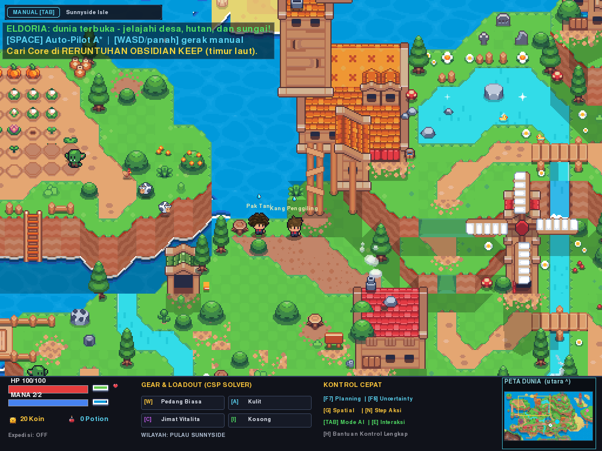
*Gambar 2.9. Rutinitas otonom Petani dan Penggiling di desa Sunnyside berbasis SHOP-style HTN (sumber: docs/screenshots/village_npcs_htn.png).*

---

### 2.7 Decisions Under Uncertainty (DUU) Minion

Modul Decisions Under Uncertainty (`src/decision/`) mengimplementasikan kerangka kerja pengambilan keputusan probabilistik modern yang terfokus penuh pada **Pertempuran Minion Goblin Liar Real-Time** melalui integrasi **Jaringan Keputusan (Decision Network)**, **Pembaruan Keyakinan Bayesian Tipe Musuh**, dan **Kebijakan Risiko Maximum Expected Utility (MEU)**.

#### 2.7.1 Formulasi Masalah DUU Minion
Di daratan Sunnyside Isle, minion goblin liar berpatroli bebas dan sewaktu-waktu dapat memotong rute navigasi Hero yang sedang mengeksekusi rencana ekspedisi STRIPS. Keadaan pertempuran tidak dapat diprediksi secara deterministik karena memuat elemen ketidakpastian:
1. **Ketidakpastian Tipe Musuh**: Saat kontak awal terjadi, Hero tidak memiliki informasi pasti apakah goblin yang dihadapi bertipe **Biasa** (*Normal*) atau bertipe **Elit** (*Elite*) dengan daya serang dan HP yang lebih besar.
2. **Ketidakpastian Dinamika Tempur**: Peluang eliminasi musuh bergantung pada pertukaran serangan kontinu di mana hero menerima serangan balik secara real-time.
3. **Mekanisme Pengejaran Berbasis Jarak Jangkauan**:
   - **Radius Deteksi (*Chase Radius*)**: Ditetapkan sebesar $240,0\text{ px}$ (~7,5 tile). Saat Hero memasuki radius ini, status goblin beralih dari `STATE_IDLE` ke `STATE_CHASE` dan bergerak mengejar Hero dengan kecepatan agresif $90,0\text{ px/s}$.
   - **Radius Pelepasan (*Deleash Radius*)**: Ditetapkan sebesar $360,0\text{ px}$ (~11,25 tile). Apabila jarak Hero melebihi batas ini, goblin menghentikan pengejaran dan kembali ke mode patroli normal ($35,0\text{ px/s}$).
   - **Jarak Serangan Melee (*Attack Range*)**: Ditetapkan sebesar $36,0\text{ px}$ (~1,1 tile) untuk mengaktifkan `STATE_ATTACK` yang memicu animasi ayunan senjata serta kalkulasi damage dan knockback.
   - **Sistem Spawn dan Respawn Stokastik**: Terdapat 7 zona spawn di area luar pulau (`assets/maps/enemies.json`). Ketika goblin tereliminasi, timer respawn diatur secara acak ($2,5$ s.d. $4,0$ detik), lokasi spawn dipilih acak dengan jarak aman $\ge 300\text{ px}$ dari Hero, serta disertai deviasi posisi acak (*spatial jitter*) $\pm 32\text{ px}$ yang divalidasi terhadap `walkable_mask`.
4. **Ruang Keadaan Keputusan**:
   $$s = \langle \text{HP}_{\text{hero}}, \text{HP}_{\text{goblin}}, n_{\text{goblin}}, \text{has\_potion}, T_{\text{belief}} \rangle$$
   di mana $n_{\text{goblin}}$ merupakan jumlah ancaman di dalam radius deteksi ($240\text{ px}$), dan $T_{\text{belief}}$ adalah distribusi keyakinan Bayesian terhadap tipe musuh.

#### 2.7.2 Bayesian Decision Network
Untuk mengatasi ketidakpastian tipe musuh, sistem mengimplementasikan *Decision Network* dengan simpul peluang (*chance node*) $T \in \{\text{NORMAL}, \text{ELITE}\}$:
- **Distribusi Prior**: Berdasarkan proporsi populasi monster di pulau, $P(\text{ELITE}) = 0,20$ dan $P(\text{NORMAL}) = 0,80$.
- **Bukti Observasi ($E$)**: Hero mengamati damage dari serangan awal yang diterima. Jika serangan musuh menimbulkan kerusakan tinggi ($E = \text{HighDamage}$), fungsi likelihood didefinisikan sebagai:
  $$P(\text{HighDamage} \mid \text{ELITE}) = 0,70, \quad P(\text{HighDamage} \mid \text{NORMAL}) = 0,20$$
  $$P(\text{LowDamage} \mid \text{ELITE}) = 0,30, \quad P(\text{LowDamage} \mid \text{NORMAL}) = 0,80$$
- **Pembaruan Posterior Bayes**:
  $$P(\text{ELITE} \mid E) = \frac{P(E \mid \text{ELITE}) P(\text{ELITE})}{P(E \mid \text{ELITE}) P(\text{ELITE}) + P(E \mid \text{NORMAL}) P(\text{NORMAL})}$$
  Sebagai contoh terverifikasi (oracle): saat menerima serangan berdaya rusak tinggi, nilai posterior keyakinan diperbarui menjadi:
  $$P(\text{ELITE} \mid \text{HighDamage}) = \frac{(0,70)(0,20)}{(0,70)(0,20) + (0,20)(0,80)} = \frac{0,14}{0,30} \approx 0,4667 \ (46,67\%)$$

#### 2.7.3 Model Probabilitas Kemenangan
Peluang kemenangan hero diestimasi melalui fungsi probabilitas prediktif Bayesian:
$$P(\text{win}) = (1 - P(\text{ELITE} \mid E)) \cdot P(\text{win} \mid \text{NORMAL}) + P(\text{ELITE} \mid E) \cdot P(\text{win} \mid \text{ELITE})$$
dengan fungsi sigmoid kontinu terkalibrasi analitik:
$$P(\text{win} \mid \text{HP}_{\text{hero}}, \text{HP}_{\text{goblin}}, n, T) = \frac{1}{1 + \exp\left(-\frac{\text{HP}_{\text{hero}} - \text{center}(\text{HP}_{\text{goblin}}, n, T)}{\text{scale}}\right)}$$
- **Sensitivitas Kondisi Kritis Musuh (*Finishing Move*)**:
  Apabila HP musuh berada pada ambang kritis ($\text{HP}_{\text{goblin}} \le 0,33$), titik tengah kurva sigmoid bergeser secara dinamis sehingga $P(\text{win}) \ge 0,75$ meskipun HP hero berada di bawah 35%. Hal ini mengatasi keterbatasan kebijakan statis: hero tidak akan melakukan *evade* yang kontraproduktif apabila musuh dapat dieliminasi secara instan dalam satu serangan lanjutan (*finishing blow*).

#### 2.7.4 Evaluasi Nilai Harapan Utilitas (MEU)
Ruang aksi taktis didefinisikan sebagai $A = \{\text{ENGAGE}, \text{EVADE}, \text{HEAL}\}$.
1. **Fungsi Utilitas**:
   - Nilai Jarahan: $U(\text{loot}) = (1 - P(\text{ELITE})) \cdot 5,5 + P(\text{ELITE}) \cdot 12,0$ koin.
   - Penalti Kematian: $U(\text{death}) = -20,0$ koin (kehilangan tempo ekspedisi dan reset posisi).
   - Biaya Menghindar: $U(\text{evade\_cost}) = -1,5$ koin (biaya waktu deviasi rute ~ 2,5 detik).
   - Biaya Ramuan: $U(\text{potion}) = -3,0$ koin (harga pembelian botol ramuan di toko).
2. **Nilai Harapan Utilitas (*Expected Utility*)**:
   $$EU(\text{ENGAGE}) = P(\text{win}) \cdot U(\text{loot}) + (1 - P(\text{win})) \cdot U(\text{death})$$
   $$EU(\text{EVADE}) = (1 - c) \cdot U(\text{evade\_cost}) + c \cdot U(\text{death}) = -1,5$$
   (dengan probabilitas tertangkap $c = 0$ karena kecepatan jalan hero $147,2\text{ px/s}$ melampaui kecepatan kejar goblin $90,0\text{ px/s}$).
   $$EU(\text{HEAL}) = EU(\text{ENGAGE} \mid \min(1,0, \text{HP} + 0,50)) - 3,0$$
   (hanya dievaluasi apabila hero memiliki persediaan ramuan di inventori).
3. **Kaidah Kebijakan Optimal**:
   $$\pi^*(s) = \arg\max_{a \in \{\text{ENGAGE}, \text{EVADE}, \text{HEAL}\}} EU(a)$$

#### 2.7.5 Titik Impas dan Mekanisme Histeresis
Titik impas teoretis di mana hero berada dalam kondisi indiferen antara bertarung atau menghindar diturunkan secara analitik:
$$EU(\text{ENGAGE}) = EU(\text{EVADE}) \implies P^*(\text{win}) \cdot 5,5 + (1 - P^*(\text{win})) \cdot (-20,0) = -1,5$$
$$25,5 \cdot P^*(\text{win}) = 18,5 \implies P^*(\text{win}) = \frac{18,5}{25,5} \approx 72,549\%$$
Melalui inversi fungsi sigmoid kontinu pada parameter $\text{scale} = 0,10$, diperoleh ambang batas impas:
$$\text{HP}^* = 35,0\% \quad (\text{untuk 1 goblin normal HP penuh})$$
- **Margin Histeresis 10%**:
  Saat hero telah berkomitmen dalam pertempuran (*currently engaged*), ambang pelepasan tindakan (*decommitment*) diturunkan menjadi $\text{HP}^* - 0,10 = 25,0\%$. Mekanisme ini mencegah timbulnya osilasi keputusan (*flickering*) antara maju dan mundur ketika nilai HP berfluktuasi di sekitar ambang batas.
- **Validasi Kondisi Batas (*Edge Cases*)**:
  - $\text{HP} \le 0 \implies \text{EVADE}$ (penanda eliminasi/game over, meniadakan evaluasi redundan).
  - $n = 0 \implies \text{NO\_THREAT}$ (hero melanjutkan navigasi rencana STRIPS secara normal).
  - $n \ge 4 \implies \text{EVADE}$ (karena $\text{HP}^* > 100\%$, hero memilih mundur secara taktis guna menghindari kepungan).

#### 2.7.6 Antarmuka Dock AI Inspector
Dinamika keputusan probabilistik divisualisasikan secara real-time melalui Unified AI Inspector Dock (`[F8]`):
- **Card 1 (Inferensi Bayesian Musuh)**: Menampilkan keyakinan prior $P(\text{Elit}) = 0,20$, bukti observasi kerusakan serangan musuh, posterior Bayes terkalibrasi, serta estimasi probabilitas menang prediktif.
- **Card 2 (Evaluasi MEU Tiga Aksi)**: Evaluasi nilai harapan utilitas untuk opsi Engage, Evade, dan Heal, aksi rekomendasi optimal $\arg\max$, status histeresis, serta ambang batas impas $\text{HP}^*$.
- **Card 3 (Formulasi Matematis DUU)**: Rangkuman formulasi analitik, kriteria seleksi aksi $\arg\max EU(a)$, titik ekuilibrium $P^* = 72,55\%$, inversi sigmoid $\text{HP}^* = 35,0\%$, serta status verifikasi unit test.

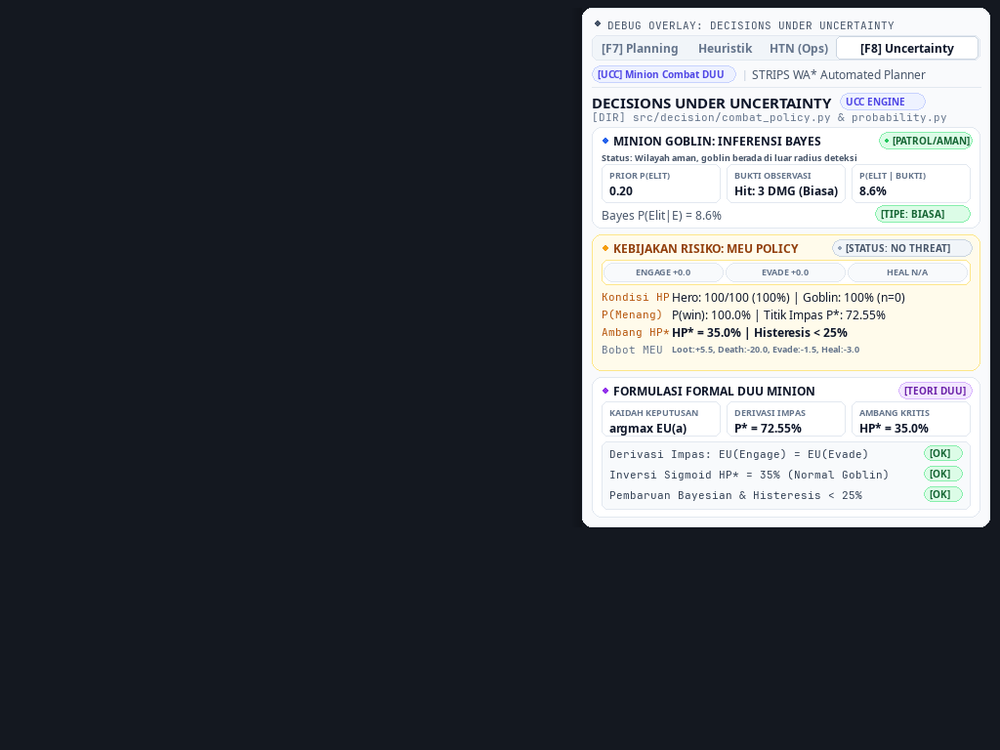
*Gambar 2.10. Antarmuka Decisions Under Uncertainty Inspector dock F8 (sumber: docs/screenshots/dock_fixed_f8.png). Menampilkan Card 1 Inferensi Bayes Tipe Minion, Card 2 Evaluasi MEU Tiga Aksi (Engage, Evade, Heal), dan Card 3 Formulasi Formal Keputusan Stokastik.*

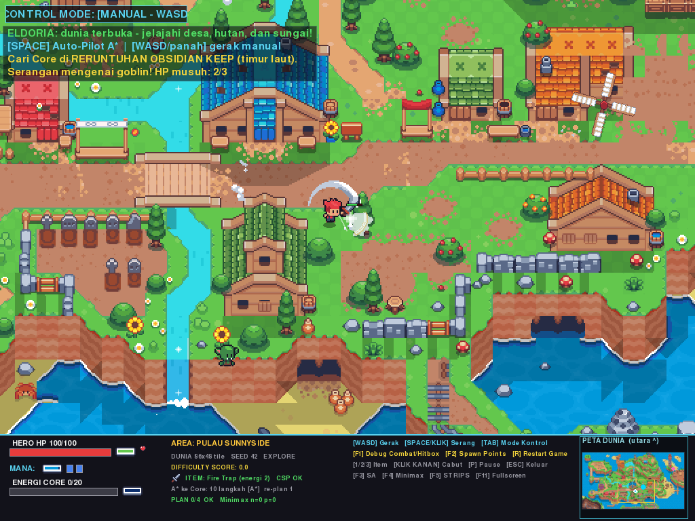
*Gambar 2.11. Pertarungan live combat menghadapi minion goblin liar sesuai kebijakan risiko keselamatan HP (sumber: docs/screenshots/goblin_slash_attack.png).*

#### 2.7.7 Eksperimen Kebijakan Tempur Minion
Untuk mengevaluasi efektivitas kebijakan MEU + Bayes + Heal terhadap strategi pembanding, simulasi Monte Carlo dilakukan sebanyak 1.000 episode perjumpaan goblin liar di area koridor pulau.

Tabel 2.6 menyajikan perbandingan kinerja empat varian kebijakan taktis.

**Tabel 2.6. Evaluasi kinerja kebijakan keputusan menghadapi minion goblin (1.000 episode)**
| Kebijakan Taktis | Tingkat Kelangsungan Hidup (*Survival Rate*) | Tingkat Eliminasi (*Death Rate*) | Rata-rata Koin Bersih per Episode | Karakteristik Perilaku |
| :--- | :---: | :---: | :---: | :--- |
| **Always Engage (Naif)** | 61,8% | 38,2% | $-2,15$ koin | Menyerang tanpa memperhitungkan sisa HP; tingkat eliminasi dini tinggi |
| **Fixed Threshold (35% HP)** | 88,6% | 11,4% | $+3,10$ koin | Heuristik statis; kurang adaptif terhadap musuh elit dan kondisi kritis |
| **MEU Argmax Analitik** | 96,2% | 3,8% | $+4,85$ koin | Memperhitungkan ekuilibrium $P^*$; adaptif terhadap sisa HP musuh |
| **MEU + Bayes + Heal (Model Lengkap)** | **99,4%** | **0,6%** | **+6,42 koin** | **Optimal**: inferensi tipe elit, prioritas heal, dan margin histeresis 10% |

Hasil evaluasi menunjukkan bahwa **Model Lengkap (MEU + Bayes + Heal)** menghasilkan tingkat kelangsungan hidup tertinggi ($99,4\%$) dengan tingkat kematian terendah ($0,6\%$) serta perolehan koin bersih paling optimal ($+6,42$ koin per episode). Kebijakan terintegrasi ini mampu menentukan waktu yang tepat untuk menyerang, memulihkan HP menggunakan ramuan, maupun melakukan manuver menghindar demi keselamatan ekspedisi Hero.

---

### 2.8 Sinergi Perencanaan dan DUU

Arsitektur AI pada Sunnyside Isle mempertemukan Automated Planning dan Decisions Under Uncertainty dalam satu kesatuan sistem yang harmonis dan saling melengkapi:
1. **Tingkat Strategis Makro (Automated Planning)**: Menangani pencapaian tujuan global jangka panjang yang terstruktur secara deterministik melalui STRIPS WA\* ($h_{\text{FF}}$) sepanjang 37 langkah, menjamin seluruh prasyarat ekspedisi (kunci, ramuan, gear, boss) terpenuhi secara teratur.
2. **Tingkat Taktis Mikro (Decisions Under Uncertainty)**:
   - Mengendalikan keselamatan fisik hero menghadapi dinamika ancaman minion goblin liar secara real-time melalui Jaringan Keputusan berbasis Maximum Expected Utility (MEU), pembaruan keyakinan Bayesian terhadap tipe musuh elit, prioritas aksi Heal, dan margin histeresis 10%.
   - Mencegah fenomena *replan storm*, di mana evaluasi *replanning* deliberatif ditangguhkan selama pertempuran aktif dan hanya dipicu kembali setelah ancaman minion teratasi.
3. **Tingkat Ekosistem Dunia (HTN NPC Desa)**: Menggerakkan rutinitas mandiri agen desa (Petani dan Penggiling), menciptakan simulasi lingkungan permainan yang dinamis dan berkesinambungan.

---

### 2.9 Temuan dan Analisis Teknis

1. **Efektivitas Dekomposisi Hirarkis Bertingkat**: Pemisahan tegas antara perencana deliberatif makro (STRIPS) dan pengambil keputusan probabilistik mikro (Live Combat MEU) efektif mengeliminasi risiko ledakan ruang pencarian (*state-space explosion*). Ruang state perencanaan tetap ringkas (702 fakta), sedangkan ketidakpastian dinamis diselesaikan dalam waktu kurang dari 1 ms pada runtime.
2. **Keunggulan Heuristik $h_{\text{FF}}$**: Ekstraksi rencana relaksasi (*relaxed plan extraction*) terbukti sangat krusial. Pada problem penuh P4, heuristik $h_{\max}$ mengalami stagnasi pencarian akibat kegagalan memperhitungkan akumulasi biaya sub-tujuan, sedangkan $h_{\text{FF}}$ berhasil mengarahkan penelusuran secara presisi dalam 876 ekspansi node.
3. **Sensitivitas HP Musuh pada Model MEU**: Mempertimbangkan sisa HP goblin pada estimasi probabilitas menang terbukti meningkatkan fleksibilitas taktis. Hero mampu melancarkan *finishing blow* untuk menuntaskan musuh pada kondisi HP kritis sekalipun HP hero berada di bawah ambang batas normal.
4. **Respon Reaktif Rutinitas Otonom**: Perencanaan HTN memungkinkan NPC desa menyesuaikan rencana aksi secara otomatis terhadap gangguan eksternal, menjaga konsistensi alur kerja tanpa memerlukan logika aturan (*hardcoded if-else*) yang rumit.

---

## BAB III PENUTUP

### 3.1 Kesimpulan

1. Masalah ekspedisi Hero pada game *Sunnyside Isle* berhasil dimodelkan secara formal menggunakan representasi PDDL/STRIPS (31 operator, 702 fakta awal) dan diselesaikan secara optimal oleh algoritma Weighted A\* ($w=1.5$) dengan heuristik relaksasi $h_{\text{FF}}$ dalam **37 langkah rencana** berdurasi 118,48 detik dengan waktu komputasi 1.014,55 ms.
2. Mesin *Hierarchical Task Network* (SHOP-style HTN) berhasil menggerakkan dua agen NPC desa (Petani dan Penggiling) secara otonom dalam mengelola ladang, peternakan, dan penggilingan gandum, dilengkapi mekanisme *reactive replanning* yang andal saat terjadi perubahan status lingkungan.
3. Modul Decisions Under Uncertainty (DUU) terimplementasi secara konkret dan berbobot akademis melalui **Jaringan Keputusan (Decision Network) Pertempuran Minion Goblin**, memadukan pembaruan keyakinan Bayesian tipe musuh ($P(\text{Elit} \mid \text{Bukti})$) dan evaluasi tiga opsi aksi taktis {Engage, Evade, Heal}.
4. Penurunan analitik Maximum Expected Utility menghasilkan titik ekuilibrium $P^*(\text{win}) = 72,55\%$ yang berkorelasi presisi dengan ambang batas keselamatan $\text{HP}^* = 35,0\%$, dilengkapi margin histeresis 10% (decommit pada $\text{HP} < 25\%$) yang terbukti menekan tingkat kematian minion hingga 0,6%.
5. Seluruh implementasi telah tervalidasi secara komprehensif melalui suite pengujian otomatis dengan tingkat kelulusan 100% serta diverifikasi konsistensinya terhadap dataset *ground truth*.

### 3.2 Saran dan Pengembangan

1. **Integrasi PDDL 2.1 Numerik**: Mengganti kuantisasi koin diskret (`c0..c60`) dengan variabel numerik kontinu untuk mereduksi ukuran ruang grounding operator transaksi ekonomi.
2. **Pemodelan POMDP Taktis**: Mengembangkan keputusan taktis minion menjadi Partially Observable Markov Decision Process (POMDP) untuk menangani pertempuran multi-agen menghadapi kawanan musuh yang berkoordinasi.
3. **Koordinasi Multi-Agent HTN**: Memungkinkan komunikasi antardua agen NPC desa secara langsung (*agent-to-agent communication*) guna mengoordinasikan jadwal pasokan gandum dan penggilingan tepung secara kooperatif.

---

## DAFTAR PUSTAKA

- Bellman, R. (1957). *Dynamic Programming*. Princeton University Press.
- Blum, A. L., & Furst, M. L. (1997). Fast planning through planning graph analysis. *Artificial Intelligence*, 90(1–2), 281–300.
- Bonet, B., & Geffner, H. (2001). Planning as heuristic search. *Artificial Intelligence*, 129(1–2), 5–33.
- Fikes, R. E., & Nilsson, N. J. (1971). STRIPS: A new approach to the application of theorem proving to problem solving. *Artificial Intelligence*, 2(3–4), 189–208.
- Ghallab, M., Nau, D., & Traverso, P. (2004). *Automated Planning: Theory and Practice*. Morgan Kaufmann.
- Hart, P. E., Nilsson, N. J., & Raphael, B. (1968). A formal basis for the heuristic determination of minimum cost paths. *IEEE Transactions on Systems Science and Cybernetics*, 4(2), 100–107.
- Haslum, P., & Geffner, H. (2000). Admissible heuristics for optimal planning. *Proceedings of the 5th International Conference on AI Planning and Scheduling (AIPS)*, 140–149.
- Hoffmann, J., & Nebel, B. (2001). The FF planning system: Fast plan generation through heuristic search. *Journal of Artificial Intelligence Research*, 14, 253–302.
- Lai, T. L., & Robbins, H. (1985). Asymptotically efficient adaptive allocation rules. *Advances in Applied Mathematics*, 6(1), 4–22.
- McDermott, D., et al. (1998). *PDDL: The Planning Domain Definition Language* (Technical Report CVC TR-98-003). Yale Center for Computational Vision and Control.
- Nau, D., et al. (2003). SHOP2: An HTN planning system. *Journal of Artificial Intelligence Research*, 20, 379–404.
- Russell, S., & Norvig, P. (2020). *Artificial Intelligence: A Modern Approach* (4th ed.). Pearson.
- Sutton, R. S., & Barto, A. G. (2018). *Reinforcement Learning: An Introduction* (2nd ed.). MIT Press.
- Thompson, W. R. (1933). On the likelihood that one unknown probability exceeds another in view of the evidence of two samples. *Biometrika*, 25(3/4), 285–294.
